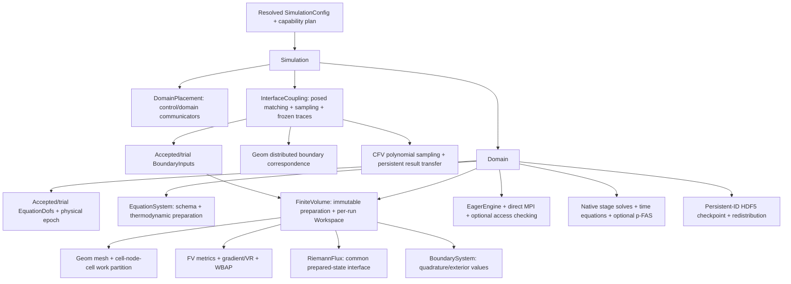
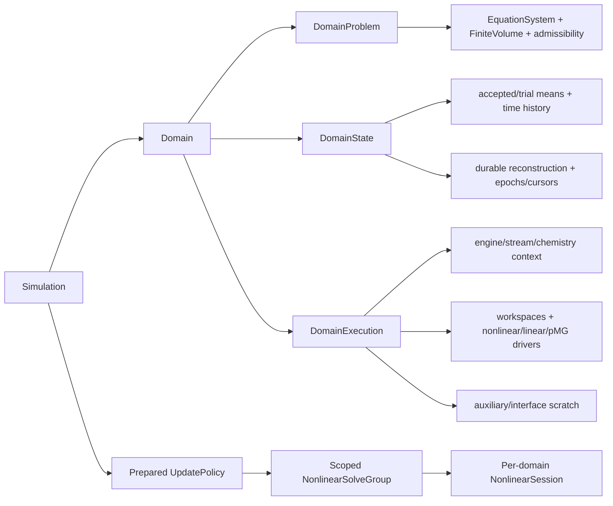
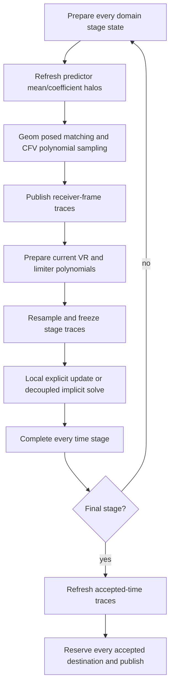
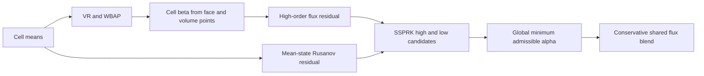

# Cauchy solver: module contracts and implementation ledger

For the current extended-physics capability summary, use
[Cauchy equation state](CauchyState.md), [shared Physics](Physics.md) and
[the PP policy](CauchyPositivity.md). The dated checkpoints below retain their
historical scope and validation limits. Physical correctness and usable solver
capabilities take priority over broad UT matrices or strict performance tuning.

The simulation and its registered update policy coordinate domain-local spatial,
linear and time operators. CPU profiles include compressible mixtures and ACM.
CUDA supports the combined-AoS perfect-gas and ACM profiles in the
[kernel dispatch catalog](CauchyDispatch.md). Pressure-referenced reciprocal
ACM interfaces have moving-domain coverage. Closed-component gauge projection
and cross-domain moving-wall distances have separate qualification requirements.
The [equation-state and implicit implementation history](../dev/cauchy_state_implicit_history.md)
records earlier CPU-only milestones and case limitations.



## Domain ownership and coordinated phases

`Domain` is a facade over three explicit owners:



`DomainProblem` owns long-lived physical and discretization definitions but no
solution history or backend scratch. `DomainState` owns restart-relevant mutable
means, time-method history, durable reconstruction and active trial metadata.
`DomainExecution` is rebuildable: it owns prepared workspaces, solver sessions
and the retained execution context, but no accepted state. Its destruction
order retires submitted work before state/problem storage disappears.

`Simulation` coordinates physical steps and time groups directly through
`Domain`; there are no forwarding simulation/domain controllers. Domain
candidate/checkpoint tokens retain opaque reservations and cancel an abandoned
writer. Every local domain is reserved before any candidate is committed.
Checkpoint arithmetic stays under `Cauchy/IO`. One-domain production execution
is the degenerate coordinated case. The standalone `Domain` debugging/Python
frontend uses the same group and policy interfaces.

The resolved `UpdatePolicy` owns its complete nonlinear loop. `NonlinearSession`
holds one domain's convergence/CFL/report state and numerical callbacks;
`NonlinearSolveGroup` supplies interface and publication helpers but never a
second iteration loop. One-stage policies refresh traces and visit all domains;
the DITR policy refreshes and visits all midpoint states before doing the same
for endpoint states. Colocated and dislocated placements use this same order.
Ranks with no local domain still participate in control-communicator ordering.
Optional iteration-check collectives are selected from the full simulation
configuration, not from rank-local domain membership.

Each domain's residual norms, CFL/PP reductions, linear solves and halo
operations use its subset communicator. Dislocated ranks instantiate only the
domains they occupy; other domain slots are empty. All control ranks retain the
small configuration/placement metadata. The simulation communicator handles
cross-domain interfaces, stage/iteration agreement and joint termination;
it does not combine domain residual norms into one stopping criterion.

Serialized BDF/DIRK stages and coupled DITR groups use the same candidate
reservation/commit transaction. For DITR with interfaces, the controller first
prepares independent midpoint and endpoint boundary packets. Each packet owns
its sampled equation rows and publication metadata, so preparing the endpoint
cannot invalidate the midpoint through the interface coordinator's reusable
incoming allocation. Stage-frozen mode retains those packets. The active
per-evaluation-refresh work adds separate midpoint/endpoint route caches and
retained asynchronous value publications; interface-independent overlap and all
nested spatial-evaluation sites are still undergoing the Plan 60 source audit.
Interstage compute overlap is a future policy, not an acceptance claim here.

`Cauchy/Core/DomainPlacement` owns immutable simulation/domain communicator
namespaces. Descriptor construction is collective and checked for exact agreement.
Ranks retain only metadata for domains they do not own. Rank lists retain their
declared order, including noncontiguous/reversed groups. Domain iterators use the
domain communicator, and simulation acceptance uses control boundaries. Release
the final placement/context owner on an MPI-permitted thread before finalization.

`Motion/RigidMotion` prepares immutable stage-time poses and kinematics for
prescribed constant angular/translation velocity. Geometry, quadrature and VR
bases stay in reference coordinates. Stored velocity is absolute fluid velocity
expressed in the moving Cartesian axes; total energy retains absolute kinetic
energy. The ALE face flux receives the local grid velocity explicitly, including
energy pressure work. The component-axis source is `-Omega cross momentum`,
with zero energy source. Approximate flux Jacobians include `-w_n I`; full block
diagonals include the negative rotation-source derivative. Scalar diagonal
preconditioning uses an angular-speed norm bound because it cannot store that
skew block. Cell time-step spectral sums include the same source norm bound.

Farfield and analytic profile data use ground coordinates/velocity and rotate
into the current domain axes. Characteristic inflow/outflow counts use relative
normal speed. Walls default to `wallVelocityFrame="mesh"`: prescribed velocity
is relative to the moving wall, in its reference axes. `"ground"` prescribes an
absolute ground velocity. Slip reflection, no-slip reflection and their frozen
BC Jacobians use the resulting wall velocity. Boundary values are prepared for
the actual physical stage time. No centrifugal/double-Coriolis source or relative
kinetic-energy offset belongs to this absolute-state convention.

Restart metadata records this convention, the prescribed motion law and the
pose at accepted time. A reader reconstructs the pose from that law/time and
checks the stored pose to roundoff. Old archives without frame metadata remain
valid only for a fixed frame. Default inactive motion/new wall-frame controls
normalize away for existing fixed-grid configuration compatibility. These are
rigid, constant-volume operations; deforming ALE/GCL is not implemented.

`BoundaryInputs` is an explicit incoming interface packet in receiver axes,
separate from conservative means and from physical-BC reconstruction scratch.
Its quadrature and face-center tables contain the complete canonical equation
row, including RANS and independent species. Donor physical fields are mapped
to receiver logical components by qualified schema names and matching units,
conservation groups and vector roles; equal row width or donor ordinal is never
treated as compatibility. The initial coupling law still requires identical
equation/material/scaling configuration.
`BoundaryPoints()` exposes the canonical reference-frame point order used by
reconstruction, gradients, auxiliary faces and RHS incidences. The coupling
controller owns search, donor polynomial evaluation, vector rotation and return
transfers. The domain posts no hidden interface exchange from a row accessor.

```text
BuildBoundaryInputs -> BeginBoundaryUpdate (withdraw, clear rows to NaN)
  -> fill/transfer every interface row -> PublishBoundaryInputs(time, epoch)
  -> SetBoundaryInputs(workspace) -> auxiliary / VR / RHS / Jacobian
```

Publication checks the receiver's equation-aware admissibility bounds and
records payload/shape generations, physical time and the controller's actual
source epoch. It also records exact donor/receiver poses and a per-connection
matching-route generation, and retains the distributed sampling/return-route
owner. Clearing
rows catches an incomplete refresh without a coverage bitmap or accidentally
accepting values from the previous stage. Unused physical-BC rows are unspecified;
their boundary operators still compute ordinary physical conditions. Packet
queries do not refresh data or certify current donor state. The controller
freezes donor snapshots and coordinates publication/failures across its coupling
communicator before domains consume them. Serialize packet update/publication
calls, finish all producers/receives, and release conflicting debug views first.

Interface BCs have no fallback functor: an absent, unpublished, modified or
wrong-time packet fails at the wrapper boundary. Raw RHS views borrow the ready
packet with caller-retained leases. Auxiliary provenance also retains its input
packet, so a later interface update invalidates the corresponding Jacobian's
auxiliary inputs. A fixed incoming trace has zero derivative with respect to the
local interior state in a decoupled implicit solve. Pointwise EOS evaluation,
fluxes and the rotation source remain stateless.

Physical boundary Jacobians use the same centralized boundary-state semantics.
The generic LU-SGS approximation composes the frozen exterior flux derivative
with the homogeneous wall reflection. Transported wall scalars are copied;
no-slip RANS exterior values follow `2*target-interior` and contribute `-I`.
Interface and prescribed targets remain frozen. Component selection projects
the fully composed matrix, rather than dropping intermediate couplings before
the boundary chain rule.

`implicit.boundaryJacobian="eulerScalar"` is an opt-in comparison policy for
scalar dissipation (`roeDissipation=false`). It retains only the boundary
spectral diagonal, as in Euler's `LUSGSMatrixInit` when `useRoeJacobian=false`,
and omits the exterior-state chain rule for every equation component. It
does not change boundary values, reconstruction, RHS, interior face blocks,
source blocks or Roe-mode linearization. The default `"physical"` retains
the full approximation described above. Coarse pMG controls inherit this
choice unless explicitly overridden. Operator-level users can set
`JacobianPreparation::scalarBoundaryDerivative=false` (Python:
`scalar_boundary_derivative=False`).

`AliasBoundaryInputs` can share payload across FV levels after proving identical
reference mesh, canonical point order, geometry and boundary semantics. This is
not interpolation and never accepts equal row counts alone. Normal validation
then uses the matched layout identity and native generations outside hot loops.
The focused test reproduces analytic nonconstant P3 reconstruction, residual and
frozen Jacobian action exactly, including rigid posing, and rejects incomplete
or modified publication. `Interface/InterfaceCoupling` produces these packets
using Geom distributed matching and CFV direct polynomial interpolation.

The physical CPU multi-domain stage controller supports serial local domains
on shared ranks and concurrent local solves on disjoint/reversed communicator
groups. Nonmembers hold descriptors/routes and no dummy mesh/field. Root
`interfaces` entries select donor/receiver names and boundary zones, routing
(`coarseBoxes` or `allGatherBoundary`), coarse box count and maximum projection
gap. A receiver zone has exactly one incoming connection and an `interface` BC;
two-way connections use two directed entries. The initial flow5 profile requires
the same gas/energy convention on each side.
Individual ranks may have no selected boundary/query rows. Each directed
connection must have a globally nonempty donor patch and receiver quadrature;
unused or misspelled zone IDs reject instead of producing a silent no-op.



Stage query points are posed into ground coordinates. Geom projects each query
onto the donor boundary before CFV evaluates its adjacent-cell polynomial.
Returned absolute momentum is rotated from donor to receiver axes; density and
absolute total energy are unchanged. Intrinsic mesh geometry/VR caches stay in
their reference frame. A new stage-time pose rebuilds correspondence/sampling;
the predictor/refined rounds at that time reuse stable scratch and persistent
native result bindings. This implementation freezes the refined trace during
the local stage solve. Per-nonlinear-iteration refresh and a global coupled
implicit solve require further coordination; neither is implied here.

Accepted and trial boundary packets use separate allocations. Repeated trial
rounds reuse scratch; commit swaps packet handles, and discard restores the
retained accepted publication without payload copies or new matching. Initial
accepted-time traces are prepared before CFL/diagnostic queries. The controller
reserves all accepted state destinations before changing any domain, so a debug
reader blocking one domain rejects the entire publication. The caller must
serialize stepping and external mutation; this is not process-failure recovery.
Point interpolation imposes no conservative flux, so short IV error/drift checks
must not be interpreted as global conservation or fourth-order interface proof.
`GetInterfaceDiagnostics` (Python `interface_diagnostics()`) collectively reports
global query rows, donor-key change events, directed map builds and the maximum
physical projection gap. Counters include attempted/rejected work; a query may
change donor multiple times across non-monotone stage visits. Initial maps do
not count as donor changes. Counter updates occur during map construction, not
inside FV kernels, and diagnostics never refresh fields or alter trajectories.

The excluded `cauchy_experiment_multidomain_iv` target provides a bounded
deterministic sliding-IV evidence driver. It emits controls/history as JSON lines
and final owned CSV fields keyed by domain and persistent cell ID into its CWD.
Those keys permit comparison across decompositions; local row order does not.
It is a research fixture, not the general production output/restart frontend.

```text
Python Simulation handle ----owns----> C++ Simulation
Python borrowed Domain ------retains----^     |
                                             +-- unique Domain objects
                                             |     +-- shared immutable FV/mesh plans
                                             |     +-- native means and VR workspace
                                             +-- unique InterfaceCoupling
                                                   +-- matching/sampling plans
                                                   +-- persistent return bindings
                                                   +-- accepted/trial BoundaryInputs
                                                          -> shared ArrayStorage
Python domain.fields entry / retained NumPy view ----------> allocation + metadata
```

Python `Simulation(meshes, mpi, config_json)` accepts one mesh slot per domain;
nonmembers supply `None`. Each mesh communicator must match configured domain
membership **and rank order** (identical or congruent, not merely similar).
`simulation.domain(i)` retains its parent Simulation; an Array obtained from
`domain.fields` independently retains storage after frontend destruction. All control
ranks call `advance`, including ranks with no local domain. Destroy communicator
owners on an MPI-permitted thread before finalization. The initial Python tests
cover shared meshes and reversed split communicators; the geometric rotating-IV
fixture is in the C++ suite. Production output/restart supports these domain
placements through one child archive per domain and a coordinated manifest;
single-domain archives retain their existing file naming and representation.

Python `Domain.advance`/`Simulation.advance` use the same C++ engine and release
the GIL. `defaults.execution.overlap=true` enables native halo/core overlap;
`hostThreads=0` runs CPU work inline and positive counts enable workers. The
Python call returns after native work is joined. Retained array debug views
still obey the normal lease contract and must be released before conflicting
stepping or publication. Domain tests cover inline/worker execution and shared/
split simulation ownership. Configured ideal-mixture Domains also expose shared
flow/species fields, full residual reports, implicit stepping and explicit-worker
derived refresh. The supported RANS/mixture profiles and explicit missing
profiles are listed in [CauchyState.md](CauchyState.md). Short physical checks
do not establish broad RANS acceptance, and Cauchy CUDA remains deferred.

Runtime arrays, transfers, streams/events and native CFV reconstruction,
gradient, limiter and sampling APIs are exposed separately. CFV has All/Core/
HaloDependent calls for explicitly ordered halo/core/wait/dependent sequences.
Some synchronous CPU wrappers retain the GIL; these are not a complete Python
CPU-worker enqueue API. The [Cauchy operator frontend](../guides/python_cauchy_operators.md)
exposes logical state, optional auxiliary/RHS preparation, approximate matrices,
SGS/ILU/linear solves, nonlinear corrections, spatial FAS and visualization
through the same native C++ entrypoints. It retains their owners and releases
the GIL around native work; it never infers external stream dependencies.

The production executable uses DNDS MPI initialization/finalization, segmented
`CsvLog` histories and `argparse` with typed JSON overrides and recorded effective
configuration. It visits domains in the agreed global order and uses the
coordinated restart/output controller. On normal exits, domain and communicator
owners are destroyed before MPI finalization. Unexpected exceptions abort MPI
immediately without a final agreement/finalization; see the
[distributed exception contract](RuntimeCallerContract.md#distributed-exceptions).

`CoordinatedSchedule` is a scalar mock of the frozen-trace contract, not a fluid
integrator. All domains read the same old trace snapshot for a round. Only each
domain root publishes its candidate to the control communicator. Failure leaves
accepted time and traces unchanged; retry uses a fresh trial identity. Domain
callbacks own their internal collective phases. Unexpected exceptions propagate
directly to the fatal boundary. Only a nonfinite returned candidate is agreed
after all callbacks return. MPI process failure recovery is not promised.

The [equation-state contract](CauchyState.md) describes semantic `EquationDofs`
bindings, physical ownership, layout-aware block views and explicit kernel
dispatch. `Domain` holds accepted/trial bindings and exposes only the canonical
`Dofs()` state API; physical fields and logical blocks are selected from that
binding rather than through a flow5-only facade.
`execution.fieldGrouping` defaults to `coupled`; it may instead select
`equationBlocks`, independently of the AoS/SoA/AoSoA `execution.layout`. The full logical
`Residual()` returns the complete logical residual with either grouping.

`DNDS/Algebra/DofBundle` composes named numerical blocks on one row space. It
contains no equation/BC/mesh policy. Blocks retain their individual physical
layouts and use native DOF algebra. Norms ignore ghosts and padding, with one
domain reduction across all selected blocks. An empty selection means all blocks;
unknown/duplicate names and incompatible schemas fail before numerical changes.
Cloning creates independent values on the same row-space identity; ordinary C++
copies share handles. Ghost values are refreshed by the caller after owned state
updates, including a rollback or deep clone. Rebinding blocks must preserve
space/shape and non-aliasing requirements, validated at algebra boundaries.

The extension contract is a bundle of logical equation blocks, not one mandatory
physical array. Keep flow5 together; RANS and species may occupy separate arrays
with their own uniform layouts. Kernel wrappers resolve block/schema choices
once and pass stride-aware row views; numerical loops must not infer a species
pointer from the end of a flow row. Coupled equations remain coupled regardless
of physical block separation. The coupled matrix/vector adapter maps logical
component ordering across blocks without a persistent flattened state. The
configured ideal-mixture Domain now uses full-state FV/implicit stages and
publication with separate flow/species arrays. Native checkpoint/output
preserve every block; the remaining extended flux/limiter/interface profiles
remain guarded until their adapters are connected.
RANS and incompressible physical models are not supplied by the bundle container.

Checkpoint writing calls native `Runtime::WriteArray` on the owned field;
there is no normalization buffer to AoS. Contiguous-row arrays use format3
row-ordered values. Column/tiled arrays use format4 component datasets and
physical-layout descriptors, omitting unused padding. Runtime reads may restore
matching-rank placement or select another physical layout through direct HDF5
memory/file selections. Cauchy explicitly reads file row shards and transfers
by persistent cell ID into the configured target arrays, so writer layout/rank
count is not a restart requirement. This may involve shard allocations and the
redistribution transfer, not an application payload copy to normalize writing.
The present HDF5 backend accepts host buffers only; device-resident direct I/O
still rejects. See `RuntimeArrayIO` and `Cauchy/Checkpoint` distributed tests.

For explicit in-memory conversion, `Runtime::ConvertLayout(array, layout)`
allocates a destination and copies logical entries between AoS, SoA and AoSoA;
CPU and CUDA placements are supported. The generic CUDA conversion is a
setup/interop path, not a tuned bulk transpose. `Algebra::Copy(engine, stream,
output, input)` instead fills a preallocated compatible DOF field using
stride-aware CPU/CUDA kernels; only owned rows are copied, and callers refresh
ghosts separately. Neither operation permutes an allocation in place.
`array = ConvertLayout(array, layout)` rebinds the handle; retained views keep
the former allocation alive. Ordinary `Array::CopyFrom` requires matching
physical layouts.

The foundation tests run at np1/2/4/8. They use an independent two-variable
recurrence to compare shared and disjoint execution, reversed rank namespaces,
rank-local rejection and retry epochs, empty local ownership, mixed physical
field formats, subset updates and numerically poisoned ghosts. These foundation
mocks do not establish physical inter-domain coupling. Real single-domain
`Domain`, residuals, SSPRK3, basic IO and Python stepping are implemented
separately below. The physical stage/packet controller described above has its
own distributed fluid tests; the scalar mocks remain independent placement tests.

`Config/SimulationConfig` expands immutable domain profiles, solver defaults,
domain overrides and CLI pointers, retaining leaf provenance. Domain rank groups
are explicit. Production calls `ResolveCollective` before mesh work, coordinating
parse/capability failures and exact root/provenance agreement. A process-local
`Resolve` is available for inspection and noncollective tooling. Missing Cauchy
backend/model/BC kernels fail rather than falling back to an available device.
Independent CFV settings remain a separate mathematical configuration section.

`Riemann/` owns numerical flux algorithms independently of the EOS/energy model.
`EquationSystem::PrepareFluxState` supplies pressure and physical sound speed;
Riemann kernels only project velocities, combine supplied signal data and form
the numerical flux. They do not recover pressure, acoustics or enthalpy from
conservative energy and never accept an effective-gamma substitution.
Rusanov uses typed pressure/acoustic inputs; other solvers declare additional
enthalpy/derivative/averaged-state requirements explicitly. Missing inputs or
unsupported EOS/flux algorithms must fail at preparation. Physical energy flux
preserves the equation model's conservative energy origin. The plan repository's
document46 records the accepted redesign and independent-input validation gates.
The common `FluxInput`/`FluxResult` interface covers Rusanov and all16 Euler
selections: Roe/Roe_M1..M9, HLLC, HLLEP/HLLEP_V1 and AUSMPWPlus/PlusUp/PlusUp2.
Face and mean thermodynamic inputs remain distinct. Equation preparation also
supplies the Roe contact projection/right-mode energy data, HLLC shock bounds
and AUSM interface acoustic scale. `Validate` checks required optional inputs at
an operator boundary; `Evaluate` consumes prepared inputs without EOS calls.
The scalar CPU implementation is established; CUDA production dispatch remains
unsupported. HLLC retains the legacy mean/face and moving-grid formula, including
its documented accuracy limits; parity does not prove general-EOS stability.

| Flux selection | Additional equation-prepared data |
| --- | --- |
| `rusanov` | Facial pressure and sound speed |
| `Roe_M2` | Facial states and mean acoustic states |
| `Roe`, `Roe_M1`, `Roe_M3`..`Roe_M9` | Mean acoustic states and Roe velocity/acoustics, total enthalpy, contact-mode energy and inverse contact projection |
| `HLLEP`, `HLLEP_V1` | Same linearization, with their own numerical wave/dissipation formulas |
| `HLLC` | Supplied outer shock bounds and mean acoustic/linearization data for legacy signal diagnostics |
| `AUSMPWPlus`, `AUSMPlusUp`, `AUSMPlusUp2` | Supplied face acoustic scale and mean acoustic states for diagnostics |

Pressure/acoustics are independent of conservative energy in the input contract.
The perfect-gas provider is the initial implemented thermodynamic adapter; a new
EOS must provide mathematically appropriate averages/bounds for each flux it
advertises. Numerical correction controls are `numerics.riemann` settings.
`Validate` is the checked outer interface; direct callers of `Evaluate` must
already satisfy its preconditions and retain all optional input records.

`Discretization/FiniteVolume` prepares immutable geometry, incidence quadratures,
cached basis data and conservative core/halo cell sets. Its per-run `Workspace`
owns reconstruction/primitive-gradient fields and persistent direct MPI bindings.
The CPU residual integrates inviscid flux minus Newtonian/Fourier flux. The
existing `numerics.viscousGradient="primitive"` default uses cell gradients
of `[rho,u,v,w,T]` and the center-displacement correction. The explicit
`"polynomial"` mode uses cached conservative polynomial derivatives and
Euler's normal jump penalty, then the equation-owned chain rule to `[rho,u,v,w,T]`.
Both transform gradients and vector components across periodic frames. See the
[polynomial viscous contract](CauchyImplicit.md#polynomial-viscous-operator).
Second-order LS/GG/GGMP or Jacobi/ordered-SOR VR and descending 3WBAP use explicit boundary
quadrature values. P3 is a cubic polynomial with nominal fourth-order spatial
accuracy. Each limiter order refreshes neighbor coefficients before the next.
CPU SOR uses separate immutable input and output buffers. A visited local
predecessor comes from the output; other neighbors come from the old input.
The split driver automatically selects logical core-before-dependent ordering,
prepared once outside the cell loop, while MPI reads the frozen old coefficients.
Both phases finish before publishing the output. The unsplit CFV API retains
natural order or explicit core-first order; comparisons must use the same order.
The perfect-gas equation provides cell-mean characteristic transforms over all
five flow components. Reconstruction retains its initial guess between stages;
`reconstructionIterations` is a cap and positive `reconstructionTolerance`
enables relative Jacobi-update stopping. The last sweep count/update is reported.
Each sweep projects the current boundary polynomial through the physical BC;
this preserves its unconstrained components instead of pinning them to the cell
mean. `reconstructionBoundaryFromPolynomial:false` retains mean-based input
for a controlled comparison. Boundary kernels still receive explicit values.
High-order inadmissible face values fall back to their valid mean, with a global
diagnostic count; `faceFallback:false` rejects any such event for non-PP accuracy
studies. Inadmissible means/stages reject; no mean clipping.
Final coefficient exchange overlaps the owned-only core residual; dependent cells
run after exchange. The synchronous wrapper observes its own submitted prefix.

`Core/Domain` holds accepted and trial state separately and supplies rigid-frame
SSPRK3 with physical boundary stage times `t,t+dt,t+dt/2`. All stage means are
checked collectively. A rejected trial
does not replace accepted values/time; a commit preflights destination leases
collectively, cancelling unused accesses if a peer rejects. Residual inspection
overwrites workspace and invalidates any prepared candidate. First-stage tests
cover planar/3D geometry, all three table layouts, inline/worker execution, empty
owners, periodic constants, spatial order, smooth transport, shear and retry.
`Simulation::Advance` coordinates domain candidates and the accepted clock;
the executable uses this entry. `Simulation::ReadCheckpoint` currently restores a single domain's
simulation and domain epochs. Directly advancing its contained Domain creates a
clock mismatch that is rejected at the next coordinated advancement. Standalone
Python Domain stepping remains a supported debugging/tuning frontend for domains
without inter-domain boundaries. Interface domains advance through Simulation.

`cauchy_solver` builds `app/cauchy.exe`; it reads a Cauchy JSON and optional
`--restart path.h5`. Paths are relative to its invocation directory. The current
executable requires one domain spanning all simulation ranks. Mesh input uses
`mesh.boundaryIds` for explicit CGNS name/zone mapping; physical BCs are keyed by
those zone integers. Python `DNDSR.Cauchy.Domain` accepts an already prepared native
mesh and the same config JSON; `flow` is the same shared Runtime Array allocation.
No per-element Python loop or duplicate Python state participates in stepping.
CGNS zone IDs retain Geom's reserved meanings: `0` interior, `1` invalid/null,
and `-1..-6` periodic frames. Cauchy validates the boundary-name map before mesh
collectives; ordinary physical IDs must be at least2.

`initialProfile` supplies quadrature-integrated conservative cell averages;
`initialPrimitive` remains the constant/background physical input. Standard
beta-five isentropic-vortex and canonical Mach-ten DMR profiles share one provider
with analytic time-dependent boundary conditions. Periodic CGNS import uses
explicit `mesh.periodicLengths` translations and periodic boundary IDs. Initial
and exact vortex errors use physical-volume-weighted cell averages, not centroid
point values. There is no positivity limiter in the non-PP vortex cases.

The executable supports fixed dt or a global CFL capped by dt, physical end
time, bounded timestep-halving retries, an analytic BDF1 steady limit
(`time.steady=true`; see [implicit contracts](CauchyImplicit.md)), residual
stopping and a collective
wall stop, measured from startup including mesh setup. A wall stop writes final
evidence and returns status 2, rather than
claiming convergence. `--check-config` resolves capabilities without mesh or
solver execution. Maintained cases are in `cases/cauchy/`, with paths relative
to the invocation directory (run these from the source root).

Build the physical executable with target `cauchy_solver` (`cauchy` is the C++
library). Python changes additionally require rebuilding `cauchy_pybind11` and
installing the `py` component; rebuilding the DNDS/Geom/CFV/EulerP bindings alone
does not refresh Cauchy's shared library or its configuration parser.

Diagnostics and output use independent reconstruction scratch, so changing
history/output cadence cannot change a fixed-sweep solution. CSV history records
conservation, minima, accepted-state residual, body force, reconstruction update,
analytic error and stage fallback counts. Force is the integrated numerical wall
momentum flux (pressure minus Newtonian traction), with outward fluid normal.
Final output includes a matching-partition restart and collective volume and
boundary VTKHDF files. The [output contract](CauchyOutput.md) specifies the
optional boundary flux fields and their signs.
`output.hdfDeflateLevel` selects VTKHDF compression from0to9; the new frontend
defaults to0. Per-call Geom output settings leave the shared mesh's defaults
unchanged and must agree across ranks. The initial cs compressed-output campaign
exposed intermittent unreadable offset chunks. This is an open MPI/HDF5 I/O
investigation, not proof of a numerical-array mismatch; preserve the affected
files and validate stored datasets independently before using them as evidence.

Optional `numerics.positivity` prepares an equation-owned internal-energy-density
bound at `temperatureFloor`. The common policy tests density and total energy
minus kinetic energy against that bound, including shifted energy references;
no equivalent-gamma substitution or temperature inversion occurs in CFV/Riemann.
The initial affine bound is convex; a future EOS must certify an appropriate
admissible set and supply its own bound, with additional species/RANS constraints.

The thermal margin is `rhoE - |momentum|²/(2*rho) - E_min(U,Tmin)`, where the
equation owns `E_min`, including the energy reference and composition. A
negative reference internal energy is therefore valid when the bound allows it.



After WBAP, one beta scales every nonconstant coefficient of a cell, retaining
its mean. Both face and volume quadrature states are re-evaluated and verified
after scaling. SSPRK constructs high-order and mean-state Rusanov candidates.
If correction is needed and the low candidate is admissible, a globally shared
alpha blends their fluxes; equal alpha on both sides preserves conservation.
Invalid low endpoints reject the step for dt reduction; nonfinite inputs are
errors. This conservative baseline can be more diffusive than localized flux
correction and differs from legacy cellwise increment scaling. The method does
not independently clip density, energy or pressure or change physical RK times.
The no-PP vortex keeps this path disabled. Counts are cell-stage activations,
with min beta/alpha and accepted temperature minimum in the history.
The beta cutoff defaults to1e-3, matching Euler's zero-slope treatment of tiny
factors. Energy-scaled roundoff protection handles high-Mach subtraction near
Tmin; the physical admissibility predicate stays unchanged. Characteristic
bases that cannot retain finite verified inverses use explicitly counted
componentwise transforms. Physical EOS and Riemann wave speeds are untouched.
Characteristic preparation/finalization agrees failures across ranks before
any following halo operation. Counts describe local face-stage transform work,
including partition copies, rather than unique physical faces.
Reported instantaneous wall force/residual uses the high-order reconstructed
accepted-state operator; the step alpha additionally describes the applied
flux correction. Do not infer stage-integrated momentum balance from that
instantaneous force column alone.

Focused PP tests cover shifted negative energy references, a supplied nonlinear
thermal bound, a composition-dependent affine bound, high-kinetic-energy
roundoff, reconstruction/stage activation, periodic global conservation,
collective rejection/retry, and exact inactive-PP trajectories. These are
flow5 policy tests. Extended equations retain uncompressed explicit residual
updates with whole-step rejection and caller-controlled smaller-dt retry;
see [the explicit acceptance contract](CauchyPositivity.md#explicit-stage-acceptance-and-retry).

Checkpoint format4 records structured numerical/physical metadata, canonical
`cell_ids`, owned means and physical time history. Reconstruction coefficients
are omitted by default; an explicit option saves a compatible warm guess.
Missing or incompatible polynomial caches cold-start at zero. A cold restart
does not promise bit-identical finite-sweep continuation. Formats2/3 remain
readable under their documented compatibility checks. Ghosts and iteration
scratch are regenerated.

Native I/O writes retained Array storage directly, including SoA/AoSoA, without
an AoS normalization buffer. Reading uses parallel file shards and canonical
row transfers keyed by persistent cell IDs, supporting changed rank counts,
ownership, local order and physical layout on the same physical mesh/schema.
Validation precedes accepted-state replacement and preserves existing field
allocations/bindings. See [the checkpoint contract](CauchyImplicit.md) for cache,
history, geometry and legacy-format details. Broader visualization/statistics
and user-defined outputs remain later composition work.

Caller responsibilities: invoke domain collectives in matching order on its
communicator; serialize each Domain/Workspace, mesh publication and debug edits;
release retained writable/debug views before stepping or loading. Read-only flow
views may coexist with candidate evaluation but intentionally block commit.
Release residual views before the next evaluation. Do not rebind domain-owned
fields, alias residual output to an input, or use escaped raw pointers. Keep MPI
contexts and solver objects alive until operations finish and destroy them before
MPI finalization on an MPI-permitted thread. This is coordinated error handling,
not process-failure recovery. GPU flow kernels, real-gas adapters, broader
species/RANS qualification, deforming ALE and stronger nonlinear-iteration
interface coupling remain later capability packages and fail explicitly when
requested now.

See [checked execution](CheckedExecution.md) for the shared optional submission
checker, alias/free fan-in, checked/unchecked policy boundaries and portable MPI.

Riemann spatial corrections belong to the FV preparation layer. By default,
`numerics.riemann.useStencil` builds the incident-face maximum wave jump for
Roe_M6/M8/M9 and HLLEP variants, and the pressure minimum for AUSMPWPlus.
An owned cell uses its complete incident-face means; the two scalar values
are exchanged on the ordinary cell field's ghost mapping. A ghost cell's
stencil is supplied by its owner, never inferred from partial local closure.
The face combines its parents' maxima/minima. The pointwise Riemann module
still receives equation-prepared pressure and sound speeds, without EOS calls.
This restores the H-correction input that legacy Euler supplies to Roe_M9.

With spatial preparation enabled, `dLambda` is a signal floor and
`pressureStencilMin` a pressure upper bound. Set `useStencil=false` for exact
manual scalar inputs and reproduction of the earlier no-stencil Cauchy path.
Only consuming fluxes allocate their optional cell-wave or cell-pressure
buffers; they do not require both statistics. `PreparedAuxValues` exposes
the explicit outputs after evaluation. Retained debug leases obey the same
synchronous workspace contract as other fields.
Archives predating `useStencil` are interpreted as manual mode when validating
their resolved configuration. Restore them with `useStencil=false`; automatic
mode rejects the mismatch rather than silently changing continuation behavior.

`FiniteVolume::PrepareAuxValues(state, output, time)` is the stateless local
preparation operator. `AuxiliaryValues` is an extensible struct of optional
native arrays: mean thermodynamics, face convective/diffusive signal bounds,
face wave jumps/pressure minima, and their owned-cell reductions. An absent
member is neither allocated nor written. Face rows follow `AuxiliaryFaces()`
(required local mesh face IDs in sorted order). Each face is evaluated once
locally, including physical boundary states at the supplied stage time and
periodic transformations into its incidence frame. Thermodynamics/transport
remain equation-owned, BC values boundary-owned, and fluxes gas-agnostic.

`AuxiliaryRequest::derived` selects an optional accompanying property bundle.
`DerivedFields` stores only enabled scalar properties in a shared table, with
separate owned/ghost instances. It is independent of the solved equation
components and has no automatic transfer. Perfect-gas and ideal-mixture
providers use exact model/units provenance; mixtures require an explicit
compatible worker. See [equation state and property contracts](CauchyState.md).
A cheap perfect-gas workspace keeps its
existing combined thermodynamic table by default. When derived storage is
requested together with mean thermodynamics, pressure, sound speed and diffusion
bounds join that table instead: `MeanThermodynamicView` projects columns for
the stateless RHS and Jacobian without a second property copy.

`EvaluateDerivedPoint` evaluates the enabled profile's local physics;
`RefreshDerivedFields` refreshes every enabled field in one complete owned or
ghost row part. It performs no MPI, stencil, reduction or conservative update.
The auxiliary core refreshes owned properties while the separate input ghost
writer may be active; the dependent phase refreshes ghosts after their input
exchange. `onlyIfStale` reuses published values without acquiring a writer.
Publication records source storage/generations, shape, equation row space and
model parameters. Current reads retain source/property leases. External writes
through a shared debug handle invalidate publication by generation. Controller
refresh/publication calls must be serialized; a freshness query alone is not
an access reservation.

`ReadTemperatureGuess` permits a previously published temperature from an older
solution generation, while preserving row/model compatibility. It exposes only
temperature, never stale pressure or transport as current physics. Temperature
means `T(U_mean)`, not average temperature. The perfect-gas provider does not need
an iterative inversion; using this guess in a mixture inversion belongs to the
shared-physics integration. Ordinary restart excludes these derived values.
Python `Domain.make_derived_fields`, `DerivedFields.refresh/current/values`
provide explicit local debugging access with shared allocation lifetime; raw
`values` access does not certify freshness or refresh automatically.

The unsplit convenience completes preparation with current host-visible mean
halos. For overlap, `BeginAuxValues` returns a move-only `AuxiliaryPreparation`:

```text
begin mean exchange -> Apply(Core): owned thermodynamics + local faces + core cells
join mean exchange  -> Apply(HaloDependent): ghost thermodynamics + other faces/cells
                    -> Finish(output): release leases, publish full provenance
```

The input relation is `Adj::Cell2CellFace`; the cell split remains the conservative
cell-node-cell split used elsewhere. Setup derives face work lists and sorted
cell-to-auxiliary-face rows from the canonical incidences. Repeated self-periodic
incidences are retained. Every face is evaluated once; each cell reduces in the
same sorted face order under split and unsplit execution. No row membership check
or lease lookup enters numerical element access.

The transaction retains copied input/output array handles, an owned input read
lease and output writers. It acquires the ghost input read lease only in the
dependent phase. Duplicate/out-of-order phases, unfinished publication and
replaced output buffers fail. An abandoned result has no complete provenance.
Requested cell reductions without their corresponding public face outputs use
private three-column face scratch retained by `AuxiliaryValues`; the factory
allocates it once. Caller-supplied outputs create missing scratch lazily at the
first begin. Unused retained scratch is neither leased nor written. Absent public
outputs stay absent, including when buffers are strided AoS/SoA/AoSoA tables.

The operator posts no MPI, global timestep selection or input mutation. Cell
outputs write owned rows only: the caller exchanges wave/pressure reductions
from their owners before a ghost-dependent flux consumes them. A local face
subset is not a complete stencil for a ghost cell. The Domain/residual wrappers
own communication and engine scheduling; phase kernels have no such policy.

The CPU wrapper records these phases through `OperatorSchedule`, which is the
same backend-neutral submission contract for inline CPU, worker CPU and future
resolved device launchers. It posts mean and first-coefficient exchanges before queueing the
auxiliary core. This order matters: checked MPI observes a producer stream prefix
and would prematurely join a core task queued before the coefficient bridge.
A worker can execute auxiliary core while the controller executes the independent
VR core and progresses MPI. The dependent task follows on the same CPU lane after
the mean wait and publishes when that CPU phase finishes. The wrapper observes
the prefix before consuming or returning the packet.
With overlap disabled, the same schedule waits for the transfer and executes an
unsplit `All` operation; it does not silently choose another numerical kernel.
Inline CPU uses the same ordering and phase APIs. These are CPU wrappers; CUDA
auxiliary kernels and stream-ordered device leases are not implied.

Direct callers serialize phase calls and retain a queued transaction through its
stream join. Host-side `Finish` follows the join; a queued CPU continuation may
finish directly after its dependent phase. Synchronous `Evaluate` also joins outstanding borrowed auxiliary/RHS
work before an exceptional controller unwind. Runtime deliberately marks partial
write allocations as failed during unwinding. Standalone local operators may
replace failed outputs/workspace; unexpected distributed errors must reach the
fatal boundary. Preserve accepted input and do not clear failure state or
treat a failed partial packet as a valid cache. A controlled worker/rejection test
checks joining, explicit failed-buffer reuse rejection and recovery with fresh
scratch, without intentionally executing a dangling reference.

Flow5 workspaces retain a weak reference to their actual discretization plan
for identity validation. Managed entry points lock and compare it against their
own retained plan before use; a copied plan handle remains compatible, while a
foreign or expired plan is rejected. Raw address reuse cannot make stale scratch
belong to a new plan. These checks stay outside numerical row loops.

`ValidateAuxValues` checks source allocation/value/shape generations, the
prepared geometry plan, boundary time, and output presence/owned generations.
Cell outputs must also retain the plan's DOF row identity, even when their owned
and ghost buffers are unchanged. Identity checks are O(1) at publication/reuse.
Active writers also reject reuse before their generation is published. An
output's ghost exchange does not invalidate its owned preparation; the caller
is responsible for that exchange's completeness. Validation is synchronous
at the operator boundary, with no row-loop lookup. No automatic cache reuse
is implied. Different RK stages prepare from their own current state/time.

`StableStep(state, prepared, cfl, time)` consumes a requested cell spectral sum
and performs the domain minimum reduction. The production Domain retains its
allocation and binding separately from the trial residual workspace. The
convenience two-argument wrapper prepares temporary outputs synchronously.
The prepared spectral estimate uses both mean-state convective bounds and a
symmetric face-area/cell-volume diffusion bound, including thermal diffusion;
this intentionally changes the earlier owned-state-only CFL estimate. Fixed
dt flux/reconstruction mathematics do not depend on this global selection.

## Stateless spatial residual

`FiniteVolume::AcquireRHSOperator()` acquires an immutable geometry/basis read
scope. Its checked `ApplyBorrowedChecked(RHSReadViews, RHSWriteViews, region,
time)` (and compatibility spelling `Apply`) performs only the
spatial residual calculation. It has no workspace, communication, reconstruction
update, auxiliary publication or implicit diagnostic storage. The `Evaluate`
convenience wrapper retains the orchestration of those operations.
The resolved production wrapper uses `ApplyBorrowedFatal`: both instantiate the
same arithmetic, but invariant failure throws from the standalone checked entry
and aborts rank-locally from a collectively ordered worker entry. Positivity
rejection and timestep retry remain explicit numerical results, not exceptions.

Basis values are borrowed from CFV's canonical face cache through a retained
`ReconstructionBasisRead`, with only an incidence-to-face mapping in Cauchy.
There is no solver-owned duplicate basis table. `cacheDiffBaseOrder=1` retains
values/first derivatives by default; cache-off and requests beyond retained
coverage evaluate the same zero-mean polynomial in bounded per-call scratch.
Boundary-polynomial refresh and surface output use this same read facility.

`RHSReadViews` groups the mean, reconstruction coefficients, optional viscous
primitive gradients or a distinct optional `viscousCoefficients` field, and one
`RHSAuxiliaryViews` bundle. An absent viscous coefficient view uses the convective
coefficient view; the primitive scheme requires the primitive-gradient view.
These alternatives are checked once before the cell loop. The auxiliary bundle
currently contains optional mean thermodynamics `[pressure, sound speed,
diffusivity]`, the cell wave-jump signal used by the H correction, and cell
pressure minima used by AUSMPW+. New cached temperature, dissipation masks or
other cell/face fields belong in this bundle with an explicit indexing contract.
This is argument grouping; it does not pack or copy array payloads. Missing
optional thermodynamics are calculated from the supplied means. Missing signals
required by the configured stencil flux are rejected before the cell loop.

Residual and optional low-order residual are explicit borrowed outputs. Each
core/dependent kernel returns a movable `RHSKernelDiagnostics` containing a
plain fallback count and dense boundary-force slots. The face loop contains no
diagnostic pointer, map lookup, atomic operation or shared mutation. The caller
merges that value once into workspace-owned `RHSLocalDiagnostics` after the
operation completes, then performs any MPI reduction. Current cell loops are
serial inside one submitted operation; a future OpenMP implementation should
use a thread reduction into the same operation-local value. Neither `Apply` nor
the packed input bundle owns the caller's numerical arrays.

The borrowed-view interface is the kernel boundary: callers retain the corresponding
Array leases, validate prepared auxiliary provenance, and ensure output storage
does not overlap input or other output storage. `Apply` checks required fields
and shapes; a raw pointer view alone cannot establish its producer's generation.
The checked `Evaluate` wrapper performs `ValidateAuxValues` and declares its
Array accesses before invoking the kernel. It passes owned-only paired views
to Core while coefficient ghost writes are active, then waits and supplies
complete paired views to HaloDependent. All is also supported. A future queued
wrapper must declare the same accesses to the execution context rather than
infer completion from a raw view.

Distributed tests compare the convenience wrapper, raw All, and Core followed
by HaloDependent with an active coefficient transfer. They check unchanged
owned input generations, equivalent optional thermodynamic caching, missing
required-field errors, and sensitivity to separately supplied wave/pressure
signals. Auxiliary preparation cannot be silently repeated inside this API.

`execution.overlap` selects the domain's split orchestration. It defaults to
true. Mean exchange can run while local physical boundary values are built;
each VR or descending WBAP sweep and the final RHS can compute owned-only core
rows while its coefficient halo is active. With false, the wrapper waits for
the same exchange, skips Core and invokes All once. It retains identical transfer
and publication contracts. Direct conservative gradients and primitive viscous
gradients use `GradientPlan::Evaluate(..., region)` with the same conservative
cell-node-cell partition. Their core calls acquire owned input only; dependent
calls follow observed mean-halo completion. Primitive and conservative gradients
have distinct output and boundary buffers so neither can overwrite the other.
The primitive-gradient halo starts after both gradient phases complete and can
run during VR/limiting and core RHS work. Its ghost read is acquired only after
the transfer completes, before the dependent RHS phase.

`FiniteVolumePlan::CellWorkPartition()` lazily shares one immutable partition
among FV, gradient and VR setup; it performs no MPI or remote fetch. Gradient
setup proves its prepared core stencils use owned input only. Direct callers
must complete both gradient phases before reading the full output, serialize
writes to that output, and complete the input transfer before dependent/All
calls. Checks and lease acquisition occur outside numerical row loops. The
standalone All path remains available for callers which do not overlap.

The first VR core sweep starts before waiting for the mean halo, with its
coefficient halo active too. It consumes owned means/coefficients and ready local
boundary values, so it does not depend on the auxiliary preparation running
concurrently. Its dependent sweep runs after both required halos are complete.
Later VR sweeps retain the same coefficient/core overlap. The disabled-overlap
path still runs one All call per sweep, with the same selected logical ordering.

Split SOR automatically visits core rows first. Cauchy resolves that same
logical ordering for its unsplit policy. Standalone CFV comparisons must also
select the same ordering: changing it changes the finite-sweep method. CPU inline and worker launchers
use the same orchestration. Tests compare two retained-guess residual evaluations
with viscosity, H-correction and WBAP enabled, for both Jacobi and SOR, including
the resulting reconstruction coefficients.

`BoundaryCondition::ExteriorJacobian` returns the conservative derivative of
the selected physical exterior-state branch. It covers extrapolation, prescribed
analytic states, slip reflection, moving-wall velocity reflection, all four
farfield characteristic-count branches, and either DMR-bottom branch. The
normal, prescribed data, point and time are frozen; derivatives of branch
switching decisions are not implied. It is separate from the Riemann flux and
from viscous wall-temperature treatment. Centered-difference tests use the
physical `Exterior` function as an independent oracle, away from switch points,
with oblique normals, two gases and four inward/outward speed regimes.

## Native linear problem foundation

The [implicit operator contracts](CauchyImplicit.md) describe native sparse
storage, the integrated approximate Jacobian, staged two-buffer SGS, ownership
and publication. Physical assembly and numerical linear operators are separate
from domain communication, nonlinear iteration and physical time/history policy.

CPU halo payload execution can opt into
`execution.communicationExecution = "worker"`; the default is `"caller"`.
This uses the Runtime [communication worker](ArrayTransientMPI.md), requires
MPI_THREAD_MULTIPLE and leaves numerical kernels, overlap selection and the
`implicit.collectiveChecks` master switch unchanged. Producer access reservation
and optional preflight remain on the controller. Each prepared FV owner retains
one worker shared by its explicitly prepared halo bindings. No worker is
constructed in the default mode.
