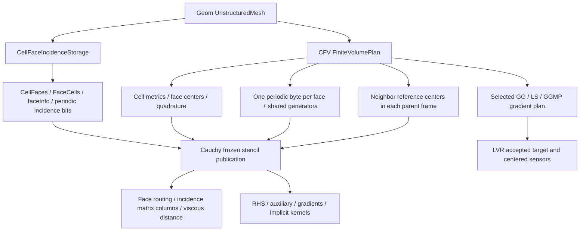

# Compact FV geometry and cell-local positivity

The spatial plan publishes topology, geometry and routing once. Operators retain
these immutable publications through CPU worker or CUDA completion and declare
changing equation fields as scheduled operands. Numerical leaves receive views
and small value parameters, acquire no leases, and report numerical failures as
`NumericalStatus`.

`CellFaceIncidenceStorage` is a Geom facility. Host capture shares canonical
native Array storage; placement copies only the four incidence payload families
and their necessary shape buffers. It does not copy coordinates, node cones or
a full mesh snapshot. Read scopes pin the source generation. An unused cached
publication may become stale after a permitted mesh transition; acquiring it
then fails rather than exposing the old numbering as current.

## Faces, incidences and frames

Face work uses the canonical `FaceCells(face)[0]` and `[1]`. A rank owning only
parent one still evaluates in parent zero's frame after its halo is ready and
writes only its owned cell. No new flux exchange is introduced. Cell gathers
preserve each cell-face slot, including both sides of a self-periodic face.

The CFV face code denotes parent-zero to parent-one transformation: identity,
one of three forward generators, or its inverse. The remaining ordinal is
reserved and rejected until a composed-map registry is implemented. Translation
is retained even when the generator's rotation is exactly identity. Normals,
vector components and spatial derivatives use the explicit transform direction;
rigid-body pose/ALE is a separate physical input.

`FiniteVolumeStencilView` derives a transient point record at a named center or
quadrature location. It owns no field of point records or rotations. Neighbor
reference centers come from CFV, while gradient means use their barycenter
origin. The scalar viscous distance retains the existing quadrature-normal
projection and clamp. Jacobian column slots remain per incidence.

The frozen publication retains whole-array leases and a device-resident POD
descriptor. Passing that descriptor's managed view avoids oversized kernel
argument lists. Acquiring another operator handle neither uploads metadata nor
creates an immediate device fence. Mutable field readiness remains the engine's
scheduled-access contract.

## Centers and boundary values

GG, weighted LS and GGMP have one weight and boundary-row ID per incident face.
The location is the mapped reference center, its direction the normalized
integrated normal, and its measure the separately integrated face area. A
zero-radius axis face keeps its geometric direction and zero weighted measure.
The selected gradient method's weighting and SVD/GGMP correction remain intact.
Physical gradients and LVR's linear target check those centers, not the parent
P3/P5 quadrature. Variational P1 remains a modal reconstruction.

The compact boundary registry stores face IDs and center/quadrature ranges.
Physical center traces are evaluated independently through point physics.
Conservative exterior states used by the flux are a different contract; VR
continues to select `physicalTrace` or `physicalMirrored`. A polynomial center
request bypasses the quadrature basis cache and requires resident moments and
point geometry. Unsupported residency is rejected at the host launcher.

A direct midpoint route requests one interface center payload per boundary face
and no quadrature payload. The same center publication serves centered RHS,
gradients and approximate Jacobians. Direct-gradient BC read roles also share
one local value buffer and one producer. High-order routes request centers and
quadrature together through the existing matching/sampling/return route.
Center-only pMG readers may alias a fine packet's superset without deleting its
live quadrature values. Packet time, route and publication epochs still apply;
matching neither averages quadrature values nor substitutes the first row.

Geometry snapshots for matching/debug/output belong to the requesting caller.
Ordinary numerical boundary kernels do not consume persistent `BoundaryPoint`
or `BoundaryTraceGeometry` tables. Output reconstructs only boundary geometry
on the host rather than downloading the complete device mesh.

## Fused positivity and LVR

Modal PP enumerates incident face quadrature followed by the same volume rule
used by the source. Face basis rows derive directly from quadrature and parent
side. Source and PP share volume offsets, coordinates or optional basis storage;
VR setup retains its independent higher-derivative scratch. Cache-off evaluation
reuses normalized point powers and inverse scales across modes and components.
No PP query cell/scatter maps, displacement table or full-domain sampled state
is required.

One CPU cell invocation owns degree selection, coefficient correction, bounded
recovery and final stored-state verification. CPU workers have bounded private
scratch. CUDA warp-per-cell and block-per-cell leaves cooperatively load
coefficients, then evaluate each point into its lane's registers and check it
before a group acceptance vote. Only cells requiring limiting materialize the
bounded shared sampled scratch for the existing fallback algorithm. Refresh
stores and reloads its candidate before sampling; modified outputs are verified
cooperatively after storage, retaining the same local decision scope.
Producing kernels emit status/count/minimum summaries per block; a small
finalizer merges only those summaries. Reporting observes the result after the
existing operator drain, not after every backtracking trial.

The mathematics remains the [positivity policy](CauchyPositivity.md): locked
flow/species scaling, independent RANS limiting, raw polynomial composition for
fluxes and clipped composition for temporary EOS checks. A lower-degree policy
retains its actual reference coefficients and the previously accepted fallback
sequence. The final predicate evaluates coefficients after storage. Removing
sampled fields does not remove that guarantee.

LVR uses the domain's selected gradient plan and workspace. It retains its
accepted target coefficients, sensors, history, seeds, penalties and necessary
halos. Its centered sensors evaluate the accepted target directly; private GG,
point samplers and duplicated face geometry are absent.

## Validation and measurements

The Plan 61-4 execution record in the separate plan repository owns build/run
status and measured memory/timings. This architecture description states the
source contract; it is not a claim that numerical or performance gates passed.
Focused fixtures distinguish centers from nonconstant quadrature traces,
canonical ghost-left/owned-right and self-periodic incidences, selected-gradient
LVR, mean/lower PP bases, stored-output acceptance and CPU/worker/CUDA lifetime.
