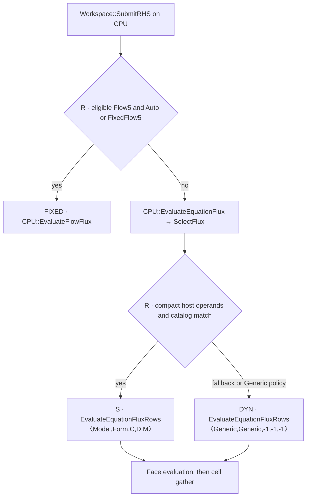
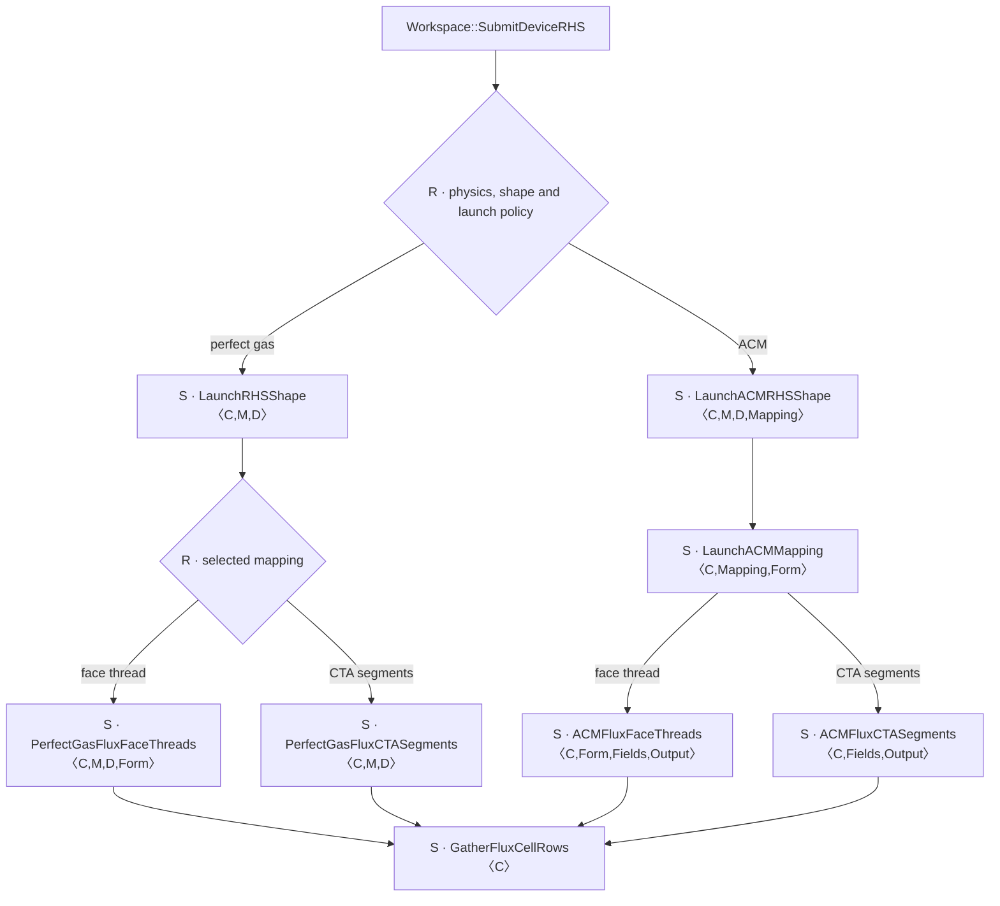
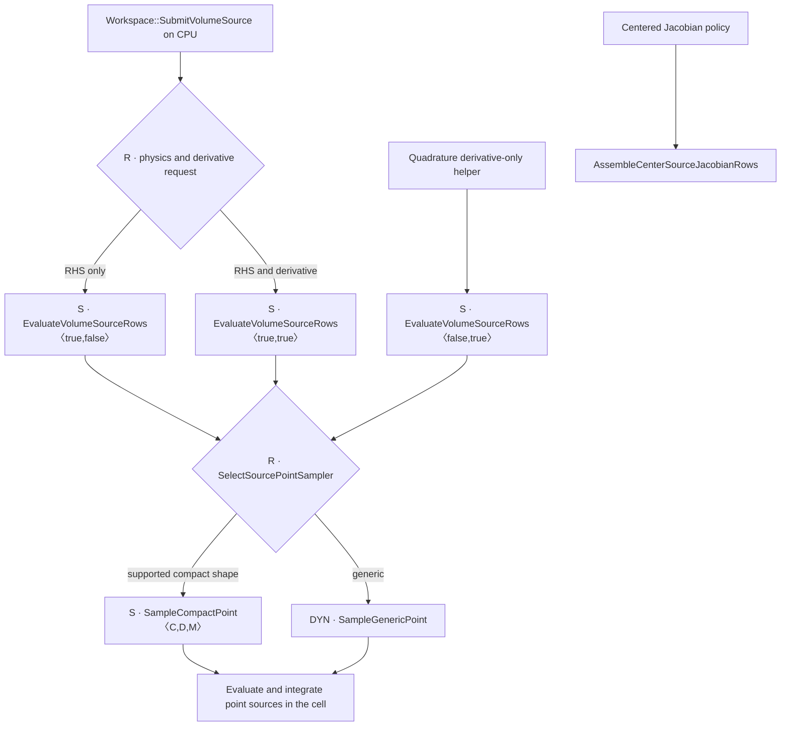
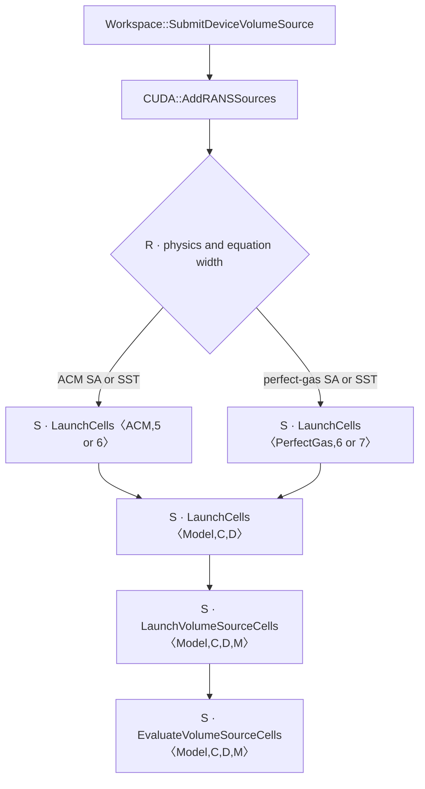
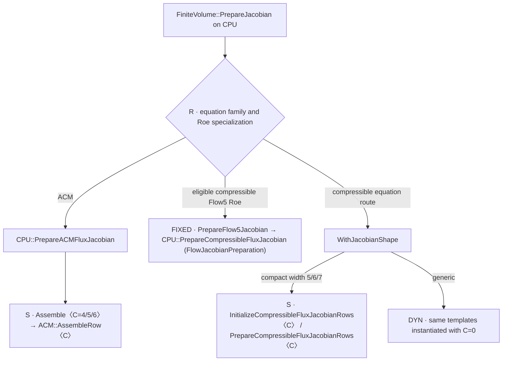
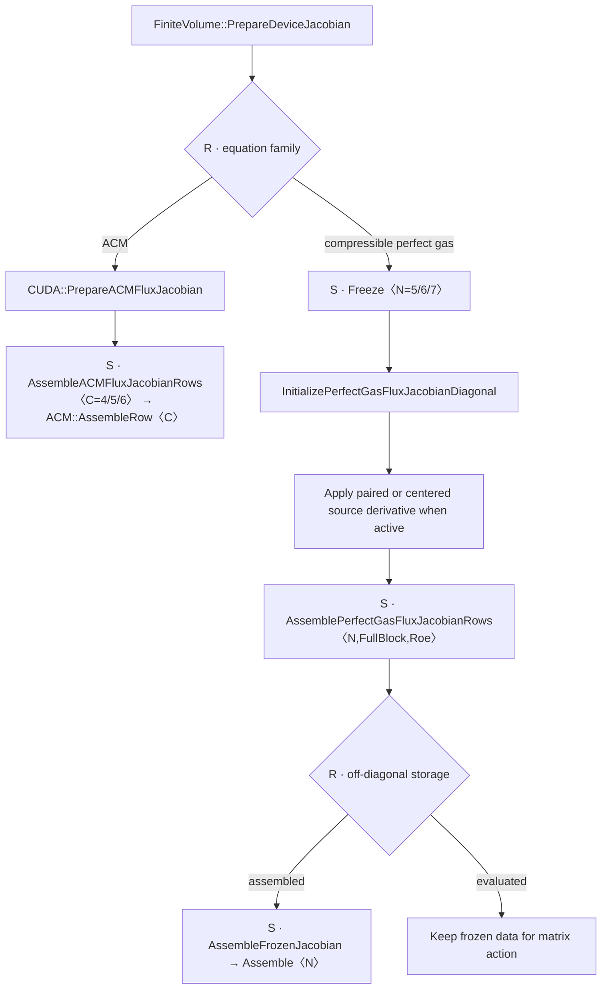

# Cauchy finite-volume kernel dispatch

The three operators below take equation-aware operands. Their host wrappers
select physics, validate layout and submit the corresponding CPU or CUDA work.
In the graphs, **R** denotes a runtime selection, **S** denotes a compiled
template instantiation, **DYN** denotes runtime shape, and **FIXED** denotes
handwritten fixed-width arithmetic. The angle brackets show template arguments.
Deduced view types are omitted where the diagram gives their shape separately.

`C` is equation width, `D` is spatial dimension, and `M` counts nonconstant
polynomial modes. `Form` is `MeanOnly`, `DirectGradient`, or `Modal`.
The overlapping widths of ACM and compressible states carry distinct physics
tags. A compact table projection uses `FixedRows<W,W>` after checking the
physical pitch. The typical widths are `C` for the mean, `C*D` for a gradient,
and `C*M` for modal coefficients.

## CPU flux RHS

`numerics.ransMeanFaceValues` selects cell-mean RANS scalars at interior
face traces in the CPU and CUDA RHS kernels. Flow and species reconstruction,
physical and interface exterior states, and reconstructed derivatives keep
their usual policies. With variational reconstruction, `ransP1Overlay`
can supply the RANS face gradients independently of the trace selection.
The viscous normal jump uses the selected traces.
Volume sources and their Jacobian policies keep their own inputs.

The generated and generic equation routes share the row template.
`Profiled` allows the generated Flow5 entry. The eligible `Auto` and
`FixedFlow5` routes preserve the established Flow5 arithmetic and its
rounding order in the existing exact comparisons. The fixed leaf runs in the
same workspace and operator schedule.

## CUDA flux RHS

The diagram covers the generated production FP64 routes. Perfect gas uses
widths 5/6/7, ACM uses 4/5/6, and both cover 2D and 3D. ACM's projected
`Fields` encode modal or gradient row widths. A launch policy also controls
eligible arithmetic experiments and selects the CTA face package when required.

## CPU volume source

The boolean template arguments select residual and derivative output.
`rhsQuadrature` pairs the caller-owned integrated derivative with the
spatial rate that produced it. The centered chemistry derivative uses the
cell mean. The centered RANS derivative uses the physical mean gradient.
A modal RANS evaluation that also publishes the auxiliary data for a
centered Jacobian prepares the mean gradient before VR. LVR and SST
auxiliary preparation can consume the same gradient. Direct gradient RHS
shares its reconstruction with the centered derivative.

## CUDA volume source

A cell thread evaluates and integrates its volume points in order. The
requested source output is selected at runtime. `M=0` selects nonmodal work,
and 2D/3D modal P1–P3 use modes 2/5/9 and 3/9/19 respectively. Rotating-frame
source work uses its own `Rotation` kernel. CTA quadrature lanes and a
cell-local reduction are future work.

## CPU flux Jacobian

The Flow5 Roe matrix specialization and the Flow5 RHS use independent
eligibility checks. Source derivatives contribute to the diagonal through
the centered or paired quadrature policy. Matrix preparation precedes
inversion, factorization and smoother setup.

## CUDA flux Jacobian

ACM uses assembled full blocks and shares `ACM::AssembleRow<C>` arithmetic
with the CPU backend. Its centered source contribution enters diagonal
assembly. `FullBlock` and `Roe` are compile-time booleans for the CUDA
perfect-gas face kernel. See [implicit operator contracts](CauchyImplicit.md)
for ownership and numeric lifetimes.
