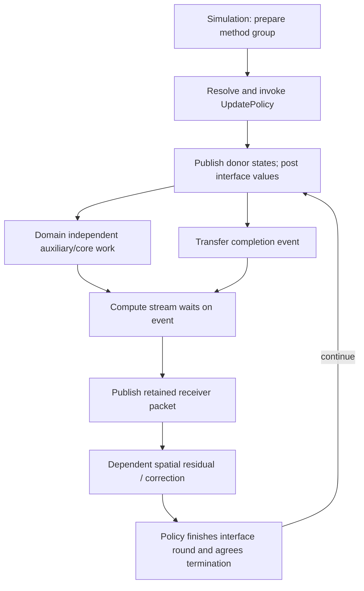
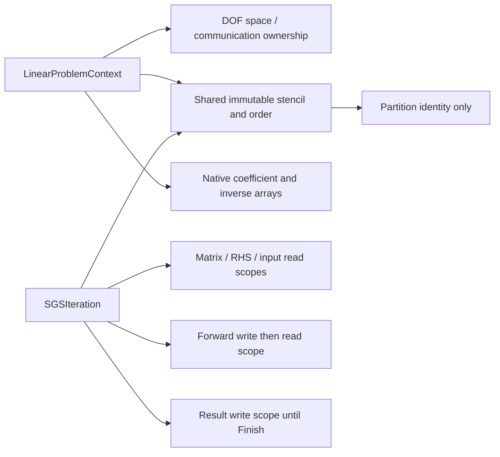
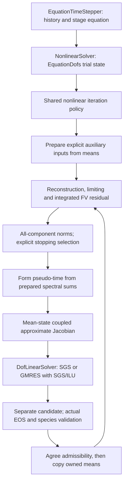

# Cauchy native implicit operator contracts

## Preconditioner-only AmgX iteration

`implicit.linear.method="amgx"` selects stationary defect correction on the
assembled CUDA operator. It does not instantiate GMRES or any other Krylov
history. With `stopping="fixedCount"` and `iterations=2`, it performs exactly
two corrections, irrespective of the tolerance fields:

1. Start from zero and publish `x = P_local(b)` without reading an old field.
2. Refresh `x`'s halo, evaluate the full distributed `A*x`, then publish
   `x = x + P_local(b - A*x)`.

More iterations repeat the second operation. A supplied nonzero initial guess
requires the residual before the first correction too. `P_local` is the existing
fixed, zero-started single-device AmgX V-cycle on each rank's owned-owned
principal matrix. It owns no MPI communicator. DNDS performs the global action
and communication, exactly as in the ILU stationary correction path. AmgX uses
fixed smoother/coarse sweeps and has neither residual stopping nor a hidden
Krylov solver. `method="gmres", preconditioner="amgx"` remains a distinct,
explicitly requested algorithm. The `preconditioner` string is unused by
stationary methods.

For flow AmgX, `implicit.linear.amgxAggregateSize` defaults to 0, which selects
`SIZE_4` on 2D meshes and `SIZE_8` on 3D meshes. Set 2, 4 or 8 to select a
target explicitly. This is an aggregation target in cells per coarse unknown.
All equation components stay together in the coarse block. The current provider
scores edges using matrix coefficients and refreshes the hierarchy when the
assembled coefficient epochs change.

`DNDS_CAUCHY_DIAG_LINEAR=1` emits one `CAUCHY_LINEAR_REPORT` JSON record per
completed solve on the domain master (all ranks only when
`DNDS_CAUCHY_PROFILE_ALL_RANKS` is set). It exposes the already-computed
initial/true/preconditioned residuals and application counts, adding no norms,
MPI reductions, stopping points or changes to the numerical work. Fixed-count
residual fields are `null` because they were not evaluated; `usable` certifies
finite output, not convergence. A finite iteration-limited GMRES correction
may likewise be accepted by the nonlinear driver without meeting its linear
tolerance. Inspect the true residual before blaming a nonlinear update.

All flow5, SA and two-equation operators retain native 5x5, 6x6 and 7x7
block CSR, with one physical cell per provider row. Scalar expansion and
padding are forbidden in the Cauchy adapter. The pinned AmgX source patch adds
6/7 coarse-operator/restriction dispatch and corrects large-block traversal
across 32-column warp boundaries, including separate-diagonal accumulation.
The generic >5 Jacobi inverse also uses correctly sized per-thread scratch,
explicit 16-lane shared-memory ordering and the correct Schur-update sign.
The build recipe records the patch and installed-library hashes; CMake rejects mismatched or unpatched installs.
A genuinely scalar DNDS matrix can still use block width one.

The previous SA experiment used scalar expansion; that changed block Jacobi
into scalar Jacobi and allowed component-mixing aggregation. It therefore did
not assess the requested coupled-block preconditioner. This verified algorithm
difference does not alone prove the cause of that run's nonlinear residual
growth. The new entry keeps fixed V-cycle/smoother/coarse sweep counts. A separate
configuration-scope bug is corrected: Jacobi now receives the requested
relaxation (default 0.75), whereas the old string-valued smoother silently used
AmgX's default 0.9. Actual-operator residual diagnostics and corrected fixed-work experiments are
needed before making a causal or convergence claim.

## Optional diagonal inverse refinement

`implicit.linear.diagonalInverseRefinement` is an integer from 0 to 3.
Zero (the default) preserves the existing CPU guarded-LU/SVD and CUDA batched
SVD arithmetic. Positive values allow that many guarded Newton corrections
for block-diagonal SGS/Jacobi, including their GMRES preconditioner use.
Independent diagonal entries, ILU and provider-owned AmgX inverses reject this
option. The C++ standalone inverse accepts the same optional count, and Python
exposes `invert_diagonal(refinement_steps=0)` and the linear setting.

For the row-scaled matrix B, the correction is X' = X + X(I-BX). It is accepted
only when finite and the infinity norm of I-BX strictly decreases. Corrections
stop at a small FP64 roundoff floor or the first rejected trial. The default
CUDA specialization has no refinement scratch; enabled work stays on device.

The singular cutoff remains epsilon*sigma_max. If modes were discarded, the
identity-residual criterion applies only inside the retained singular subspace:
form C = U_r^T B V_r, refine its inverse Z, then reconstruct X = V_r Z U_r^T.
Discarded directions never participate. A full-space I-BX residual is not an
inverse error for a truncated pseudoinverse. Shared host/device arithmetic in
`Solver/InverseRefinement.hpp` owns these rules; Cauchy wrappers own shape,
residency, leases, submission and the final status check. Euler callers retain
the zero-correction default and their existing behavior.

This is opt-in because it changes rounding and therefore nonlinear history.
It targets measured ill-conditioned SST block errors; it is not a requirement
that GPU SVD match a less accurate CPU inverse. Focused tests use a retained
SST block with an independent high-precision action and a deliberately perturbed
truncated decomposition with a known nullspace.

## Queued row actions

`LinearProblemContext::SubmitApply`, `SubmitJacobi` and `SubmitJacobiZero`
reserve numerical operands with Runtime `SubmitArrayBatch`. The retained record
owns array/layout reservations, immutable symbolic read scopes and (on the CPU
evaluated path) the frozen evaluator. It does not capture a live problem pointer
or an equation-field communicator owner. CPU-inline, CPU-worker and CUDA use the
same submission interface. CPU retains segmented and column-major layouts;
the specialized CUDA leaves require full combined AoS widths 5, 6 or 7.

The controller still submits input exchange, core work, a dependency on exchange
completion, then dependent work. Core actions acquire no input-ghost access.
Jacobi's optional second local sweep copies the same frozen remote values into
its scratch halo using queued DNDS algebra, with no intervening communication.
Zero-start Jacobi omits input and off-diagonal reservations entirely. These are
row actions, not SGS scans; they have no ordered new-value neighbor reads.

An inverse records the diagonal and inverse Array mutation epochs. Queued Jacobi
checks them at submission, so a submitted write invalidates an inverse before
that write completes. Subsequent ordered writes do not retroactively invalidate
an already accepted read: Runtime access ordering protects the accepted prefix.
This is distinct from checking completed value versions inside a worker.

Independent CPU matrix-action/Jacobi rows use private per-partition dense
scratch, allocated before OpenMP execution. Diagonal inversion keeps the same
per-cell guarded LU/SVD policy and merges integer fallback counts after workers
join. SGS scans retain their existing logical ordering at OMP=1.

`LinearSweepPartitions` supplies immutable physical row-range boundaries from
the mesh setup to CPU SGS. With distributed OMP enabled, each subpartition
scans its selected core/dependent rows sequentially in the existing logical
order. Across subpartitions, the lower scan reads the frozen old iterate
(analytic zero for zero-start), and the upper scan reads the completed lower
result. It never reads a different partition's concurrently changing output.
The lower/upper phase joins and optional exposed MPI middle exchange remain
unchanged. Empty metadata means a single serial block; OMP=1 ignores the
partition split and reproduces the original global scan. Independent matrix
and Jacobi actions do not require these ordered-sweep boundaries. This does
not add CUDA SGS or change CPU ILU triangular ordering.

Spatial entry validates shapes and owners without acquiring immediate probes
of queued inputs. A previous stage's worker/device update can still be pending
on the compute lane. `DofHalo::BeginAfter` imports that producer prefix onto the
communication lane, and the transport applies its native or MPI readiness
contract. Actual scheduled reservations still reject unmanaged conflicting
access. This permits the same stage-to-spatial schedule on inline CPU, worker
CPU and CUDA without an extra engine-wide drain.

Persistent device Jacobian read scopes seal immutable storage against writes;
they do not borrow the preparation stream's lifetime. They use the stable
default device context, while every asynchronous action retains the publication
or scratch owner through its real completion. No default-stream fence is used
as a substitute for ordering the numerical action on its declared stream.

The assembled CUDA matrix supports queued inverse preparation, matrix action
and Jacobi updates. CUDA profile validation rejects unsupported producers at
setup. The nonlinear solver and pMG use the same operator entry points as CPU.

### Inverse preparation and observation

`PrepareDiagonalInverse(context)` allocates reusable status/workspace buffers
and, for CUDA full blocks, a fixed-stream DNDS `BatchedSVD` provider.
`SubmitInvertDiagonal(engine, stream)` invalidates the old inverse, queues
preparation, and retains every allocation/provider in operation records. After
the preparation segment drains, `ObserveDiagonalInverse()` checks a compact
status and commits the inverse provenance. Jacobi rejects an unobserved inverse.
The ordinary linear-solve controller uses this same sequence for CPU-inline and
CPU-worker; device integration uses the same operator entries.

The approved initial CUDA full-block policy is batched FP64 SVD for every row.
For diagonal block D, compute B = diag(1/D_ii) D, retain only singular values
strictly greater than epsilon times the largest value, then form
B^+ diag(1/D_ii). CPU keeps its guarded LU/SVD policy. CUDA scalar diagonal
entries use reciprocals directly. Invalid input blocks feed identity to the
vendor solver while retaining failure status, and vendor nonconvergence also
fails observation. No matrix payload is downloaded for these decisions.
`LastInverseSVDCells()` reports actual SVD work; `LastInverseFallbacks()` remains
the CPU LU-fallback count and is zero for the all-SVD CUDA policy.

The [cuSOLVER 12.6.1 API](https://docs.nvidia.com/cuda/archive/12.6.1/cusolver/index.html)
defines the batched Jacobi SVD interface. The DNDS wrapper fixes its stream and
dimensions, uses caller-owned compact buffers, and leaves numerical info on
device for Cauchy's status reduction. Provider launch failures follow the host
operator error policy; no CPU numerical fallback is hidden in a CUDA kernel.

## Auxiliary ordering and retained linearization

The equation FV workspace owns an integrated face-flux table. Each RHS call
evaluates unique faces needed by its output cells, then gathers signed fluxes
into those cells. Opposite periodic incidences rotate vector components and
reverse sign; side ordinals also distinguish self-periodic faces. `All` visits
each local stencil face once. `Core` and `HaloDependent` remain independently
callable and may both evaluate a face at their shared boundary; neither relies
on hidden freshness from a preceding region call. The core read scope still
excludes input ghosts. All workspace calls must be serialized as before.

Jacobian topology is an immutable FV-owned stencil. A linear context checks
the full stencil on its first preparation with that token, then compares the
retained identity. The existing mesh/metric stamps still reject changed
geometry or numbering. Numeric ILU preparation fills the private factor
buffer directly, including fill zeros, and retains the original operator for
matrix actions. It uses the existing symbolic ordering and decomposition.
Each non-diagonal Jacobian incidence also owns the dense column slot resolved
when that immutable topology is built; assembled writers index the sparse block
row directly instead of searching canonical columns on every preparation. The
generic sparse column table remains authoritative for matrix consumers.
Direct-FV midpoint source values and gradients borrow the owned cell fields.
Modal RHS sources evaluate the finalized reconstruction inside the cell loop.
Direct physical gradients for repeated RANS source preparation carry separate
owned/ghost ready publications per physical field. Reuse occurs only when the input
and destination storage, shape and value versions still match. The input read
lease spans the check and any refresh; an unfinished writer cannot be mistaken
for current data. Weak storage identities do not retain old mesh-sized arrays.
A miss performs the original copy/extraction, and changed geometry is still
rejected. P0 sources retain physical gradients; P1 uses the final limiter/PP
coefficients. This is local workspace reuse, without a new MPI agreement or
inherited coarse auxiliary signals. Callers still serialize workspace use.

Mean-state approximate Jacobian preparation can combine EOS linearization and
source derivatives in the same owned-cell point evaluation. The internal
borrowed output descriptor publishes pressure, its conservative derivatives
and the evaluated operator's optional mean snapshot before chemistry views
expire. No persistent point-property cache is introduced. Mass/frame diagonal
initialization precedes additive source terms; ghost means and source-free or
no-sampling cases retain their own property preparation. The independent source
entry calls the same loop without these optional outputs. P0 source gradients,
one-point approximation and chemical fallback without a workspace are retained.

Equation implicit evaluation prepares mean thermodynamics, face signals and
cell spectral sums during the mean halo exchange, before reconstruction and
RHS. The explicit `Evaluate(..., AuxiliaryValues &, ...)` overload publishes
these buffers; RHS receives read views, not a mutable solver-owned evaluator.
The no-aux standalone overload retains its narrower reconstruction/RHS scope.
Pseudo-time uses the prepared mean-based cell spectral sums; preparation must
not be repeated in the subsequent matrix/linear block. In particular, future
RHS-refined face signals must survive until Jacobian setup. Preparation and
RHS outputs are distinct publications, not untracked in-kernel mutation.

`NonlinearSolver::EvaluateRate` and `EvaluateEquation` retain their
auxiliary input state/time/ghost generations. A cached `CorrectOnce` on that
same publication reuses them. A foreign cached rate still follows the existing
explicit correction-preparation fallback; the caller owns rate provenance.
Owned-only local freshness decisions assume coordinated mutations and call
order across ranks, as the existing eager contract requires. No new Allreduce
is introduced for this cache choice. `PreparedAuxValues()` is a read-only
diagnostic view of the last linearization; after an update it describes the
pre-update state. It does not silently refresh.

The polynomial FAS operator evaluates and publishes auxiliary values for the
coarse state it has just assembled. The immediately following cached-rate
correction reuses that publication only while the state/time and both owned and
ghost versions still match. A correction, restriction or next sweep changes
those versions, so the next pseudo-time and matrix preparation must refresh
current-state spectra. Those refreshes are necessary rather than duplicated
work. Coarse auxiliary work must not be fused by retaining a prior state's
spectra, and an RHS pass must not overwrite the pre-RHS publication that the
subsequent Jacobian consumes. A combined coarse auxiliary/RHS kernel would need
its own explicit publication boundary and fresh-state proof before it could
replace these calls.

RHS can consume prepared mean pressure/sound speed for the Riemann mean-state
inputs; reconstructed face thermodynamics are still evaluated at the face.
The extended Jacobian currently rejects Roe characteristic dissipation, so it
does not yet produce Euler's RHS-refined `lambdaFace0/123/4` outputs. Do not
claim that option works merely because aux ordering is now correct. Such
outputs need their own optional write bundle and provenance; scalar mean-based
spectra and their pre-RHS pseudo-time estimate must remain separate.

Cantera auxiliary and RHS passes acquire worker contexts sequentially. Aux
publication releases its worker before the RHS evaluator acquires one; this
supports a pool with a single context without copying/recreating Cantera state.

## Time-method revision in progress

`Solver/TimeIntegration` now exposes normalized `TimeEquationCoefficients`,
variable-step `BDFCoefficients`, Euler-compatible `DIRKTableau` and the
`DITRMethod<State, Operations>` workspace. These definitions have no Cauchy,
mesh, physical-model or nonlinear-solver dependencies. BDF/DIRK coefficient
definitions are shared with the time frontend. Production Domain now uses the
DITR method with one shared nonlinear loop. The old nested implementation is
removed; `StateDITR.hpp` only forwards the public method type.

The DITR method owns the initial snapshot, intermediate unknown and three RHS
caches. The caller owns the endpoint trial. `Begin` evaluates the initial RHS
and uses it for the two initial rate guesses. The external controller prepares
coupledStage 0 (intermediate), applies one correction or spatial V-cycle, and
completes it by refreshing that RHS. It then does the same for coupledStage 1
(endpoint). `AssembleStoppingResidual` produces `I+H` after both updates. It
does not test convergence or perform a solve. The controller owns stopping and
CFL progression; a prepared `resOther` and the other stage/rate must remain
unchanged throughout each correction, including its FAS recursion.
`NonlinearDetail::Iterate` accepts an explicit residual-observation order:
ordinary stage solves retain before-update observation, while a DITR problem
can request observation after its two coupled updates. Both use the same norm,
reference, CFL and cap policy; after-update mode has no iteration-zero stop.

That choice is now prepared through `UpdatePolicyRegistry`, not selected by an
outer orchestration branch. `singleStageImplicit` invokes exactly one update
with before-update residual observation. `ditrSequential2Stage` invokes the
method-owned midpoint and endpoint updates in that order, then observes DITR's
combined stopping residual. A descriptor records the stage-group size,
observation point and whether the method supplies its stopping residual.
Resolution rejects a policy whose descriptor contradicts the time method.
`implicit.updatePolicy=auto` resolves these two current policies; explicit names
are accepted only when compatible. The resolved descriptor is checkpoint
metadata, while old archives without that field retain compatibility through
the already validated time method/configuration.

The registry is a setup-time extension point. A focused test registers another
compatible one-stage policy without modifying `NonlinearSolver` or `Domain` and
rejects the same policy under a two-stage DITR requirement. p-FAS smoothers do
not resolve or nest the finest policy: they continue to call bounded
`CorrectOnce` operations inside a cycle. The finest p-FAS `ApplyCycle` is a
correction provider invoked by the same prepared update policy as a
non-multigrid correction. Standalone pMG uses a one-domain solve group for its
operator/Python facade.

Production one-domain and multi-domain stepping share `Simulation::Advance`.
`StateTimeStepper::BeginStep` initializes the selected method; `PrepareGroup`
returns the common ticket for a one-unknown DIRK/BDF group or DITR's two-unknown
group. Simulation prepares domain sessions and dispatches once through
`SolveNonlinearGroup`. The resolved policy owns the iteration loop and the order
of domain sweeps. DITR packets and frozen route caches are distinct for midpoint
and endpoint. Asynchronous refresh publications retain actual packet/receiver
owners, not raw `Domain*` or interface-facade pointers. Standalone
`Domain::PrepareStep` also uses this group protocol. Completion of every nested
per-evaluation refresh and queued overlap remains in the active source audit;
DITR interstage compute overlap is deferred.

Queued interface readiness is expressed through a completion event and compute
stream dependency. Compute workers never poll MPI. Ordinary MPI requests still
need controller-side backend progress; the context imports that progress along
with a foreign interface event so draining a domain stream cannot starve it.
The receiver callback runs once after readiness and retains its actual packet,
FV and workspace owners. Each later finest spatial evaluation acquires the
latest publication again, including a corrected DITR rate evaluation; acquiring
the same publication does not repeat its binding side effects. The policy owns
donor publication cadence and the declared block-Jacobi sweep, not the FV kernel.

Auxiliary preparation has a narrower pre-event phase:
`ApplyInterfaceIndependent` computes owned mean properties and prepared
interface-independent face/cell lists. The cell list is an intersection with
the existing MPI core; face classification follows the actual auxiliary stencil.
`BindBoundary` installs the ready trace, then ordinary `Apply` completes the
remaining core and halo-dependent work. These lists are local Runtime arrays,
not global-sized masks. This proof applies to auxiliary kernels only; it does
not authorize VR/gradient/RHS kernels to ignore their own interface dependencies.

The one-stage and coupled DITR policies share
`NonlinearSolver::CorrectOnce`'s ordinary evaluation, defect assembly,
pseudo-time, approximate
Jacobian, linear solver and PP/update implementations. They do exactly one
update without a convergence loop or residual-norm Allreduce. Other required
agreement, physics and linear-solver collectives remain. Their reports never
claim convergence. Input halos may be stale; the physical evaluation handles
its exchanges. Output guarantees owned values only. Calls remain synchronous
and serialized against the bound state/workspace/engine.

The nonlinear solve has one dispatch entry: `SolveNonlinearGroup`. Each policy
implements its own `Solve` loop; no shared controller loop wraps it. The
one-stage policy refreshes interfaces, then observes/corrects each domain. DITR
refreshes midpoint interfaces and updates all midpoints, then refreshes endpoint
interfaces and updates all endpoints, then observes the combined defects.
`NonlinearSession` shares convergence/reference, CFL, cap, progress/checkpoint
and resume bookkeeping. A locally converged/capped domain remains in interface
rounds until coordinated termination; held DITR states still complete required
rate refreshes. The group agrees restored cursors once at entry and termination
each round. These algorithmic agreements remain enabled independently of
optional diagnostic checks.

Nonlinear, linear and pMG sessions are move-only. Their mutable implementations
reserve an operation-level exclusion ticket, outside numerical loops. The finest
pMG session is an explicit retained alias; a cycle holds its ticket while nested
smoothers reuse that same permission. Independent calls through the original
solver reject while the cycle is active. Frozen plans remain sharing handles.
Bound nonlinear operators retain a weak managed stream and lock the actual
runtime for each call, rejecting expired/closed execution without an engine
pointer. Python stage adapters retain native plan/state handles and preserve the
existing argument shapes and keep-alive relationships.

Linear solutions, optional LVR arrays, auxiliary bundles and interface packets
return sharing handles. They survive destruction of the enclosing facade, but
are not historical snapshots: another solve, limiter refresh or packet update
may overwrite the same allocation. Copy values explicitly when history is needed.
Version/provenance checks still determine whether a retained packet is a current
operator input. Donor participation supplies one optional mean/coefficient
bundle; nonmembers supply none and still enter the collective coupling schedule.

`PolynomialMultigrid::ApplyCycle` is one finest update. Its bounded smoothers
call `CorrectOnce`; they do not restart convergence policy or pseudo-CFL growth.
The production `PrepareSolve` entry contributes a session to the coordinated
policy; standalone `Solve` dispatches that policy with one domain.
`iterations` counts finest V-cycles;
`levelCorrections` separately counts level smoothing work. `multigrid.cycles`
remains the cap for the standalone frontend. Source coefficients and frozen
other-stage terms are unchanged throughout a cycle. Temporal-pMG is deferred.

Coarse controls are defined centrally by `PolynomialMultigrid::CoarseSettings`.
The first coarse level uses direct-gradient second-order convection. The bottom
level still prepares direct gradients for RANS/volume sources, but
`firstOrderConvection=true` uses cell means and jump-only face viscosity.
Reconstructed derivatives are not used in P0 viscous face fluxes; there is no
retained-gradient P0 face alternative. This restriction never suppresses
volume-source gradients, including RANS and chemistry. Both flow5 and
logical equation RHS profiles use this policy, with no change to finest defaults.

The viscous face-jump correction uses the centroid separation projected onto
the face normal, bounded by the adjacent-cell volume/face-area scale, also on
the P0-convection level. Like Euler, P0 zeros reconstructed face gradients;
Cauchy retains the user-selected normal-distance length while Euler uses the
full centroid distance there. Neither this face-jump length nor coarse convection order
changes the mesh wall-distance provider used by RANS.

Direct P1/P0 residuals use one reference-center sample per face and per
cell-source evaluation, matching Euler's midpoint rule. Cell volumes and face
measures are still integrated using the configured geometry order; midpoint
publication changes physics evaluation points/counts, not mesh measures.
`NumericsSettings::RHSIntegrationOrder()` selects this separately from
`cfv.intOrder`, which retains its metric/VR setup role. Wall-distance samples
follow the residual quadrature. High-order variational residuals keep their
configured quadrature, and additional PP test points remain independent.

See [the distributed exception contract](RuntimeCallerContract.md#distributed-exceptions).
Only an agreed rejected `StepResult` may drive a smaller-dt retry. General exceptions
from domain solves, interface matching, linear transfers and I/O escape directly;
the production frontend aborts MPI without a final agreement. Cross-domain accepted
state and checkpoint publication use memory-only reservation under a single
control-communicator preflight, before any commit. This preserves all-or-none
publication without wrapping collective numerical/I/O work in an outer catch.

Focused tests compare two incomplete DITR iterations against independently
written Euler-form scalar equations for both variants, compare a single CPU
correction byte-for-byte with the first ordinary-solve update, and exercise
distributed FAS with explicit finest/coarse work accounting. This does not yet
complete the remaining whole-phase qualification. BDF/DIRK history ownership
and the first tracked mean-halo integration are described below.

Optional CPU profiling uses shared `NonlinearProfile` ownership through
`NonlinearSolveControl::profile`. A null output performs no clock queries or
additional MPI operations. A provided output resets for each synchronous solve
and retains partial timings when it throws. Prepared nonlinear sessions and
their timers retain the profile until retirement, even if the caller releases
its handle. The live `NonlinearSolveState` publication is shared likewise;
callbacks themselves must retain any additional objects they capture. Do not
mutate/read these outputs concurrently with progression or share them between
simultaneous solves. Timers surround operator and
controller phases, outside numerical row loops. Per-rank Total encloses Entry,
Residual, Convergence, PseudoTimePP, Jacobian, LinearSolve and Correction.
Residual includes reconstruction/auxiliary/communication; LinearSolve includes
required preconditioner work and exchanges. These are wall times, including
waits, rather than pure arithmetic costs. Calculate the unsectioned controller
remainder per rank before reduction: sums of independently maximized phases
are not the same as maximum-rank total. No timer output certifies convergence.

The coupled DITR method, its independent intermediate-stage workspace and
accepted/trial history contracts are documented in [DITR.md](DITR.md).

## Interface input refresh protocol

`Simulation::Advance` prepares the time-method group and invokes
`SolveNonlinearGroup` once. The resolved `UpdatePolicy` owns its complete
nonlinear loop. The single-stage policy refreshes interfaces before the domain
sweep; the DITR policy refreshes and updates all midpoints before refreshing and
updating any endpoint. Colocated and dislocated placements use the same policy.
A rank retains only its resident domain sessions; empty control ranks still
participate in interface completion and group termination.



Stage topology, pose and transfer bindings are retained in separate coupled-stage
slots. `stageFrozen` reuses a stage's packet; `nonlinearIteration` republishes
donor reconstructions and posts value transfers at the policy's refresh points.
The packet retains its source epoch and storage versions. `InterfaceDonorPublication`
is a typed retained record of local mean/reconstruction allocations and their
sampled generations. The active transfer owns it independently of temporary
caller descriptors; colocated receiver packets also retain that record.
On a receiver-only rank `BoundaryInterfaceSource::localDonor` is empty: the
remote donor rank owns its allocations through sampling/transfer completion,
and the receiver's epoch and frozen route identify the sampling round. Local
generation numbers are not broadcast or mistaken for distributed clocks.
This is shared storage ownership, not a read lease or a deep copy of the donor.
Validate live donor versions before sampling, never when consuming an already
frozen packet: subsequent donor updates must not invalidate its sampled values.
Packet aliases share immutable publication metadata. Cached-rate corrections
also compare that publication identity before reusing auxiliary spectra: equal
local means and physical time do not imply equal incoming boundary data.
DITR correction preparation imports an outstanding refresh event and can run
interface-independent auxiliary core work first. Its policy joins the round
after the domain sweep, rather than before it. The current two-equation RANS
gradient provider retains an explicit host boundary for packet-dependent setup.
Reusing a completed publication is idempotent, but it does not make that packet a newly sampled donor
state. Completing the per-evaluation refresh contract, including nested finest
pMG/DITR evaluations, is part of the active Plan60 source batch.

Queued receivers retain the publication record and actual FV/workspace/packet
owners. Compute workers perform rank-local publication after the event, never
MPI agreement. Portable MPI progress belongs to the controller. CPU streams
waiting on its completion sleep until event notification; native CUDA/NCCL
dependencies use native stream ordering. A policy-boundary finish also drains
accepted transfers on ranks without a local receiver. Solver exceptions abort;
coordinated recovery/fault injection is confined to tests.

The distributed recurrence fixture now invokes the production single-stage
policy with shared/reversed and disjoint domain rank groups, both refresh
cadences and inline/worker execution. It checks the independent two-variable
recurrence and live owned-read/MPI overlap, with domain norms reduced on their
subset communicators. The DITR policy ordering fixture includes idle control
ranks. Transfer rejection tests retain source/packet access checks
without preserving the removed prototype schedule API. These are focused
integration fixtures, not evidence of a completed fluid campaign. Their current
source migration must pass the grouped build/test gate.

## Steady BDF1 limit and physical endpoints

`time.steady=true` uses the analytic infinite-timestep limit of BDF1. The
existing stage solver receives physical mass zero, history source zero and
RHS scale one. Pseudo-time continuation, PP, SGS/ILU/GMRES and optional p-FAS
remain the same operators. Physical time stays frozen; no infinity enters
floating-point arithmetic or BDF history. This matches Euler's `steadyQuit`
behavior: its BDF2 driver takes only its first, BDF1 startup step at dt1e200.

Configuration resolution forces `method=bdf1`, at most one outer solve, no
physical final-time/CFL cap and no timestep-halving retries, recording each
override's provenance. `dt` remains a required positive finite placeholder
and is ignored by the steady equation. By default the final finite admissible
iterate is published even at the correction cap, retaining an unconverged
report; this is an iterate, not a converged steady result. Explicit
`implicit.rejectUnconvergedStages=true` rejects at the cap and leaves accepted
means, time and history unchanged. A finite-dt BDF1
transient with an outer residual stop is not this steady mode.

`implicit.consoleInterval` enables rank-zero progress at selected nonlinear
iterations; zero disables it. These norms are the uncompressed equation
residual. Defaults use volume-integrated L2 and density-only convergence, tested
against its running maximum within the solve and the absolute floor. The
running-maximum reference is Euler's default behavior; `initial` remains an
explicit alternative. Explicit controls are
`normOrder=1|2`, `residualReference="initial"|"runningMaximum"` and the distinct
component names in `residualComponents` (default `["rho"]`; `[]` selects every
resolved equation). Use names from the equation schema, e.g. `["rho", "rhou"]`
or `["rhoY:H2", "rhoY:H2O"]`. A `block.component` spelling such as `flow.rho`
disambiguates names. Unknown, ambiguous and duplicate selections fail at setup;
names resolve once outside residual evaluation and cell loops. For a normalized
cell defect `r=V*defect`, L1 is `sum(abs(r))` and L2 is
`sqrt(sum(r^2/V))`; neither result is divided by total volume. This matches
Euler's volume-integrated absolute convention, while relative convergence
remains a ratio of the same definition. Selection only controls
acceptance: all component norms are still computed and reported. Reference
norms reset at solve entry and running maxima include the current evaluation.
Single-level and finest p-FAS acceptance use the same small policy after the
existing global norm reduction, with no additional collective.
Console physical-step, implicit-stage and nonlinear-iteration labels are
one-based. The initial history row remains step zero as the pre-iteration
state.

Euler's optional transient `resBaseType=1` additionally seeds the reference
with the first spatial RHS norm, then still takes the running maximum of
equation residual norms. Cauchy's `runningMaximum` implements the default
unseeded behavior (`resBaseType=0`), not this extra RHS seed.

The [PP policy](CauchyPositivity.md) distinguishes Euler's whole-vector
increment/RHS compression from its flow/species reconstruction compression and
separate scalar repairs. Composition-dependent thermal compression remains
coupled; no independent species backoff is introduced.

Euler's density/L1/running-maximum criterion is selected with
`normOrder=1`, `residualReference="runningMaximum"`, `residualComponents=["rho"]`
and its relative tolerance (absoluteTolerance0 for a purely relative target).
This choice does not assert convergence of the other equations. Reports retain
both `initialResidual` and `referenceResidual`, plus the selected-component
`residualTargetRatio`; CSV and Python use that ratio rather than recomputing an
all-component initial-reference ratio. A zero requested target means exact
zero; an unmet zero target reports the largest finite ratio. DITR uses the same
controller and named component selection. DITR inherits each domain's
`implicit.iterations`, `minIterations`, `relativeTolerance` and
`absoluteTolerance`. Explicitly supplied `time.ditr` counterparts remain
deprecated compatibility overrides; missing/null fields inherit, including
after JSON round trips. Explicit zero tolerances/minimum are valid overrides.
The combined minimum/maximum is checked before stepping. These fields do not
introduce another loop. RANS/species never enter the default criterion;
a homogeneous reactor must explicitly select reacting components or all. Align
linear relaxation and VR warmup too before calling a baseline matched.

`implicit.requireConvergedReconstruction=true` additionally requires the
finest VR update to meet `numerics.reconstructionTolerance` before accepting
the equation, including p-FAS. Variational reconstruction then requires a
positive tolerance. The default false retains Euler-style fixed-sweep mean
acceptance; a soft VR early-exit threshold alone does not guarantee a settled
polynomial at the mean stop. Inspect the reported VR update and use the strict
guard for a settled-VR qualification. It uses the norm already reduced by CFV,
without another collective or a check inside a numerical kernel. Boundary
quadrature values are refreshed from the current polynomial on each VR sweep.

The physical frontend uses `FieldTimeStepper::ReachedTimeTarget` to avoid a
roundoff-sized extra step at a requested endpoint. The tolerance scales with
the actual times, preserving tiny nonzero physical horizons. Genuine positive
steps which cannot advance a floating-point clock are rejected explicitly.
The relative endpoint guard also covers addition error from the tested800-step
vortex and2500-step cylinder sequences, rather than only one rounded addition.

Restart compatibility allows reconstruction sweep-budget/early-exit changes.
They do not change stored means or a compatible polynomial coefficient schema;
physics, flux and active PP policies retain their existing compatibility checks.
Exact replay still requires compatible numerical controls and stored guesses.

## Polynomial multigrid

VR and direct-gradient boundary input use one physical face trace evaluated from
the current polynomial when requested. A stationary slip trace removes the
relative normal momentum once; the reflected exterior used by the numerical
flux removes it twice. Viscous laws retain their separately prepared mean/jump
convention. See [the boundary convention guide](CauchyBoundary.md). Flow5 and
logical-equation paths use the same trace contract; analytic and inter-domain
prescribed point values retain their existing meanings. No reconstruction
kernel branches on a BC kind or stores an exterior-state convention.

`Cauchy/Multigrid/PolynomialMultigrid` connects the generic
[FAS cycle](FAS.md) to same-cell spatial operators. `implicit.multigrid.levels=0`
disables it. Level1 is direct-gradient second order, level2 additionally uses
first-order convection and jump-only face viscosity; source gradients, equation and
boundary conditions remain enabled. The finest operator requires variational
degree2 or3. This follows the supported Euler pMG fidelity hierarchy, without
copying its recursive orchestration lambda. No spatial coarsening or new mesh
partition is performed.

```text
Domain physical trial / time equation
  PolynomialMultigrid -> finest uncompressed convergence test
    Solver::FASCycle
      VR high-order   -> NonlinearSolver bounded PTC/SGS or GMRES smoothing
      direct O2      -> independent state, FV workspace and matrix/linear solver
      first-order    -> independent state, FV workspace and matrix/linear solver
      identity state/residual/correction maps on the same cell identity/order
```

The normalized stage equation is `inverseDt*(M U) - rhsScale*R_integrated(U)/V`.
The spatial-only FAS evaluation sets `inverseDt = 0`; the smoother and finest
convergence check use the full time equation. The compressible physical mass
matrix is the identity. ACM projects out pressure only from the state operand.
All three same-cell maps are identity in this normalized convention; an integrated-residual or
different-mesh hierarchy must supply its own transfer. Cell identity/order is
checked during setup. Means, fine/coarse matrices and mutable auxiliary/gradient
buffers are distinct. Cauchy defaults to the whole logical equation state.
`implicit.multigrid.updateComponents` optionally selects distinct logical indices
for every level's smoothing and correction; empty selects all. Other means stay
bit-identical. Generic FAS supports the same contract for arbitrary component
widths through explicit principal-system smoother callbacks.

The selected approximate Jacobian is `P*A*P + (I-P)`, with a zero RHS in
unselected equations. Both assembled and frozen evaluated blocks project after
periodic frame transforms. This solves the principal system; it is not a full
Newton solve followed by masking. The full residual is formed and measured
before its solve RHS is projected. Euler RHS/dTau PP uses that projected RHS,
and increment/final PP receives a projected increment. A physical repair that
would change a frozen component is rejected before publishing means.
The original finest equation and all component norms remain observable.
`implicit.residualComponents` remains the independent convergence selection:
its default selects density; explicitly selecting frozen equations may prevent
acceptance even if all updated equations have converged.

The field and `EquationDofs` overloads share one hierarchy implementation and
the generic `StateFASCycle` recursion. Coarse logical states preserve the exact
block-to-physical-field mapping and each parent's AoS/SoA/AoSoA pitch. Their
distinct row-space associations are constructed explicitly; only the validated
identity transfer crosses level spaces. Coarse means are initialized from the
admissible fine background before the level solver is constructed. Each level
retains the same equation, material/worker pool, RANS model, wall samples and
configured volume sources. There is no logical-state payload packing.

Identity tau edges evaluate the spatial part of the operator with zero direct
time coefficient, giving `resOther_c = resOther_f + alpha*(F_f-F_c)` directly.
The full time coefficient remains in every smoother and finest norm. The
separate DITR coupledStage cycles freeze their current resOther independently;
no temporal coarsening or nested stage-convergence loop is introduced.

`implicit.collectiveChecks` also controls the optional agreement around local
cycle algebra, identity copies, and repeated nonlinear/linear entry checks.
Repeated equation-FV entry and correction-auxiliary CPU joins/preparation
follow that same switch, including the gradient-aware auxiliary entry used by
two-equation RANS. Disabling agreement does not skip the local actions
or the stream join, and does not disable transfer access validation.
With it disabled, coefficient/component agreement is a caller obligation;
local shape, binding, coefficient and admissibility checks still execute.
`implicit.collectiveChecks` is the master switch for optional Cauchy
agreements, including prepared halo launch checks. Setting it to false also
selects unchecked launch even when `execution.transferPreflight="collective"`.
With the master enabled, `execution.transferPreflight="abortOnFailure"` may
independently remove optional launch agreements. Both modes retain local
access, route and stream validation. In the production executable, an error in
either mode aborts; the mode changes only the success-path agreement. A
coordinated library caller or UT can observe a checked rejection before posting.
Without agreement, a local launch failure aborts independently. Required protocol/schema agreements, routing, and numerical norm/PP
reductions are unaffected.

Runtime's default `TransferPreflight::Inherit` resolves the immutable binding
context once at binding construction. Explicit Runtime Collective/AbortOnFailure
options override that context, while Cauchy resolves its master switch before
building those options. Grouped transfers require one effective policy. The
same domain policy reaches mean, reconstruction, auxiliary, limiter and linear
halos, without changing numerical policy or physical storage layout.
Callers must issue identical controls and operation order on every domain rank
and propagate failures to the fail-fast frontend, as for other unchecked eager
equation operators. Do not catch a rank-local failure and continue into MPI.
With checks enabled, entry agreement detects mismatched controls before work.
Shape/binding checks remain outside cell loops.

`implicit.multigrid.coarseRHSFPP` defaults to `false`, matching Euler's
coarse pMG loop, which omits RHS/dTau alpha limiting before its linear solve.
False forces the resolved coarse `positivity.rhsFPPMode` to `"none"` after each
level's partial solver overrides. The finest policy is unchanged. Set true
to use the inherited/per-level RHS or dTau limiting policy on coarse levels.
This is a numerical-method choice, not a diagnostic validation switch;
reconstruction PP and final increment compression/repair remain independently
active according to their existing controls. No alpha-statistics reduction
is needed for a skipped coarse RHS/dTau limiter.

`implicit.ilu.ordering` selects `"natural"` (default) or `"rcm"` using the same
CorrectRCM algorithm as Euler's orderingCode4. Ordering is rank-local and
computed independently within each supplied local part on its induced graph.
If `implicit.ilu.coreFirst=true`, the selected order is then stably grouped
core before dependent rows before symbolic fill. To compare directly with
Euler's ungrouped CorrectRCM factors select `ordering="rcm", coreFirst=false`.
The mesh, physical DOF rows, halo routes and matrix columns are unchanged;
only factor permutation/fill changes. This can change incomplete-factor
corrections and convergence. No ordering work or new collective is added to
numeric factorization/triangular solves. Direct C++ callers can append ordering
to `PrepareILUStructure(fill, coreFirst, localParts, ordering)`; existing calls
remain natural. Python linear settings expose `ilu_ordering`.

`implicit.ilu.preconditionerCorrections` fixes the number of zero-started
defect corrections in each GMRES ILU preconditioner call. Its default is1,
the original local factor solve. For a larger count, subsequent corrections
exchange the iterate halo and evaluate `b-A*x`,then add the same frozen local
factor solve. The factors and count remain fixed during GMRES. Stationary ILU
continues to use `linear.iterations`. This is ordinary linear preconditioning;
it does not reevaluate the nonlinear RHS. Set2 to match Euler's two corrections
per ILU preconditioner application. Python exposes `ilu_preconditioner_corrections`.

Linear `Solve(rhs, initialGuess, componentScales)` optionally accepts a positive
logical component scale vector. The synchronous call freezes its metric
`sum((x_j/s_j)*(y_j/s_j))`; empty scales retain the Euclidean metric. Callers
must provide agreed scales and complete prior producers as for other linear
inputs. The linear layer owns no physical means,mesh or scale estimator.
The Python argument is `component_scales`.

`implicit.linear.componentScaling="meanState"` prepares Euler's compressible
flow5 metric before each nonlinear correction's GMRES call. It averages
absolute conservative components by cell volume,sets all three momentum
scales to their common Euclidean magnitude,and sets the energy scale to that
magnitude squared divided by mean density. Other equation components keep
their own absolute mean scales. Euler's `verySmallReal` regularization is
applied explicitly to the denominators. It does not provide a physical unit
fallback. The prepared vector is frozen through that linear solve. Default
`"none"` does no mean-state work and adds no reduction. Non-compressible
schemas must supply an appropriate metric through the generic linear API;
this specific policy requires the named ordered flow5 components.

`implicit.multigrid.reuseCoarseRate` reuses the immediately preceding coarse tau
evaluation for that level's first correction. Native pMG coarse levels use
direct-gradient reconstruction, so reevaluation at unchanged means does not
advance VR history. The cached rate owns a separate numerical vector, records
the owned binding/generation, physical time and equation scale, and is consumed
once. New cycle bindings, physical corrections and subsequent corrections
invalidate it. The existing cached-rate correction entry refreshes auxiliary
values and source-Jacobian provenance. Set this option false for a direct
coarse-level comparison. Profile `cached_rate_uses` counts reuse separately from
the existing smoother residual-entry count.

At the finest level, `Solve` retains the spatial rate from its convergence
evaluation for the first correction at the same owned state. This removes a
duplicate set of configured VR sweeps, matching Euler's use of the available
residual for the initial update. Later smoothing corrections reevaluate their
updated states; a coarse correction invalidates the retained rate. The generic
FAS recursion, selected components and tau algebra are unchanged. For one finest
pre-correction and no post-correction, N cycles need2N+1 finest spatial
evaluations including the final observation, rather than3N+1.

`EvaluateEquation` can publish the unscaled spatial `dU/dt` as a separate output
in the same evaluation. It does not reconstruct that rate by subtracting
`mass*U` from the defect, which could lose accuracy for a mass-dominated time
equation. Both physical and logical equation adapters implement it. An explicit
`ApplyCycle(..., rate)` accepts the same method-owned rate contract as
`CorrectOnce`: caller guarantees current means, time/stage and reconstruction
provenance, with no intervening mutation or VR update. DITR supplies its existing
stage rate this way. A standalone cycle without a supplied rate still evaluates
its first smoother normally.

P1/P0 direct FV uses one face/source midpoint with preintegrated geometric
measures. High-order VR retains configured quadrature. Interface trace packets
must match each level's sample positions: high-order packets cannot simply be
aliased to coarse midpoint packets. Mismatches are rejected; explicit coarse
interface sampling remains required for that combined feature.

`execution.fieldGrouping` selects physical allocation independently of equation
blocks and `execution.layout`: `equationBlocks` retains separate flow/RANS/species
fields; `coupled` stores all logical components in one uniform table. Numerical
operators still address the same blocks, and implicit blocks couple the full
state in either case. One coupled field needs one canonical halo binding instead
of one per physical field. No packing or loss of stride information is implied.

Direct nonlinear users can select the same behavior with
`NonlinearSolveControl::updateComponents`. Selection is always validated locally;
cross-rank agreement follows `implicit.collectiveChecks`. Unchecked callers
must provide the same selection, coefficients, limit and cached-input mode.
Standalone `ApplyCorrection` callers must agree its optional selection and
scale before entering. All public defaults retain full-state behavior.

`preSmooth`, `postSmooth` and `coarseSmooth` bound nonlinear corrections, and
`cycles` caps V-cycles. The finest smoother uses the domain's `implicit`
settings. `multigrid.coarseLevelSettings["1"]` and `["2"]` independently
override each coarse level's `preSmooth`, `postSmooth`, and partial `solver`
controls. Unspecified solver fields inherit the domain defaults, including
individual fields within `linear`, `sgs`, `ilu` and `positivity`. Allowed scalar
overrides are `diagonal`, `jacobianAction`, `roeDissipation`, `pseudoCFL`,
`maxPseudoCFL` and `relaxation`. Physics, finest convergence and the hierarchy
cannot be changed by a smoother override; resolved controls are validated before
constructing that level's solver. Unsupported equation/backend combinations
still fail explicitly.

For the maintained Euler ILU/4ILU/4ILU schedule use `preSmooth=1`,
`postSmooth=0`, `coarseSmooth=4`, and override level1's `preSmooth` to4.
Each level may independently choose its linear method/iterations and ILU fill;
the4 in that schedule counts coarse nonlinear corrections, not ILU fill.
At the bottom, an explicit pre/post pair sums to its correction count; -1
inherits `coarseSmooth`/zero. At intermediate levels -1 inherits the common
pre/post count. No coarse level has a separate convergence loop.

Each coarse CFL starts from its own configured base and follows the finest
CFL's relative growth, capped by that coarse level's `maxPseudoCFL`; the next
physical stage resets it. Coarse correction `damping` and physical PP
reuse the same candidate-before-publication policy as the fine smoother.
Convergence checks the original finest equation with its original source,
per-component norms and configured tolerances. A coarse forcing tolerance or
a V-cycle count never implies physical stage acceptance. Reports contain
cycle counts, corrections per level and total corrections/linear work across
levels. No acceleration claim follows from the correctness tests alone.

Physical discard/retry still restores the fine reconstruction guess. Coarse
levels have no persistent VR polynomial guesses and restriction overwrites
their state each cycle. A failed cycle drops its scratch hierarchy; the next
attempt constructs fresh scratch before reuse. The physical caller still owns
restoring any changed fine trial. Failed or explicitly rejected attempts never
publish accepted state/time history. Finite capped solves follow the configured
Euler-style advance/rejection policy. Same-cell pMG tests cover manufactured nonconstant P3
equations, mixed DOF layouts, active distributed halos, constant fixed points,
physical discard/retry and commit rejection by a retained debug reader.


`Cauchy/Implicit/LinearProblemContext` owns the numerical matrix for one fixed
native DOF space. Its immutable sparse columns use the same owned-plus-ghost
local numbering as the input field. It stores rank-owned rows only, separate
diagonal-entry or full diagonal blocks. By default full off-diagonal blocks use
`DNDS::Algebra::BlockMatrixStorage`; diagonal values and inverses are native
Arrays. No legacy ArrayDOF or EulerJacobian adapter is involved.

`implicit.jacobianAction="directEvaluated"` omits the assembled off-diagonal
Array and applies off-diagonal flux derivatives from frozen physical data. This is the same
simplified approximate Jacobian as `"assembled"`, not a Frechet derivative of
the high-order residual. Both modes support scalar or block diagonals, scalar
or characteristic Roe dissipation, periodic momentum transforms and physical
BC/self-periodic diagonal terms. SGS and GMRES request directional actions;
local ILU filling requests explicit blocks. ILU still stores and factors its explicit local
template; this is not matrix-free factorization.

`assembled` remains canonical, especially for ILU/GMRES+ILU. GMRES may explicitly
use direct-evaluated `A*x` with separately assembled ILU preconditioner factors;
the operator and preconditioner are distinct objects. This supported option is
not the canonical performance comparison. The old config spelling
`semiMatrixFree` and C++/Python enum `SemiMatrixFree` remain compatibility aliases
for `directEvaluated` / `DirectEvaluated`. Archived experiments retain their
original input spelling.

The physical evaluator owns mean values, face radii and (for Roe) prepared
characteristic magnitudes. EquationSystem regenerates physical derivatives and
characteristic matrices; EOS calculations remain outside Riemann. Approximate
Jacobians use one face-centered incidence, never RHS quadrature, in both
assembled and direct-evaluated modes and on every polynomial level. CFV always
maintains reference-center position, scalar area `integral dS`, and mean normal
`normalize(integral n dS)`; accurate geometric integration happens only at setup.
Curved faces use the same one-record contract. Scalar area is not the magnitude
of the integrated normal vector. Periodic images transform the face center and
normal into the current cell frame; grid velocity is evaluated at that center.
Geometry is immutable and reused on subsequent preparation. A weak FV-owner
key identifies that geometry without retaining the mesh or communicator.
Changing live means/auxiliary after preparation cannot change the frozen
operator. Reprepare explicitly for a new nonlinear state; stale auxiliary
provenance rejects before matrix writes.

The assembled equation operator has a bounded CPU leaf for a complete ordered
six-component AoS state (flow5 plus one scalar). Its prologue recognizes owned
and ghost tables under the original leases, retaining physical parent pitch.
An identity component frame and full component selection permit direct fixed
row spans into the existing column-major block. The separate numerical leaf
receives actual EOS pressure and every conservative pressure derivative,
including scalar coupling, plus frozen dissipation and grid velocity. It does
not compute thermodynamics, allocate, pack, communicate or inspect geometry.
Split/permuted/column-major states, other widths, selected components,
nonidentity transforms and two-equation turbulent stress retain the generic
writer. Direct-evaluated actions remain independent mathematical oracles.

`ReadOffDiagonal().WithBlocks(callback)` selects a block accessor once outside
the numerical loop. Stored blocks retain their ordinary stable Eigen maps;
evaluated blocks return owning matrices, with flow5 on the stack. Holding the
result of one block query and evaluating another is safe. Other component
counts use a generic dynamic dense matrix. A raw callback/map still requires
the enclosing read scope to remain alive; custom evaluators must own immutable
inputs, match exact row identity/columns/components, perform no MPI or hidden
mutation, and obey the same controller serialization contract.

`ReadOffDiagonal().WithActions(callback)` selects the action adapter once before
SGS/matrix-vector loops. The physical producers override `ApplyBlock(row,slot,
direction,output)` with a direct flux derivative rather than building a dense
block for every neighbor. Equation-state actions use the prepared conservative
pressure-derivative row and retain passive scalar convection, turbulent stress,
ALE velocity, periodic momentum rotation and component projection. This changes
floating-point grouping, so parity is numerical rather than byte identity.
Input Eigen views retain dynamic component strides; SoA/AoSoA rows do not need
implicit packing. The kernel allocates one output vector before the scan and
reuses it for all neighbor actions. The assembled adapter retains the ordinary
static/dynamic Eigen multiply-add expression and needs no such scratch.
Every producer must implement the pure-virtual `ApplyBlock` action directly;
there is no dense fallback. Evaluated SGS/Jv must never materialize an N-by-N
off-diagonal temporary. `EvaluateBlock` remains a separate, explicit request
for assembly, factorization or matrix inspection. Both action and block adapters
borrow the enclosing read scope; neither acquires leases or communicates in a
neighbor loop.

The equation producer has a bounded CPU path for a complete ordered flow5 plus
one scalar, with no two-equation kinetic-stress coupling and no component-frame
rotation in the prepared off-diagonal geometry. Selection and exact frame
classification are frozen during preparation; the geometry flag is reused with
the existing immutable geometry. Moving-grid velocity remains explicit. The
six-component directional leaf retains the full EOS pressure row, including
the scalar column, and the actual direction stride. It creates no dense matrix
and performs no hidden packing. Input and output are distinct borrowed vectors;
the caller retains their enclosing scopes and supplies contiguous output scratch.
Other shapes, selected subsets and rotated component frames use the original
generic producer. The leaf is inline at this private operator boundary so fixed
row-view metadata need not cross an out-of-line ABI for each neighbor product.
This does not change assembled storage, defaults, source terms or quadrature.

### TODO: large-species structured Jacobian storage and factors

Future optimization, **not implemented or enabled by current controls**. For
large mixtures, dense off-diagonal blocks cost O(N²) per graph entry, although
an intentionally decoupled approximate Jacobian can have much less structure.
Add an explicit choice of off-diagonal storage with a dense flow5 block and
diagonal entries for transported RANS/species scalars. This costs 25+Ns scalar
entries per edge rather than (5+Ns)². A shared scalar coefficient can be stored
once only when every affected scalar really has the same frozen coefficient;
otherwise retain one entry per scalar. Diagonal cell blocks can remain dense.
Common original convection coefficients do not imply common scalar factors:
different scalar diagonal/source terms can distinguish them during elimination.
Sharing factor coefficients needs its own equality proof.

Separate the **Jacobian approximation** from the **storage/factor policy**:

1. If the chosen approximate Jacobian omits both directions of flow5/scalar
   coupling and all cross-scalar coupling, including in each diagonal cell
   block, it has the direct-sum form `A_flow ⊕ A_scalar1 ⊕ ...`. Elimination,
   inversion of diagonal blocks and any retained graph fill preserve that
   component structure. Flow5 block factorization plus scalar factorizations
   therefore represent the same approximate operator, for both LU and the same
   ILU fill/drop policy and entity ordering. This does not make ILU an exact
   solve of the full physical Jacobian. Equivalence is mathematical, not
   necessarily bitwise. Rank cutoffs/regularization for singular diagonal
   inverses must also agree; a per-component relative cutoff can differ from
   one referenced to the full cell block's largest singular value.
2. Relevant approximation choices include SA, explicitly diagonalized
   two-equation RANS, and inert scalar transport when reaction is handled in a
   separate Strang substep. Those model names do not themselves prove closure:
   the actual diagonal and off-diagonal derivatives must obey the selected
   decoupling. Thermodynamic composition derivatives, density dependence and
   chemistry/source couplings must be explicitly omitted or treated elsewhere.
3. With a general dense diagonal block, its inverse can mix components. The
   Schur update `A_ij -= L_ik U_kj` can then produce cross-component terms even
   if the original off-diagonal blocks were structured. Forcing those terms
   to zero changes the factors/preconditioner. A projected structured ILU/LU
   may still save substantial memory, but must be explicitly named, opt-in,
   and assessed for convergence/robustness. Define its projection points in
   diagonal solves and Schur updates; do not silently truncate stored factors.
   It is not an equivalent dense LU.
4. SGS/Jv can directly use a structured assembled approximate operator without
   promising structured factors. A dense local diagonal inverse remains valid
   there. The direct evaluated action must also honor the same selected
   approximation without constructing dense off-diagonal blocks.

Keep physical component selection in Cauchy's Jacobian preparation. A future
generic numerical storage/factor policy in DNDS/Solver should accept numerical
component partitions and dense/diagonal subblocks, without knowing flow, RANS,
species or EOS names. Preserve full dense storage as a reference/alternative,
and record the approximation and projection policy in configuration/restarts.
Validate structured actions against explicitly assembled projected operators;
validate direct-sum factors against dense factors of that same approximate
operator with identical ordering/fill; measure memory, setup/apply cost and
nonlinear convergence before adoption. No physical policy changes in this
optimization are implicit in the present performance work.

Publishing evaluated data validates its complete stencil and exact row identity
outside the hot loops. A short exclusive diagonal lease guards publication;
evaluated reads pin a shared diagonal lease. Active action/SGS/factor readers
therefore reject replacement. Publication does not change the diagonal values
or its generation, but advances a separate off-diagonal generation, invalidating
old ILU factors. A numeric read scope retains row metadata and allocations or
the immutable evaluator, without communicator ownership. Unprepared evaluated
data, explicit storage access in evaluated mode, and mismatched selection across
domain ranks all fail explicitly. No CUDA kernel/fallback is introduced.

The constructor checks the core set against actual matrix columns. Its logical
scan visits `[core][noncore]`, without permuting physical arrays or communication
mappings. `Apply(Core)` acquires only owned input; All and HaloDependent require
completed ghost input. Output buffers must be distinct from inputs and matrix
storage. Array allocation or shape replacement invalidates the fixed stencil.
Bindings retain the exact `ArrayStorage`, including its payload range and shape
metadata. Allocation identity alone is insufficient: two disjoint views can
share an allocation and its mutation epoch. Replacing a bound handle with such
a view also requires rebuilding the workspace. These O(1) checks run at wrapper
entry, outside numerical loops. Ordinary shallow handle copies retain the same
storage and remain valid. Auxiliary provenance uses the same storage pins plus
state/output versions and time; cell auxiliary halo writes may refresh values,
but may not replace the bound ghost storage.
Fill finite coefficients before use; the low-level action does not rescan every
coefficient or input value on each matrix-vector multiplication.

`InvertDiagonal` explicitly prepares scalar reciprocals or robust block inverses
using the shared active-Euler LU/SVD policy. Changed or actively written diagonal
values reject SGS until inversion is repeated. `ApplySGS` exposes an unsplit
convenience over the staged symmetric-GS kernel: RHS, old iterate, forward scratch and result are
separate buffers. Remote old values stay frozen through both scans. No MPI or
middle exchange is hidden in the numerical operator. ILU composition and
Krylov/nonlinear drivers remain separate phase items.

`FiniteVolume::BuildLinearProblem` allocates the cell-face-cell stencil on the
prototype's existing row space. `PrepareJacobian` fills its explicit numerical
arrays from frozen means, prepared face spectral radii and an owned scalar
inverse-pseudo-time array. For a cell of volume `V` and integrated spatial residual `R`, its convention
is `A = V*Gamma/dTau + V*M/dt - residualScale*J_R_approx`.
Here `Gamma` and `M` are the pseudo-time and physical-time matrices, respectively. No division by cell
volume is hidden in the action. Diagonal inversion/factorization is a later
explicit operation.

Scalar dissipation uses the Euler spectral diagonal and off-diagonal
`0.5*residualScale*weight*(A_normal(U_other)-lambda*I)`. Its boundary contribution
is the same scalar spectral diagonal, without a BC derivative. Full-block Roe
mode forms equation-owned characteristic dissipation from mean-state numerical
wave magnitudes and adds the physical exterior-state Jacobian on boundaries.
Viscosity enters the approximate spectral dissipation; this does not differentiate
the complete gradient reconstruction or viscous flux. Source Jacobians are not
part of the initial source-free profile. Off-rank columns remain in the operator.

Periodic neighbor states and increment columns are transformed into the current
cell's frame. Multiple incidences accumulate into one sparse block. A periodic
self-neighbor contributes to the diagonal block; diagonal-entry storage retains
only that block's diagonal entries. Core classification stays conservative with
the mesh's node-star halo. The producer performs no MPI, input/reconstruction
mutation or hidden inverse update. It rejects stale auxiliary provenance,
missing required signals, incompatible spaces and input/output aliases before
filling. Its caller coordinates rank-local errors before later MPI operations.

Distributed tests compare assembled action against independent centered
differences of a frozen-spectral first-order flux residual on a periodic torus
and a cube with physical slip boundaries. They include integrated time/pseudo-time
scaling, both diagonal representations where applicable, and stale-input errors.
These validate the approximate operator; convergence of the eventual nonlinear
solver and equivalence to a full high-order residual derivative are separate
questions. Linear/nonlinear drivers and native physical methods are connected;
the complete implicit-phase qualification remains in progress.

## Local ILU composition

`PrepareILUStructure(fill, coreFirst, localParts)` constructs an independent
rank-local template, then `FactorizeILU` copies current native coefficients and
factors them. Fill levels0..5 and complete LU(-1) match the generic Solver
facility. Local factors exclude off-rank columns, which remain in the full
matrix action. Explicit local parts additionally exclude cross-part columns
from the preconditioner, giving independent part solves. The Cauchy adapter
builds these induced graphs before symbolic fill: the generic symbolic routine
preserves every supplied edge and does not perform that partitioning itself.

Optional core-first ordering precedes fill and stays within each local part.
Incomplete templates publish dependency-safe forward and backward ready rows;
the latter account for the actually available forward rows. An upper ready core
can be empty. Complete LU has no bounded-core promise. No physical field/halo
mapping is reordered by this setup.

`ApplyILU(rhs, forward, result)` uses separate native fields and the guarded
local triangular solve. It acquires no RHS ghost lease and posts no MPI between
scans. Matrix coefficient generations are checked while source reads are pinned;
changed/active diagonal or off-diagonal values require numeric refactorization.
Symbolic preparation and numerical factorization are independent of SGS inverse
preparation. Dense-local reference tests check optional ordering, diagonal modes,
fill, independent local parts, held ghost writers, empty owners and stale factors.
The generic legacy factor algorithm and its first-build arithmetic stay intact.

## Staged symmetric GS and publication

`BeginSGS(rhs, old, forward, result, middleExchange=false)` creates a move-only
`SGSIteration`. Phase calls execute CPU numerical work synchronously. They do
not post MPI, choose streams or perform rank agreement. The caller serializes
phase calls and coordinates local failures before later distributed operations.

`BeginSGSZero(rhs, forward, result, middleExchange=false)` is a separate zero-start
entry. It takes no old-input array and acquires no old-input lease. A statically
dispatched kernel omits not-yet-processed/remote zero terms in the lower scan;
the upper scan still uses updated local increments. Without middle exchange,
remote old upper increments are analytically zero and need no storage or reads.
With middle exchange, Upper reads the freshly exchanged forward halo normally.
Output/work leases, split scan ordering and middle-exchange requirements remain.
An unrelated old array may be dirty, busy or absent. No zero buffer is allocated,
filled or scanned to establish that condition. Warm starts and later sweeps use
the ordinary entry. Python exposes `begin_sgs_zero(rhs, forward, output, ...)`.
The controller avoids clearing the unused initial solution/old vector; if a solve
returns without any sweep, it explicitly publishes a real zero answer instead.

```cpp
auto halo = oldBinding.Begin();
auto iteration = matrix.BeginSGS(rhs, old, forward, result, refreshMiddle);
iteration.Lower(LinearRegion::Core);       // no ghost lease or ghost access
halo.Wait();
iteration.Lower(LinearRegion::HaloDependent);
if (refreshMiddle)
    forwardBinding.Begin().Wait();        // explicit, exposed inter-scan join
iteration.Upper(LinearRegion::HaloDependent);
iteration.Upper(LinearRegion::Core);
iteration.Finish();                      // publishes complete result
```

Either scan also accepts All. Lower Core precedes Lower HaloDependent; the
reverse scan requires Upper HaloDependent before Upper Core. Full and staged
calls use the same logical ordering, coefficients and arithmetic. The native
layout and transfer mapping are unchanged. Wrong, repeated or incomplete phase
sequences throw at the phase boundary, outside cell/block loops.

The iteration holds input/matrix reads and exclusive output access. Lower core
work cannot see the input ghost allocation. Dependent lower work acquires it
only after the caller observes the input exchange. The default upper scan
retains that same frozen remote input. The optional middle mode instead reads
the completed forward halo; it rejects both an active write and an unchanged
generation from an earlier iteration. Generation checks establish publication,
not semantic routing identity: the caller binds the intended shared mapping.

Forward scratch becomes readable when the complete lower scan finishes, so its
halo can be sent then. The result stays exclusively held even after a partial
upper scan and becomes readable only at Finish. Abandoning a started iteration
invalidates unfinished scratch/results. An unused iteration cancels its unused
writes without changing their values. Reinitialize failed buffers with a full
Array write or replace them before reuse; a failed partial result is not an old
valid iterate. A failed Finish leaves the scope available to complete its missing
phases. Calling it again after successful publication is an error.



Numeric scopes retain allocations, row metadata and partition identity after
original handles/context expire. They do not retain communicator ownership,
which avoids moving MPI resource destruction into a worker's numerical scope.
Read/write views and dense adapters are constructed once per phase; the hot
loop uses bare views, with a stack flow5 vector and a general-component fallback.
No row-mask, shared-pointer copy or lease lookup occurs in block arithmetic.

Focused distributed tests run active direct-MPI input exchanges with core lower
work, compare staged/full default results exactly, and compare the refreshed
middle option with an independent global forward-scratch oracle. They exercise
phase/readiness errors, retained lifetimes, output publication, unused scopes and
abandonment for AoS/SoA/AoSoA. The eventual engine wrapper must declare scheduled
accesses/events for queued execution. These synchronous CPU entry points do not
claim CUDA submission or graph support.

## CPU linear orchestration

`Implicit/LinearSolver` owns reusable native vectors and persistent input halo
bindings, while `LinearProblemContext` owns coefficients and numerical kernels.
It supports standalone SGS, stationary rank-local ILU defect correction, and
restarted left-GMRES with a fixed SGS or local ILU preconditioner. Select
`implicit.linear.method="ilu"` for `x_next=x+M_local^-1*(b-A*x)` with frozen
factors. The first zero-started correction solves the local RHS; later
corrections refresh `x`'s halo before forming its global defect.
The matrix and linear RHS stay frozen during these iterations: `A*x` and
`b-A*x` are linear operations on the increment, not another nonlinear FV RHS,
reconstruction or auxiliary refresh. Such physical work belongs to the enclosing
nonlinear correction. VR Jacobi/SOR iterations have separate controls.
`preconditioner` applies only to GMRES. Setting both linear tolerances to zero requests the fixed
iteration count, unless the true residual becomes exactly zero. The norm is
Euclidean on the cell-integrated defect, whereas nonlinear norms are volume
normalized; an absolute cutoff must be chosen for that scale. For the transient
flame comparison use standalone ILU, with no Krylov history. Every SGS
preconditioner application starts from zero and
uses the configured fixed number of sweeps. ILU never inserts a middle exchange;
the optional SGS middle exchange is explicitly exposed. Matrix read scopes pin
coefficients throughout a solve. Both overlapping core/dependent and unsplit
wait-then-All execution use the same numerical order.

Linear matrix-action, SGS and Jacobi core/dependent work, and unsplit local ILU
application, now use the common
stream/event schedule. `LinearExecution.streams` binds the domain's lanes;
standalone use creates an inline runtime running that same sequence. MPI is
posted/progressed on the controller and completion orders the dependent work.
The ILU application record retains matrix/factor and numeric field handles;
it does not retain the linear solver or create an execution-context cycle.
The optional SGS middle exchange remains exposed. Actual device arithmetic is
still unavailable and rejects explicitly; the CPU inline/worker source path
must pass the active batch's grouped validation.

`implicit.linear.residualCheckInterval` defaults to **1**. In residual-stopped
SGS/Jacobi/ILU, observe the norm at each multiple of this interval and at the
final iteration; the initial residual is still checked. ILU forms `b-A*x` when
needed for each correction even when its diagnostic norm is not reduced.
For GMRES, the interval gates convergence-estimate-triggered cycle exits;
restart, breakdown and the final cycle still check the true residual. Arnoldi
inner products are mathematical dependencies and are not skipped. Fixed-count
linear solving continues to omit convergence norms.

`numerics.reconstructionResidualCheckInterval` defaults to **4**, preserving the
existing VR check cadence. With positive `reconstructionTolerance`, observe
the update norm at that interval and the last sweep; with zero tolerance, use
the fixed sweep count without norm observations.

These dynamic stopping decisions are explicit **host observation boundaries**,
outside queued operator segments. Reductions whose results remain inside a
queued segment must use engine-managed, stream-ordered operations; they must
not interrupt submission with a hidden host wait. Removing a dynamic stopping
boundary through in-queue mutation, a megakernel or a device driver is future
work. The current host Arnoldi loop and MPI producer-readiness bridges are not
claimed to be a synchronization-free whole linear solve.

**TODO(sync-free-gmres), TODO(sync-free-iteration-control) — deferred.** Reduction results can
live in managed, device-aware scalar allocations (GPU global memory for CUDA).
They are numerical data with stream dependencies and retained lifetimes. A
dependent kernel phase consumes the reduced values to update the Hessenberg
matrix, Givens rotations, residual estimate and vector-update coefficients.
Thus a fixed-count GMRES sequence need not expose every reduction to the host;
the required Arnoldi dependencies remain, expressed through streams/events.
Small matrix/scalar scratch should be reserved and reused under those ordering
rules, like the vector workspaces.

Dynamic early stopping, restart and breakdown handling are the harder part.
Candidate designs to investigate are CUDA Dynamic Parallelism (CDP) with
device-managed streams, or a persistent/megakernel driver that explicitly
manages asynchronous device work and overlap. These are future options, not an
implemented or selected controller. A distributed version must preserve common
stopping decisions and collective issue order across ranks. Ordinary MPI still
requires its host progress bridge; fully device-driven execution requires a
compatible communication backend. For now, explicit host observation at the
configured stopping cadence remains supported.

`implicit.linear.stopping="fixedCount"` is an explicit SGS/ILU smoothing mode;
the default `"residual"` keeps the tolerance checks and true-residual reporting
above. Fixed-count mode ignores tolerances and always performs `iterations`
corrections, including for a zero RHS. It omits convergence norms and matrix
actions used only for reporting. ILU still forms `b-A*x` before each correction
after the first zero-started one (also before the first with a warm guess);
SGS keeps its existing old/forward/output and optional middle-exchange policy.
Both paths share exactly the same correction kernels. No nonlinear stopping
or PP policy changes. GMRES rejects this mode.

Every domain rank validates finite owned update entries. With collective
checks enabled, one final agreement makes a bad update unusable on all ranks.
With checks disabled, a bad local update aborts the domain communicator
immediately, without another collective; a good update needs no agreement.
This is not an inner product or a convergence measurement.
Successful reports use `LinearStop::FixedCount`, `usable=true`,
`converged=false`, with unevaluated residual norms left NaN and zero
`innerProductBatches`. Callers
must not compare those NaN norms to a tolerance or interpret the stop as
linear convergence. Python exposes the same setting, stop and report semantics.

All domain ranks construct/call the solver together with agreed controls.
Callers serialize access, release conflicting debug/Python views, and bind each
input to the intended entity ghost mapping. Checked execution coordinates local
kernel errors before more MPI; disabling those checks is caller-ordered eager
execution and transfers distributed failure handling to the caller. Setup
agreement stays collective; repeated solve-entry agreement follows that switch.
Coordinated unit tests may catch a preflight rejection before mutation. Solver
collective paths abort on exceptions; they never recover an iteration from one.
Explicit numerical reports distinguish convergence, finite iteration limits
and unusable breakdowns. The sharing solution handle changes at the next solve;
it cannot serve as that solve's RHS.

Distributed tests solve an independently assembled global block matrix, using
real persistent ring transfers, both overlap policies, both SGS middle modes,
SGS/ILU/GMRES+SGS/GMRES+ILU and AoS/SoA/AoSoA. They check warm/repeated solves,
unchanged RHS generations, rank-inconsistent controls and rank-local conflicting
accesses. These gates validate linear orchestration, not nonlinear CFD acceptance.

## Polynomial viscous operator

`numerics.viscousGradient="polynomial"` selects the high-order viscous path;
`"primitive"` retains the earlier cell-gradient method and remains the default
for archive compatibility. P3 inviscid accuracy alone does not qualify viscous
accuracy. Changing this option is a numerical-method change, not a restart-layout
conversion. Older archives missing it mean `"primitive"`; readers reject a
silent change to `"polynomial"`. Inactive viscous controls do not invalidate an
inviscid restart.

The polynomial path follows `EulerEvaluator_EvaluateRHS.hxx`'s default
`usePrimGradInVisFlux=0` construction. In a single physical frame,

```text
G_face = (G_left + G_right)/2 + n * (U_right_vis - U_left_vis)/d_GRP
primitive_gradient = equation.PreparePrimitiveGradient((U_left + U_right)/2, G_face)
```

Convective states set the linearization. `viscousLimited=true` selects the
filtered WBAP/PP polynomial; false selects the unlimited VR polynomial for
viscous values and derivatives. At boundaries the exterior is generated from
the convective interior, following Euler even with an unlimited viscous interior.
No EOS work enters Riemann. `PolynomialViscousFlux` is a pure local numerical
operator; `EquationSystem` owns the conservative-to-primitive chain rule and
`PerfectGas` supplies the initial Newtonian/Fourier law.

The length is normal centroid separation clamped to `[0.25,2]` times
`2*min(V_left,V_right)/A_face`, with doubled center-to-boundary distance for an
exterior face. Setup caches it per incidence quadrature; no geometry or matrix
allocation occurs in the residual loop. The boundary centroid is quadrature
weighted (identical to the reference center for planar affine faces); exact
curved-face/legacy geometric-center equivalence is not claimed.

Only no-slip walls contribute boundary viscous flux in this mode; extrapolate,
farfield, analytic, slip and DMR special boundaries use Euler's zero-viscous-flux
convention. Adiabatic walls remove the normal temperature gradient. Isothermal
viscous exterior density follows prescribed pressure/temperature without changing
the inviscid exterior API. `noGRPOnWall=true` sets the no-slip jump coefficient to
zero while retaining polynomial derivatives. Euler's optional pressure-primitive
penalty variant (`usePrimGradInVisFlux!=0`) is not implemented here.

```text
VR -> unlimited owned commit -> own halo refresh (only if separately consumed)
  \-> copy -> WBAP -> PP -> flux halo refresh
                              \-> core / dependent RHS
```

The wrapper refreshes a separately selected unlimited halo after the final VR
commit. Its read leases, geometry cache and optional raw views remain alive
through worker execution. Core views omit all ghosts; the dependent call follows
the exchange wait. `RHSOperator::ApplyBorrowedChecked` and
`ApplyBorrowedFatal` do not communicate or acquire leases: direct callers supply
ready inputs, retain their leases and avoid output aliases. Each region returns
operation-local diagnostics; the managed wrapper merges them after completion
rather than sharing atomics through the face loop.
The physical-dt PP mean trial still explicitly ignores viscosity in both modes.
Finite-difference gradient, legacy face-formula, exact P3 conduction/shear,
limited/unlimited halo, policy-agreement and old-archive tests cover these contracts.
Physical Re20/Re200 qualification and matched performance are separate gates.

## Implicit PP and physical time building blocks

See [Cauchy positivity semantics](CauchyPositivity.md) for the mathematical
constraints, application scopes, legacy references and remaining RANS gaps.

The unlimited VR warm guess and the filtered flux polynomial are distinct
fields when WBAP or reconstruction PP is enabled, as in Euler's default
`preserveLimited=false` path. `ReconstructionGuess()` is the unlimited field
retained for the next residual, rollback and optional restart.
`FluxReconstruction()` is the prepared polynomial consumed by RHS and surface
sampling. Its independent halo binding follows its own allocation; it is
invalidated by reset/restore and the next residual entry. Do not use its ghost
values until the corresponding coefficient exchange completes.

```text
unlimited guess -> VR sweeps -> next unlimited warm guess / optional restart
                                  |
                                  +-> owned copy -> WBAP -> PP -> halo -> RHS
```

Only coefficient payloads and their halo bindings are separate. Immutable
plans and temporary/scratch buffers are shared between the serial VR/filter
phases. Each simultaneous residual still requires its own Workspace. No extra
coefficient allocation or copy occurs when filtering is disabled. The public
standalone `LimitReconstructionPP()` starts from a fresh unlimited guess on
every call; inside Evaluate, PP instead consumes the preceding WBAP result.
Means remain unchanged. Reconstruction metadata identifies the coefficient
role: older ambiguous saved guesses cold-start, while compatible means remain
readable. No byte-identical cross-version continuation is claimed for them.

`Physics/ImplicitPositivity.hpp` ports Euler's active scheme-one internal-energy
compression, relaxed increment fraction and flow5 increment repair as pure
functions. Density is handled before energy; the legacy safety, compression
powers and repair factors are retained. Temperature and pressure constraints are
an intersection of two affine energy bounds for the initial perfect-gas model.
The same concave rule applies to both. A future EOS must supply valid energy
reference/bound information, rather than substituting gamma in numerical code.
Callers supply finite admissible old states, valid relaxation/power controls,
check the resulting state, and perform the field/global reductions themselves.
An exhausted energy repair returns NaN; it must be rejected, never applied.
These functions do not yet replace the existing explicit flux-blend path.

`time.positivity.enabled=true` adds Euler's physical-dt bound before any time
equation or BDF history coefficient is prepared. `relax` defaults0.8, `scale`
defaults1 and `increaseLimit` defaults2. The compression exponent uses
`implicit.positivity.compressionPower`, with **compress=1** at physical-step
selection (the internal/increment path uses compress=2). Defaults leave this
feature disabled. Steady BDF1 disables it with explicit config provenance.

```text
fixed/CFL/final-time candidate
  -> independent mean-only convective RHS
  -> global Euler admissible fraction
  -> last-accepted-dt growth cap
  -> time-equation preparation -> trial/retry -> accepted publication
```

The source reference is `EulerSolver.hxx`'s `useDtPPLimit` caller and
`frhsOuter(reconstructionFlag=0)`: the latter explicitly passes
`RHS_Ignore_Viscosity`. `FiniteVolume::BuildMeanWorkspace/EvaluateMean` matches
that choice, retaining the configured Riemann, boundary and stencil policies
with zero reconstruction and viscosity disabled. Its distinct opaque type
cannot be supplied as the normal nonlinear/VR workspace. It shares immutable
geometry/plans and allocates scratch once; it never changes the accepted VR
guess. This zero-polynomial physical-dt probe retains the parent's integration
and trace points, matching Euler's non-direct `frhsOuter` path; it is distinct
from configuring a standalone P0 FV operator, which uses midpoint. Even on flat
meshes with constant face/source integrands, the different summation counts
can change roundoff, so their test oracle checks a machine-epsilon bound rather
than bit equality. Unused characteristic matrices, PP samples and low-order blend outputs
are not allocated there. Normal workspaces also allocate those optional
channels when their corresponding options are enabled. Workspace mode
agreement precedes binding setup.

`FiniteVolume::LimitPhysicalStep` consumes explicit ready owned-only means
and integrated trial residual. It evaluates `dt*scale*R_i/V_i` through the
existing Euler compression rule and equation-owned thermal constraints, then
reduces the minimum fraction and trigger count. It neither changes input
payloads nor needs a ghost read; a real mean halo write may be active.
Invalid/nonfinite, aliased or rank-inconsistent inputs fail explicitly. A zero
bound is observable at this low-level interface; the Domain wrapper rejects
it as no positive representable step. It does not invent another PP rule or
use the SSPRK Rusanov blend as the physical-dt trial.

The C++/Python caller selects `bound = domain.LimitPhysicalStep(candidate)`
(`limit_physical_step` in Python), then advances with `bound.dt`. All ranks
must participate with matching arguments, serialize workspace access and
release conflicting views. `Advance` retains its exact requested-step
contract. The production frontend does this after CFL/final-time capping and
before `Simulation::Advance`. Later retry halvings can only reduce that bound.
CSV `time_pp_cells/time_pp_alpha/time_growth_limited` describe this selection,
before retry halving; `dt/retries` describe the actual accepted attempt.

Growth uses the last **committed actual** positive physical step, exposed as
`PreviousTimeStep()`/`previous_dt`. Preparation, rejection, discard and blocked
commit cannot change it. A root HDF5 scalar `last_accepted_dt` preserves it for
all methods, independently of optional BDF history or saved reconstruction.
Older BDF2 archives use their existing history dt; other older files have an
unknown zero reference, so the first resumed step has no growth cap. Its next
accepted step establishes the reference. Nonfinite/negative scalar values,
values exceeding the physical clock and conflicts with stored BDF history
reject before accepted-state/history publication. Steady steps retain reference0.

`Physics/ReconstructionPositivity.hpp` also ports the quadrature-common
density fraction, active Euler scheme-one energy fraction and beta power/safety
as a pure view-based rule. It accepts an admissible lower-order reference and
finite high-order point values, with the same two affine thermal constraints.
Its matrix-style test oracle calls active Euler Gas compression and covers
unequal reference points, shifted energy, beta cutoff, good-polynomial identity
and an exact thermal-bound mean. `FiniteVolume::LimitReconstructionPP` connects
it to owned-cell face/volume samples. Default `positivityReconstruction="Euler"`
uses a common beta and the cell mean reference. Setting
`positivityCompressToMean=false` progressively truncates the central Taylor
basis to find an admissible reference, discarding failed higher orders as in
Euler. `positivityBetaPower=1` gives beta squared; the safety/cutoff apply only
when limiting is necessary. A good polynomial remains bitwise unchanged.
Interior PP samples always use the RHS/source integration rule, including
when volumetric sources are inactive. There is no separate PP quadrature
control or extra maximum-order grid. The resulting stored coefficients are
sampled again and checked against the strict density/thermal constraints.

These synchronous CPU projections allocate their scratch once in the FV
workspace. Durable coefficients belong to the solver's `ReconstructionState`;
the projections use those explicit input/output coefficients and owned means only,
so a mean halo transfer can be active. Callers must complete coefficient
transfers and conflicting accesses before projection; use the exact state
storage bound by `BuildWorkspace`. No time advancement, reconstruction solve,
halo communication or mean mutation is hidden in this method. The workspace
does not retain either coefficient publication. Diagnostics
report this call's count and minimum *applied* beta (zero after cutoff).

`positivityReconstruction="Segment"` explicitly reproduces the earlier Cauchy
pointwise rule, with the original default order/power controls. A pre-control
checkpoint is interpreted as Segment when PP was enabled, so reading it with
Euler PP rejects the numerical-policy mismatch. Inactive PP controls do not
invalidate an older non-PP restart. The implicit flow5 path also implements
cell/minimumLimited/minimumAll RHS/dTau alpha reductions, the physical-dt
policy above, and accepted-correction compression/repair. These are the five
requested implicit PP measures. SSPRK retains its existing conservative blend;
species/RANS-specific repairs and other Euler policies are separate extensions.

`Solver/FieldTimeStepper.hpp` owns native-field time scratch and accepted BDF
history. BDF1/2, Trapz and ESDIRK2/3/4 retain Euler's coefficients; DITR uses
its original coupled U2R2/U2R1 equations and an independent intermediate workspace.
A callback solves `mass*U-rhsScale*F(U,t)=source`; nonlinear/PP,
physical accumulation and MPI orchestration remain its caller's responsibility.
This initial profile uses identity accumulation in the semidiscrete time
equations. Different physical mass maps need an explicit adapter. Preparation
changes only trial state/scratch. Commit history only after accepted-state
publication succeeds; discard/retry never changes accepted history. Variable
BDF2 uses the last accepted timestep, with BDF1 startup or an explicit reset.
Independent nonautonomous exact-stage tests verify orders and retry semantics.
Domain now connects these time equations to the nonlinear stage solver below.
All supported implicit methods expose `BeginStep`, `PrepareGroup` and
`CompleteGroup`. An immutable `StageGroup` ticket identifies the stepper,
generation, serialized group, coupled-stage count and evaluation times. It owns
no solution payload. `PrepareEquation(group, trial, coupledStage)` validates the
ticket and reserved bindings, then returns a scoped state/source reference and
normalized coefficients. Keep the stepper and trial alive throughout the solve;
do not retain these references beyond the group. `CompleteGroup` checks bindings
again, including that the frozen source was not modified. A numerical rejection
leaves the group active until the caller discards it; it does not commit history.

DITR uses the same entry and ticket. `GroupState` selects the actual midpoint or
endpoint; `CachedRate`, `CompleteEquation` and `AssembleStoppingResidual` expose
its method-owned arithmetic without exporting the concrete method. The policy
orders midpoint/end updates. BDF/DIRK use the same equation shape with one
unknown per group. Completion, discard and history replacement invalidate old
tickets. No time coefficient or history formula is duplicated in orchestration;
a trial becomes committable only after its final group completes. Steady BDF1
is `BeginStep(..., steady=true)`, with zero physical mass and source.

The November 4 nested-control defect is corrected in code: each DITR iteration
now applies one intermediate correction and one endpoint correction, refreshing
each rate after its update. The DITR policy observes the method-provided
`I+H` residual after both updates. There is one report and one CFL/reference/cap
policy, not separate inner and outer acceptance criteria. The reacting-Domain
validation remains in progress; earlier nested-driver ratios are not evidence
for this corrected control.

`time.ditr.variant` selects `U2R2` (default) or `U2R1` for reaction-dominated
stepping. Fraction and theta default to .55 and .9146. See [DITR](DITR.md) for
its equations, state ownership and callback contracts. `LastCoupledTargetRatio`
is the same selected-component residual-to-tolerance ratio as the single common
nonlinear report, evaluated on I+H. A ratio at most one passes the residual
criterion; the reconstruction criterion may also be required. A cap accepted
by the default policy retains `converged=false`.

The requested implicit flow5 PP measures have distributed operator/transaction
tests. Full physical qualification, high-order viscous equivalence and the
remaining phase implementation/performance work are still outstanding.

## Nonlinear stage and physical transaction

`Implicit/NonlinearSolver` solves the explicit stage equation by pseudo-time
continuation. Each iteration evaluates the uncompressed physical defect,
checks per-component volume-weighted norms, prepares local pseudo-time and
the approximate Jacobian, solves a distinct correction, and publishes a checked
candidate. Root `implicit` settings separate nonlinear, linear, SGS, ILU and PP
choices. CPU backend selection is explicit. Exact constructor control agreement
prevents rank-dependent iteration/PP branches from mismatching MPI calls.

For `numerics.positivity`, the implicit path uses Euler's RHS compression or
dTau compression, relaxed delta compression and final flow5 increment repair.
Convergence always uses the uncompressed defect. Reconstruction quadrature PP
now uses the Euler rule by default (explicit Segment compatibility remains).
Physical-dt PP remains phase work. This is not yet the full PP suite.

`implicit.positivity.rhsFPPReduction` selects Euler's `cell` (default),
`minimumLimited` (`MIN_IF_NOT_ONE`) or `minimumAll` (`MIN_ALL`) policy. Select
the global fraction before applying either RHS compression or dTau compression.
The limited-cell counter counts the original alpha<1 triggers, even when every
row is subsequently scaled. Default cell mode retains its fused local apply;
only global modes allocate one reusable owned scalar alpha array and perform
a second application pass. The two existing count/min statistics reductions
also validate statistics and scope agreement, without an extra collective.
No RHS statistics reduction is needed when PP/RHS compression is disabled.
This scope applies to RHS/dTau only, not an invented global increment limiter.
Physical-dt PP remains separate phase work.

Corrections are computed into separate candidate storage, then admissibility
is agreed before any trial-state write. This required safety agreement remains
enabled when optional per-kernel collective checks are disabled. A bad correction
therefore rejects without poisoning the bound state allocation. Optional-check
disablement still transfers handling of unexpected local kernel/access failures
to the caller; it is not an MPI exception-recovery mechanism.

`Domain` preserves the reconstruction warm guess before an implicit attempt.
Discarded/rejected attempts restore it before retry. Accepted state and clock
are published before committing BDF history. An external debug reader can reject
publication collectively without advancing history; releasing it allows the
same prepared candidate to commit. By default, a nonlinear/FAS iteration cap
advances the last finite admissible iterate, following Euler's iteration-control
policy. It does **not** label the capped solve converged. Set
`implicit.rejectUnconvergedStages=true` to reject the whole physical attempt at
any of these caps; caller-controlled retries then start from accepted state and
the saved reconstruction/LVR history. Nonfinite corrections and inadmissible
states still fail regardless of this option. CSV output records stage count,
nonlinear/linear iterations and residual-to-target ratio, including ratios above
one for accepted capped stages. A steady cap can therefore publish an iterate
at unchanged physical time without proving steady convergence.

Distributed tests recover a manufactured constant solution from nonconstant
means, check unusable/bad correction handling, and exercise the connected
BDF1/2, Trapz and ESDIRK2/3/4 paths. The P3 transport test checks periodic
conservation and exact discard/retry versus fresh-run agreement. They are
focused implementation gates, not the final IV/cylinder qualification matrix.

Cauchy resolves ordered SOR to the same logical core-first scan for both
execution policies, including direct C++ FV construction. The resolved root
records the effective `cfv.coreFirst` and its ordering provenance. Merely
toggling overlap therefore preserves finite-sweep mathematics. The standalone
CFV plan still exposes natural-order unsplit SOR. The regression leaves the
requested coreFirst flag at its default false and was proven red before this
frontend resolution fix.

The Python Domain constructor honors the configured physical time method.
Stage reports expose the final equation evaluation's reconstruction sweep count
and relative update. CSV `implicit_final_vr_sweeps`/`implicit_final_vr_update`
are their maxima across the step's stage reports, distinct from `vr_sweeps`/
`vr_relative_update` produced by the independent observation workspace. They
are not cumulative VR work counts or maxima over all inner RHS evaluations.
Polynomial FAS reports the finest residual evaluation's VR, rather than a
coarse smoother's last call. Failure-only correction-cap diagnostics include
the actual initial/final component residuals, work counts, pseudo-CFL and this
stage VR snapshot; accepted state/time/history remain unchanged on rejection.
Observation reconstruction is seeded afresh from the accepted numerical guess,
or its preserved backup during a pending/rejected trial. It neither carries its
own previous output's polynomial forward nor resets a converged boundary
polynomial to zero. Repeated diagnostics therefore remain deterministic for
the same accepted numerical state and cannot change the stepping trajectory.
Restart without saved coefficients intentionally cold-starts that numerical
guess, as documented; exact diagnostic/trajectory continuation then need not
match a warm restart.
`implicit_stages` returns copied read-only report objects; `flow` remains a
shared native Array handle with normal lease/lifetime rules. Reports include
convergence, initial/final component residuals, nonlinear/linear iteration
counts and PP activations. Release array access scopes before conflicting
updates or publication. Focused MPI Python tests verify BDF2/ESDIRK4 dispatch,
shared state identity through stepping/restart and retained allocation lifetime.
They require rebuilding/installing bindings and pytest's `--with-mpi` flag;
a skipped collection is not validation.

## Restart correspondence and history

Cauchy checkpoint format4 adds `metadata_json` with the flow schema, energy
convention, EOS parameters, polynomial interpretation and time-history method.
Native Array archives still own their own element/row/physical-layout schemas;
the Cauchy envelope does not serialize C++ static row types. Formats2/3 remain
readable. Reads shard file rows across the current communicator, match exact
canonical `cell_ids`, and use one reusable ordinary transfer plan to redistribute
flow, mesh records, optional coefficients and history. No global ID-sized array
or VTK row correspondence is used. Numerical payloads follow native direct I/O
and canonical direct MPI transfers; the ID directory is separate cold metadata.

The default omits reconstruction. Set `output.checkpointReconstruction=true`,
pass `includeReconstruction=true` in C++, or `include_reconstruction=True` in
Python to preserve a compatible warm guess. Missing coefficients or changed
polynomial metadata cold-start at zero. Mean restoration permits changed MPI
ownership/local order, execution layout and P-degree. Actual per-cell topology,
coordinates, periodic frames, equation schema and other retained physical/
numerical configuration must still match. Time/output/execution choices and
polynomial setup are excluded from the compatible-config comparison; ordinary
Riemann/BC/physics changes are not silently accepted. Earlier archives missing
the Riemann stencil flag retain its explicit manual interpretation.
An absent or empty boundary `massFractions` map denotes the same inactive
composition input; this preserves older flow5 files. Nonempty maps remain part
of physical compatibility and are never erased by this normalization.

BDF2 records previous accepted means and dt. Compatible history is remapped;
absent/incompatible history uses BDF1 startup. A replacement time workspace and
its restored history are prepared before accepted publication, then swapped
only after publication succeeds. A failed load leaves accepted clock/history
unchanged. Caller serializes checkpoint access and releases conflicting views
before publication. Only ready CPU arrays are supported by the current direct
I/O backend; device serialization does not silently stage through host memory.

Focused tests change writer/reader rank counts, perform a real mesh RCM
permutation, change P2 to P3 and AoS to SoA, and inspect the reserialized actual
coefficients to prove cold-start behavior. They also verify optional nonzero
warm-guess storage, exact variable-step BDF2 continuation and reader-conflict
rejection/retry. The legacy matching-partition exact-continuation tests now
explicitly opt into coefficient storage, preserving their original purpose.

Mesh envelope2 stores a periodic face's canonical axis tag and the intrinsic
frame of its nodes in the owning cell's reference coordinates. Runtime
`faceInfo.zone` main/donor choice and `cell2facePbi` instead refer to the selected
stored face image, which can change when a fresh partition chooses the other
ordered parent. They are not persistent physical mesh identifiers. Older
envelopes compare exact cell/node IDs, cell-node bits and coordinates, neighbor
IDs, periodic axis and global transforms; their valid face-image gauge bits
are not compared to a different partition's gauge. Physical boundary zones
remain exact. This changes checkpoint interpretation only, not Geom's runtime
face representation or numerical kernels.

The original strict envelope passed generated-mesh tests but rejected a real
CGNS IV20 archive when read at np4 after writing at np8. Diagnostics identified
complementary periodic tags (-1/-4, -2/-5), while coordinates matched exactly.
A permanent CGNS repartition test was proven failing before this correction.
It now passes at np1/2/4/8. The actual old format3 archive also loads and takes
its next ESDIRK4 step after repartition, preserving loaded means and diagnostics.

## Whole-equation CPU nonlinear adapter

Pure row-wise host arithmetic is isolated in `Implicit/CPU/NonlinearKernels.hpp`
and its paired implementation. Linear Apply/Jacobi/SGS dispatch and their
template instantiations live in `Implicit/CPU/LinearBlockKernels_*.cpp`;
`LinearProblemContext` only validates, retains access and selects the region.
Flow5 and whole-equation orchestration share the same stateless leaves for
cached-rate scaling, rate normalization, defect/norm accumulation, and FAS
equation assembly. The enclosing solver still owns leases, component
selection, MPI reductions, PP decisions, convergence decisions, and operation
ordering. These kernels are serial today and preserve the previous row-major
accumulation order. A future OpenMP implementation must reduce local norm and
diagnostic values per thread and merge after the loop; it must not introduce
atomic counters or pointer-owned diagnostics into the row loop.

`NonlinearSolver` connects the equation-state FV residual, physical Jacobian
and logical linear driver to one private iteration policy. It does not flatten
separate flow/species fields or infer logical positions from physical storage
order. Fixed-width flow5 specialization is resolved inside the corresponding
operator rather than by another nonlinear controller.



The constructor requires an explicit resolved `ComponentSelection` for stopping.
This prevents the historical flow5 config default from silently ignoring extra
equations. `ImplicitSettings::Validate()` retains its existing five-component
frontend contract; `ValidateComponents(n)` validates a resolved operator's
dimension. Every component's norm is reported in the dynamic equation report,
even when only a subset controls stopping. Update selection is independent and
projects the linear problem before correction; unselected means are copied
exactly. Norm formulas, initial/running-maximum reference, pseudo-CFL growth,
fixed correction cap and optional profiling use the shared iteration policy.

The native solver requires the implemented Workspace profile. Operator
capability resolution selects available fixed-width or general kernels before
execution and rejects a missing combination explicitly. Its bounded corrections and equation
application also serve polynomial FAS. It retains actual mean halos.
The default source Jacobian uses the cell mean, cell volume and a ready
physical gradient for RANS. With modal reconstruction this gradient is
computed independently before the VR sweeps. The `rhsQuadrature` policy
instead has the source RHS producer return an owned derivative array paired
with the rate. The point thermodynamics, state, gradient, quadrature weights
and approximate destruction policy used for these outputs agree. The caller
keeps the derivative alive until the matrix consumes it.
The implementation's internal workspace entry is `AddMeanSourceJacobian`;
the FV wrapper retains the production provenance checks and delegates to it.
It adds integrated coefficients to an explicitly leased diagonal-line or block
output, without publishing freshness or evaluating RHS quadrature. The standalone
source diagnostic calls this same entry and independently checks its mean-state
diagonal through Euler's point-source API. That check is separate from the
quadrature RHS comparison; a large source-diagonal magnitude cannot relax the
RHS error bound. This internal entry does not expose another public solver API.
The final VR iteration count and already-reduced update norm are observable.
Strict VR acceptance needs a positive reconstruction tolerance. With fixed
sweeps and no norm measurement, its update diagnostic is infinity; constant or
direct-gradient reconstruction reports zero. Reading diagnostics adds no MPI.

Auxiliary preparation belongs before its RHS consumers, not beside matrix
assembly. The equation FV overload accepts an explicit `AuxiliaryValues`
output and prepares it using the same mean exchange as reconstruction. Core
preparation can overlap that exchange; dependent preparation completes before
RHS reads the publication. Independent reconstruction work may also overlap.
`RHSAuxiliaryViews` is the flow5 kernel's packed read-only input contract for
mean thermodynamics, wave-jump indicators and pressure statistics. Extend this
bundle for future cached temperature or masks. The equation RHS currently
consumes prepared mean pressure and sound speed; stencil-dependent equation
fluxes explicitly reject unsupported preparation profiles.

Auxiliary values are not exclusively time-step/Jacobian data. Treat prepared
RHS inputs as an explicit read-only bundle, with their producer completed
before the relevant RHS region executes. Future RHS-refined signals belong
in a distinct explicit output bundle; they must not be overwritten by a
post-RHS mean preparation or aliased with an active read input. The logical
dependency is mean exchange/preparation -> reconstruction/RHS -> residual
arithmetic and pseudo-time -> matrix/linear correction. Independent core work
may overlap without changing those data dependencies.

An RHS-refined eigenvalue is a separate explicit output, not a reason to rerun
mean-based preparation after RHS. Euler updates its characteristic face
eigenvalues when `useRoeJacobian` is enabled; the equation Jacobian still rejects
that unsupported option. Its current mean-based spectral sums remain inputs
to pseudo-time and its face signals remain inputs to matrix assembly. A cached
rate correction preserves a matching auxiliary publication rather than
overwriting it. The match is local binding, mean/ghost generations and time;
the collective caller must choose the same evaluation schedule on every rank.

The caller constructs/calls/destroys this CPU adapter collectively in domain
order, serializes its bound state, workspace and engine, and retains MPI owners
on the controller through worker joins. Each input/output physical field must
be distinct; debug views must not conflict with its reads/writes. All ranks
agree solve coefficients, correction caps and arbitrary-length component
selections before iteration. Checked mode coordinates local failures between
operators. Caller-ordered mode delegates that intermediate error coordination
to the caller; repeated entry agreement follows the same switch, while setup
agreement and numerical reductions still run.
Construction and Solve join their supplied CPU lane's incoming prefix before
reading means. Dependencies on other lanes remain the caller's responsibility.

Correction is prepared in a separate candidate. All values must be finite;
raw independent species must be nonnegative and sum to at most density. With
PP enabled, Euler's thermal increment compression and mean-species repair run
first. The actual EOS then validates temperature and positive pressure, including
the perfect-gas pressure floor and the model's internal-energy constraints,
before any bound-state writer is acquired. Rejection by these candidate checks
preserves owned state and its generations. With PP enabled, candidate-validity agreement shares
the existing minimum-alpha reduction; local exceptions are retained and every
rank rejects before publication. PP-disabled correction keeps its ordinary
candidate agreement. This coalescing removes one successful-path collective
without changing the thermal policy or disabling validation. No new line search or rollback
algorithm is introduced. A finite correction-capped report is
unconverged; the time orchestrator retains the Euler default acceptance policy
unless rejection is explicitly requested.

This is a usable full-equation stage operator, not yet the production extended
Domain frontend. Boundary/checkpoint/frontend/RANS adapters and the requested
NACA0012/flame studies remain required. CUDA kernels remain deferred.

Focused tests compare finite-sweep flow5 corrections/norms against the existing
adapter, recover a mixture manufactured state with separate/permuted storage,
and advance a distributed reacting FV state through the actual nonlinear and
BDF drivers toward an independent Cantera reactor trajectory. The latter
checks temporal refinement and preserved full-energy flow components; it is
not the pending spatial flame sanity study. Critical errors cover aliasing and
negative-species candidate rejection without changing input generations.

### Equation-state thermal and species PP

`Physics/Chemistry/SpeciesAdmissibility.hpp` contains the transported mean
repair shared with Euler. It floors independent species densities at 1e-30
in the caller's code units, then rescales them if their sum exceeds
`rho*(1-1e-14)`. Density, momentum and full total energy do not change. This is
distinct from the clipped/normalized temporary composition used for properties.

`ThermalPolicy` prepares two energy references outside point loops.
For ideal mixtures, one is the backend's cached reference-temperature energy
with `numerics.sensibleEnergyFloor` above it. The other uses full species
internal energies at `max(numerics.temperatureFloor, material.BaseTemperature())`.
For each reference, the raw volumetric form is affine:

```text
B(U) = rho*e_last + sum_k rhoY_k*(e_k-e_last)
constraint: rhoE - |rho*u|^2/(2*rho) - B(U) >= margin
```

The temperature reference has zero margin. This enforces a temperature bound
without a gamma-equivalent substitution, including mixtures with negative
formation energies. Perfect gas retains its existing temperature and pressure
energy constraints; `pressureFloor` is a perfect-gas control, not a gamma-based
mixture conversion. The prepared mixture temperature bound, positive density
and positive mixture gas constant imply positive ideal-mixture pressure without
a pointwise temperature inversion; property kernels still validate the actual
EOS state when they evaluate it.
`IdealGasMixture::SpecificInternalEnergies` consumes a compatible worker only
at preparation; policy views retain no worker or EOS callback. The coefficient
owner must outlive its borrowed view. CUDA would require uploading coefficients
and replacing the host pointers; no Cauchy CUDA kernel is claimed here.

`AdmissibilityPolicy` owns this thermal policy together with the
resolved RANS mean-state predicate. Its property provenance and schema offsets
are checked once, after which `FiniteVolume::Admissible` performs the common
collective row check for Domain, restart and standalone callers.

The pure view implements Euler's density relaxation, scheme-one energy ratio,
power/safety compression, .99 final repair and .9 pull-up. RHS and dTau modes
use the same cell/minimumLimited/minimumAll reduction policy as flow5. Norms
always use the uncompressed defect. Final correction scales the complete
logical increment, then applies transported species repair and validates the
actual candidate before copying means. Masks remain exact: a required species
repair that would change a frozen component rejects. Limited-cell statistics
count the original relaxed-alpha triggers; species-floor adjustments do not
inflate that counter. PP disabled retains explicit rejection of bad candidates.

`Reconstruction.cpp` composes owned-only polynomial sampling, reference
selection and coefficient projection. Unlimited iteration guesses stay intact;
filtered coefficients occupy distinct per-field arrays. Default reference is
the mean. Progressive degree reduction is available when
`positivityCompressToMean=false`, preserving Euler's reference-order logic.
The same beta acts on flow/species coefficients across their physical fields.
Point buffers are allocated at workspace construction and retain each field's
physical layout. No per-cell full-state array staging occurs. The wrapper has
no hidden halo exchange; the subsequent canonical coefficient transfer publishes
the resulting ghost values. Statistics are reduced only when requested.

Protected points include face quadrature and the optional maximum-order volume
grid. Chemistry always adds its actual source quadrature, because quadrature
rules need not be nested. Published coefficients are resampled and checked,
not accepted solely from an algebraic blend. Raw affine energies determine the
Euler ratio; its legacy property-repaired energy postcheck may force fallback
to the validated reference. As in Euler, this is **not a guarantee that every
raw reconstructed species is nonnegative**: reference checks require the raw
simplex, while final thermal checks also account for the repaired property
composition. Mean species are repaired separately. Strict additional species
quadrature compression would be a numerical-method change and is not added.
Archive `Segment` reconstruction remains in the existing flow5 adapter; the
equation-state workspace explicitly requires the Euler rule.

Workspace setup agrees numerical/physical scalar controls together with its
field descriptor before binding conditional halo sequences. This prevents a
rank-dependent PP setting from changing the number of transfer plans. The
caller still ensures separately loaded mechanism contents match. The operation
views retain ordinary Array leases; validation and descriptor construction stay
outside point loops. Failure can leave scratch partial; retain the input means
and discard the failed workspace outputs rather than publishing them.

```sh
cmake --build build --target dnds_test_cauchy_finite_volume_physics dnds_test_cauchy_nonlinear -j8
ctest --test-dir build -R '^dnds_cauchy_(finite_volume_physics|nonlinear)_np(1|2|4|8)$' --output-on-failure -j1
```

## Frozen-state phase benchmark

Build the opt-in `cauchy_benchmark_implicit` target with tests enabled. It uses
the public DNDS/Geom/CFV/Cauchy facilities on a unit-square CGNS mesh, including
ordinary physical boundary labels (mapped to farfield) or unit-periodic labels.
Arguments are mesh, repetition count, trial count, scheduled-access checking,
overlap and semi-matrix-free selection, respectively:

```sh
OMP_NUM_THREADS=1 mpiexec -n 32 ./test/cpp/cauchy_benchmark_implicit \
  ../data/mesh/Uniform256.cgns 10 3 1 1 0
```

Run timings on an exclusive allocated node. Uniform256 has65,536cells, giving
2,048cells/rank at np32. The separate `cfv_benchmark_fv_facility` compares native
and legacy VR preparation/sweeps/WBAP on the same mesh, means and halo schedule.
Local small runs validate benchmark execution; they are not performance evidence.

`CAUCHY_PHASE_BENCH` lines report seconds per call, using a barrier outside
each batch and the maximum elapsed time among ranks. Import, topology, combined
FV preparation and ILU symbolic setup are separate one-shot measurements.
Diagonal inversion is timed once after a real Jacobian fill because repeated
calls otherwise measure cached no-ops. Numeric factorization is repeated;
its elapsed time includes copying native matrix blocks into the local factor.

`cauchy_benchmark_block_lu_comparison` isolates numeric block factorization or
triangular solve against Euler's actual `JacobianLocalLU<6>`, with identical
local graph, symbolic fill, matrix and RHS. Choose exactly one mode per timed
invocation: `factor`, `solve` (physical Array entry), or `logical-solve`
(EquationDofs-style component access). Symbolic preparation and MPI payloads
are excluded. Factor mode resets both numeric matrices each repetition.
Solutions and RHS generation are checked before and after each timing batch.
This synthetic six-component matrix benchmark does not measure a physical
Jacobian or distributed linear convergence.

The native guarded inverse preserves fixed matrix dimensions supplied by its
arithmetic specialization. Healthy pivots stay fixed-size through partial-pivot
LU; only the SVD fallback converts to HardEigen's dynamic interface. Scaling
and the reciprocal-condition threshold remain unchanged. Logical triangular
entry can recognize a complete ordered AoS parent through `Algebra::TryOwnedTable`
once before the scans, retaining the original payload leases and shared CRTP
algorithm. Split, permuted, subset, SoA and AoSoA component views keep the
generic gather path. No scalar access bypasses lifetime or layout validation.

Logical matrix action uses the same exact-parent recognition independently for
owned and ghost descriptors. Only when input, required ghost and output parts
are complete ordered AoS tables does it reuse direct Eigen maps and static
5/6/7-component arithmetic. Recognition occurs before scanning rows; the
enclosing scopes still own leases and the mesh-derived core/halo partition is
unchanged. Generic split/permuted/column-major layouts retain their original
gather arithmetic. The mock distributed action test exercises core work during
an active ghost write, then dependent work after completion, against independent
dense row formulas for block and diagonal-entry matrices.

`DNDS_CAUCHY_PROFILE_LINEAR=1` enables local per-instance controller counters
for factorization (including gathering matrix entries), action with halo,
triangular solves, SGS, norm products/reductions, owned algebra and total.
The same flag prints `CAUCHY_ILU_PROFILE` every32 numeric factorizations,
separating coefficient gathering from native copy/decomposition. These local
timings are nested in the controller's factor phase, not additional costs.
Symbolic preparation also compiles lower/upper factor slots to immutable
operator-column slots; numeric gathering zeros only fill-in and copies each
present block once. Rebuilding the ILUState rebuilds that mapping. Matrix
generation checks and native factor storage/leases remain authoritative.
Records print every32 calls. Instance IDs reflect setup order, not a global
mesh/domain identity. Timings are rank0-local and subphases lie inside total;
no extra MPI is introduced. This is diagnostic instrumentation, not a clean
production timing result.

`DNDS_CAUCHY_PROFILE_EQUATION_FV=1` similarly records boundary preparation,
gradients, VR sweeps, PP, RHS kernels, volume-source integration and total
FV evaluation time per workspace. Polynomial source sampling is included
in the integration kernel. Kernel scopes run on the executing CPU worker.
Workspace flags identify mean-only
probes and first-order convection. Existing serialization requirements on a
workspace apply. Both switches are default-off and query no clocks when off.

`DNDS_CAUCHY_PROFILE_ALL_RANKS=1` extends existing equation-FV, linear-solver
and pMG records to every domain rank. It does not itself enable timers. Records
carry the actual rank; FV also records owned-cell count. No collective or
barrier is added. The absent option retains rank0-only reporting. Compare
critical-rank phase distributions rather than adding independent phase maxima,
and retain instrumented runs separately from production timing evidence.
ILU records additionally retain each rank's factor block count and cumulative
guarded-inverse fallback count, rather than inferring all-rank behavior from
rank0's last factorization alone.

The unlimited physical gradient is reconstructed once from cell means and
mean-based face-center boundary values. One workspace field supplies LVR, the
centered source Jacobian, and direct P1 reconstruction. SST auxiliary
preparation also uses that field to form the diffusion contribution to
pseudo-time. A direct P1 limiter may write a separate final RHS field. Modal
RHS volume quadrature still samples the VR polynomial and its derivatives.

The centered source Jacobian never depends on VR coefficients or a gradient
limiter. If another coupled stage used the shared slot, reconstruct only the
mean gradient for the correction's state and interface publication. The
frozen auxiliary outputs and rate stay valid for their original stage. A
cached quadrature rate carries its own integrated source derivative.

Equation auxiliary preparation uses the same setup-time exact frame-identity
predicate as RHS. Ordinary and translational-periodic faces skip identity
matrix products on gathered states/gradients. Every nonidentity rotation,
however small, still applies the full scalar/vector gradient transforms.
This does not skip a halo, property request or quadrature point.

The equation nonlinear solver requests the existing optional
`meanThermodynamics` auxiliary output alongside face spectra and cell sums.
The core/dependent preparation refreshes owned/ghost mean pressure, sound speed
and diffusion bound once per call, then faces consume those rows. This explicit
3-column buffer is neither a persistent derived-field freshness shortcut nor
a separately exchanged payload. Face-average turbulent transport remains a
distinct point evaluation. General callers can still omit the buffer.

The source row kernel consumes physical gradients with component indexing
`j * dimension + d` for direct FV. Modal FV samples each final polynomial
from owned coefficients and immutable quadrature basis data while integrating
that cell's source. Worker scratch is independent of the number of points in
the mesh. The CPU generic path supports segmented, permuted, SoA and tiled
fields. Combined compact AoS fields have statically shaped point constructors.

Assembled frozen flux blocks resolve the existing exact-identity/full-selection
predicate before momentum and normal-frame products. Only that proven path
uses the original values directly. Every genuine periodic rotation, partial
selection and two-equation turbulent-stress path retains its transformations.
This is independent of EOS dispatch, ALE speed and the one-face-mean geometry
used by all approximate Jacobians; no high-order quadrature is introduced.

Fixed-count local ILU with no initial guess treats the first correction's
input iterate as analytically zero. The first factor application writes the
solution directly without reading or clearing that owned/ghost allocation;
later corrections form the ordinary defect. Explicit initial guesses,
residual-controlled solves and Krylov paths retain their respective schedules.
A zero correction budget returns an actual zero owned solution. This is a
traffic optimization, not a different preconditioner or an omitted correction.

`evaluate` includes five fixed Jacobi VR sweeps, auxiliary preparation, RHS,
leases and transfers. `raw_rhs` retains its input/output scopes across the
batch and calls the stateless operator with explicit fallback diagnostics.
It must agree exactly within1e-12 with the latest composed result. Auxiliary,
Jacobian, matrix action, local SGS pair, local ILU solve, complete five-iteration
SGS orchestration and direct mean halo each have their own measurement. These
are nested/alternative measurements, **not additive parts of Evaluate**.

The frozen smooth flow5 state uses perfect gas, polynomial viscosity and full
AoS. Every sample checks preserved owned-state generation, finite outputs,
zero fallback and exactly five linear iterations. This is not a nonlinear PDE
solve or an independent mathematical oracle; dedicated UTs supply those
oracles. Fixed means do not imply settled finite-sweep reconstruction.
PP and physical ODE/nonlinear controllers are outside this benchmark. The
`checked` argument selects both scheduled-access checking and the linear
wrapper's optional collective-error preflights; required shape/route checks,
setup agreement and numerical reductions remain enabled. Repeated solve-entry
agreement follows the same switch as intermediate error coordination.

The pMG finest residual measurement follows `implicit.collectiveChecks` too:
its local accumulation uses a diagnostic agreement only when checks are enabled.
The volume-weighted residual sum remains a mathematical allreduce in both
modes, as do required convergence and positivity statistics. Disabling checks
does not make norms rank-local. A local failure in unchecked mode propagates
to the fail-fast application boundary; callers must not catch it and continue
on one rank into a different collective sequence.


## Method-owned buffers and completed halo publications

`StateTimeStepper` owns exactly one BDFMethod, DIRKMethod or DITRMethod under
`Solver/TimeIntegration`. BDF owns its initial/source/accepted-history arrays;
DIRK owns initial/source and previous-stage RHS arrays, with no accepted-step
history; DITR owns its six required arrays without an extra BDF allocation.
The facade enforces transaction and serialized-stage order. Source assembly is
method-owned. `HasHistory`/`PreviousDt` describe BDF history only; restoring BDF
history into a DIRK/DITR method fails. Commit remains allocation-free and occurs
after accepted-state publication. Existing time-order and retry tests plus an
allocation-count fixture check this boundary.

`DNDS::Algebra::DofHalo<T,Epoch>` is a CPU transport companion over the canonical
RowTransferPlan/PayloadPlan/TransferBinding path. It preserves physical storage
and uses direct MPI datatypes. An explicit successful Wait/Test publishes the
caller epoch, owned/ghost versions, exact bound storage/shape identity and the
route dependency association. Destruction drains lifetime obligations but does
not publish a freshness certificate. Copied companion handles share this record.
`RequireCurrent` is a local prologue check; a lease separately establishes access
safety. External ghost writes, owned writes, rebinding and shape/mapping changes
invalidate the association.

Cauchy's mean exchanges use this companion for flow5 and every physical field
of an EquationDofs state. Each evaluation gets a new workspace exchange epoch;
it always exchanges and checks completion before dependent work. Owned-only core
work can overlap. The epoch is an exchange identity, not an inferred remote
state version or a solver-wide physical-time certificate. External users may
supply a richer equality-comparable step/trial/stage context. All ranks must
agree its meaning and follow a consistent schedule. No local version comparison
may independently skip an exchange, particularly after a remote-only update.
Extra halo audits are controlled by `execution.haloFreshnessChecks` (default
`false`). They are also disabled by `implicit.collectiveChecks=false`, even
when explicitly requested. This gates the extra Begin diagnostic collective
and the post-exchange freshness audits; no new freshness reduction occurs by
default. The companion folds binding validity into the selected transfer
preflight: collective rejection in the default mode, immediate MPI abort in
`abortOnFailure` mode. Completion still publishes the local version record. As with
other eager operations, callers remain responsible for common scheduling and
producer readiness. The companion rejects CUDA until a stream-ready
publication protocol is implemented. It introduces no output-halo refresh.

## Stationary Jacobi alternative

`implicit.linear.method = "jacobi"` selects a separate two-buffer block-Jacobi
kernel: `xNext = inverse(D) * (b - offDiagonal(A) * xOld)`. It supports assembled
and directly evaluated off-diagonal blocks, scalar or full block diagonals,
and coupled or separate physical fields with uniform strided layouts. Core
work reads only owned input; dependent work waits for the normal input halo.
The zero-start entry has no input array or off-diagonal products. Existing
zero-start SGS and all SGS scan semantics remain unchanged.

`implicit.linear.jacobiLocalSweeps` is 1 by default and can be 2. Two means two
local iterations with the remote iterate frozen across both, not two globally
synchronized Jacobi iterations. The first sweep fully joins before the second;
the persistent forward scratch stores the intermediate owned solution and a
copy of the frozen ghost input (explicit zero ghosts for the analytic zero
start). No DoF payload scratch is allocated per nonlinear iteration, and no two-hop overlap
is inferred from a one-hop core partition. The result has no fresh halo promise.
Linear reports count `jacobiSweeps` and `jacobiInputExchanges` separately;
diagnostic residual evaluations/exchanges are represented by operator application
counts. GMRES retains its existing SGS/ILU preconditioner selections.

## Reserved pMG scratch

`implicit.multigrid.scratchPool=true` enables the native reserved DoF pool;
the default retains explicit per-level scratch. Four full owned/ghost candidates
serve current/child operator values and residuals. Their borrows end before
recursive descent; correction borrows reuse those candidates on ascent and
remain live through PP/update. Parent sources, entrance references, selected
component snapshots, spatial-rate caches and physical states remain distinct.
Each level has its own prepared space adapter and saved halo bindings over the
shared allocations, even though these FAS scratch uses are owned-only today.

`StateFASCycle` accepts an optional scratch-acquisition adapter; it does not
depend on DNDS array storage or on Cauchy. Cauchy proves matching cell order
and reserves/prepares the adapters during hierarchy construction. Reusable
nonlinear/linear and RHS/reconstruction modules retain their existing explicit
scratch and exchange bindings. No reconstruction coefficients are pooled here.
`ScratchPoolStatistics()` returns reserved payload bytes and peak live slots;
it excludes the persistent values listed above. This is synchronous CPU pooling,
not a CUDA allocation/capture or asynchronous scratch-retirement facility.

## Resident evaluated Jacobian ownership (Plan 61 source work)

`FrozenJacobianOperator` retains an immutable numerical publication, independent
of the live FV facade and mean field. A shared `Geometry` validates canonical
host columns against resident geometry once during symbolic setup. Numerical
publications reuse that owner and retain read scopes for frozen means, pressure,
pressure derivatives, radii and optional Roe magnitudes. Preparation must finish
and validate before constructing the publication. It has no communicator or
chemistry worker and never evaluates a device block through a host Eigen call.

`OffDiagonalEvaluator::SubmitRows` accepts a named `EvaluatedLinearAction` whose
Array handles retain the selected rows, diagonal/inverse, owned input, optional
ghost/RHS, output and status scratch. The resident implementation captures its
shared owner in the eager operation and passes only views/value metadata to the
CUDA launcher. `LinearProblemContext` dispatches this capability internally;
the solver's exchange/core/dependent sequence is unchanged.

Action status is caller/context scratch, not mutable hidden evaluator state.
It begins as success and records failures until `ResetQueuedActionStatus` is
explicitly ordered. The shared context scratch requires ordered submissions;
independent concurrent actions need distinct contexts/status allocations.
`CheckQueuedActions` queues a deterministic reduction, drains at an explicit
host numerical boundary and transfers only its compact result. Solver returns
use this check; standalone callers must also observe it before accepting their
outputs. Failed rows write NaNs as well as status, so old finite output cannot
silently stand in for a failed action. This is not exception-based rollback.

The device FV producer uses the lane in `JacobianContext` for mean freezing,
mass/frame/source/face contributions, and optional sparse assembly. Every
mutable field is an explicit scheduled Array operand. Immutable mesh and
physics reads are retained by its workspace preparation record. A single
explicit drain observes accumulated numerical status before publishing the
evaluated snapshot; individual kernel launches do not wait. This is currently
a synchronous public operator, matching the CPU preparation contract, rather
than a capture-ready queued publication API.

Evaluated numerical storage uses reusable slots. A weak publication token
prevents overwriting a slot while a caller or pending action still retains its
snapshot. Usually two slots suffice; externally retained older publications
may require additional slots. Assembled storage can reuse one slot. Initial
symbolic setup copies only centered stencil records, offsets and areas to
construct resident geometry, not complete CFV metrics or basis caches.

### Shared queued linear solve

`StateGMRES` accepts a per-instance algebra adapter. Its default adapter
preserves existing CPU use. Cauchy supplies `LinearSolverAlgebra`, which binds
all vector operations to the domain compute lane for inline CPU, worker CPU
and CUDA. The mathematical GMRES loop is shared; Hessenberg/Givens updates and
dynamic stopping remain host-side. There is no global/thread-local dispatch
context. Product callbacks explicitly observe queued algebra before returning
their small host result and performing the domain reduction.

Linear halo posting uses `BeginAfterCompute`, importing the producing lane's
prefix before communication. Direct CUDA-aware MPI observes that prefix on
the host; a native stream provider can order it without a host wait. The
core/halo-dependent action sequence is unchanged. Fixed-count sweeps avoid
residual products, but the final finiteness check still observes completion.
SGS and ILU remain CPU-only and cannot silently substitute for CUDA Jacobi.

GMRES accepts a zero-started one/two-local-sweep Jacobi preconditioner, or
`amgx` for assembled CUDA matrices. The standalone `amgx` method instead uses
stationary defect correction. `LocalAMGPreconditioner` retains owned-owned
coupled 5/6/7 blocks with native int32 CSR indices and compact row-major
blocks. The flow adapter requires one MPI rank and one device. It passes the
existing row order, including unsorted neighbor columns. The public AmgX
upload copies the numeric values into provider storage. With native AmgX
storage selected, the provider attaches to the existing value allocation.
Matrix mutation epochs trigger hierarchy updates. RHS and correction vectors
must have compact AoS rows.

AmgX has an explicit provider boundary: drain the engine (including pending
host-progressed MPI), then invoke its single-device API and observe its device
completion. Do not enter that boundary with an unrelated host-progressed
transfer on the same device that requires this controller to advance it.
This is not a capture-ready or stream-native AMG provider.

`test_LinearSolverCUDA.cu` exercises coupled 5/6/7-component Jacobi and
left GMRES with an independently constructed solution. Its AmgX case runs
on one rank and covers both public upload and native attachment. A successful
matrix solve establishes the linear contract. Full pMG convergence additionally
depends on the nonlinear correction and smoother settings.

### Quadrature source derivatives and retained spatial rates

With `sourceJacobianMode=rhsQuadrature`, an implicit correction consumes
the integrated source derivative produced with its spatial rate. Each
cell row stores the dense logical equation block in row-major order,
before multiplication by the time method's RHS coefficient. A caller
retaining a rate can allocate its companion with
`NonlinearSolver::BuildSourceDerivative`, supply it to `EvaluateRate`
or `EvaluateEquation`, then pass both to `CorrectOnce`. Distinct retained
evaluations require distinct storage even when they share a state and time.

A pMG level owns its own record when retaining a level rate. DITR's
initial midpoint and endpoint rates share the same initial evaluation;
the midpoint receives a copy of that derivative before corrections start.
Subsequent midpoint and endpoint publications are independent. Exact
internal DITR checkpoints store and remap both arrays by cell alongside
the method-owned rates when the selected source policy requires them.
Older exact checkpoints lacking these arrays cannot resume that combination.
