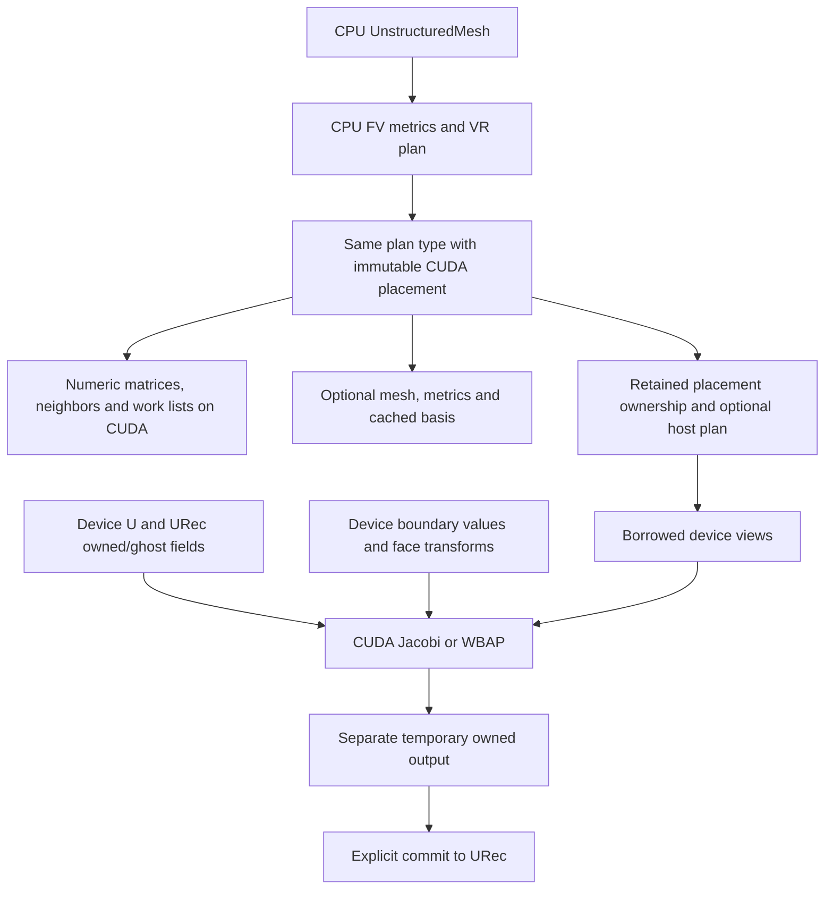

# Backend-resident reconstruction

`CFV::VariationalReconstructionPlan` is the single public reconstruction plan
on host and CUDA. `Place(device, context, options)` attaches an immutable
backend payload and returns the same plan type; `ReconstructionWorkspace` is
likewise the only public workspace type. Cauchy and other callers do not select
between CPU/device plan classes. CPU preparation, SVD, mesh mutation,
partitioning and spatial search remain on the host.



## Placement and ownership

`source.Place(Device::CUDA(i), context, options)` synchronously uploads only
the supported operators' numeric inputs. It validates the selected device and
rejects unavailable CUDA builds and device SOR before returning a usable
publication. `options.mesh`, `metrics` and `basis` select independent query data;
full `MetricView()` access requires `metrics=true`. Missing optional capabilities
throw. Mesh data uses the existing `UnstructuredMeshSnapshot`, including its
device-callable view; CFV does not create another topology implementation.

`options.sweeps=false` retains the requested sampling and optional WBAP
publication without uploading ordinary relaxation matrices, inverse blocks or
mean/boundary sweep injections. Such a publication rejects sweep kernels;
coefficient allocation, boundary values, sampling, WBAP and explicit commit
remain available. Cauchy's explicit AMG reconstruction selection uses this
mode alongside its separately owned projected AMG operator. See the
[native AMG selection and deferred work](../guides/amgx.md).

`basis=true` supplies `PointBasisView()` for cached or direct point evaluation.
`basisDerivativeOrder` defaults to one (value and first derivatives); setup
retains moments and cell geometry only when the configured cache does not
cover that request. A cached-only basis retains no direct-evaluation cell
payloads. Basis placement alone does not copy face quadrature, face means or
axisymmetric metric tables. `BasisView()` remains the raw cache accessor and
explicitly rejects cache-off placement. The point evaluator receives the
query position in the selected parent cell frame; the stencil producer owns
that periodic-frame convention. All whole-array inputs are checked for
residency by the C++ kernel launcher, outside point arithmetic.

Host-payload retention is explicit. `options.retainHostPayloads=true` is the
default and keeps the CPU plan available for setup queries and diagnostics.
With `false`, the returned placed plan releases the originating reconstruction
and metric arrays after upload. It retains only a stable logical identity,
settings/capabilities and global diagnostics, the distributed row-space,
communication context and halo route, plus the requested device publications.
The source geometry/version stamp also survives host-payload release, so a
mesh geometry or numbering change still invalidates subsequent operator entry.
Placed arrays are immutable snapshots; callers must serialize mesh mutation
with submission and must not publish an old-generation result as current.
Build and place mutable boundary values and characteristic transforms while the
host plan is available. A device-only handle can still validate, allocate
coefficients/workspace, bind halos and execute Jacobi/WBAP/commit; host-only
queries such as `Metrics()`, geometry sampling and per-cell inverse diagnostics
fail explicitly. `RetainsHostPayloads()` exposes the resolved choice.

`ResidentBuffers()` reports retained numeric capacities, names and placements, including
payload and metadata allocations of the optional mesh snapshot. Shared mesh
allocations are counted once. This is an allocation-capacity manifest, excluding
native allocator bookkeeping/alignment overhead, host authority and separately
created fields/workspaces. `UnstructuredMeshSnapshot::VisitAllocations` supplies
the reusable payload/metadata enumeration also used by mesh-state accounting.

Plan copies share the publication. Managed operation records retain the logical
plan, placement payload, device buffers and all submitted operands through
actual completion. Kernel views are plain borrows valid only within that
retained operation. Preparation's stream is not retained as an immutable
buffer's later access context. A retained host plan continues to validate its
source geometry generation. A device-only placement is a frozen independent
publication: later host geometry/topology changes do not rewrite it, and callers
must construct a new placement rather than mix it with fields/routes from the
new mesh generation. Solution changes do not invalidate geometric caches.

Device halo-binding validation inherits the source metrics' communication
policy. Payload setup and selected MPI/provider protocols remain explicit.
This only controls host preparation checks; it does not infer CUDA stream
readiness or turn CUDA-aware MPI into a stream-ordered backend.

## Fields and numerical envelope

`BuildWorkspace(components, prototype, vectorStarts)` creates device fields in
Table, ColMajorTable or TiledColMajorTable storage. Other solution fields use
the common metric plan's `BuildField(prototype, device)`; no device-plan-specific
field factory exists.
The prototype's row count is replaced by actual owned/ghost counts; its logical
width must match the requested field. The internal metric, matrix, boundary,
transform and scratch formats remain unchanged. URec still flattens
`component*NRecDOF()+mode`. There is no implicit layout transpose.

Both operators support prepared 2D/3D degrees1–3, explicit boundary quadrature
values, periodic vector triples and axisymmetric prepared metrics. WBAP accepts
finalized per-face characteristic matrices on a selected component interval and
an optional finite scalar activation array (`indicator >= threshold`). The GPU
does not invoke boundary or characteristic callbacks. Prepare/refresh these
numeric inputs explicitly; CPU and GPU matrices retain the same schema.

WBAP uses six scratch rows per active block, with at most256 blocks, rather than
six matrices per mesh cell. Scratch belongs to the workspace. Concurrent use of
the same workspace on different streams requires an explicit join. No device
allocation occurs in these kernels. This is a correct baseline mapping, not a
claim of optimal occupancy or fastest layout.

CUDA SOR/GS and tree meshes remain outside this reconstruction sweep API.
Gradient/conversion and polynomial sampling have separate queued CFV operators;
they are not CPU fallbacks hidden in a sweep. CUDA graph capture is a separate
qualification target, not implied by a device-resident operand.

### Plan 61-6 sweep catalog and typed access

Plan 61-6 consolidates the sweep implementation into two numerical bodies:

1. `FP64` is the runtime-C/runtime-M reference. It accepts the existing generic
   field layouts and dynamically selects precomputed/raw, full/triangular
   inverse and LVR behavior.
2. `FP64Pipelined` is the production optimized body. It statically selects
   M=2/3/5/9/19, C=5/6/7 or a genuine dynamic-C fallback, raw/precomputed,
   full/triangular inverse and LVR. The optimized field operands are AoS tables,
   with compact physical field rows; padded field inputs are rejected. Matrix
   row padding remains an independent prepared-storage choice. A component count above seven is
   valid for this mathematical CFV operator; no seven-value scratch ceiling
   may be inferred from the CUDA Cauchy physics scope.

Each other retained selector has exactly one comparison fixture: C=5, M=19,
precomputed maps and no LVR. This includes `FP64MatrixShared`,
`FP64TensorCoreAsync`, `FloatFloatPipelined`, `FP32Pipelined`, `FP32`,
`TF32TensorCore`, `TF32Pipelined`, `FP32FullAccumulation` and
`FP32FloatFloatAccumulation`. Precision, multiplication and accumulation
policies remain distinct. An unavailable shape/layout is an explicit error,
not permission to run another kernel. `SupportsKernel` reports plan/device
capability; the launch wrapper additionally checks the actual field width.

The optimized wrappers check compact field rows and project whole-array views
once. Static C/M extents and field pitch continue through row spans and
numerical helpers. Prepared matrix rows retain their independent physical
stride. `Runtime::ProjectKernelView` and `ProjectKernelPair` change only the
access type, preserving data pointers and devices. Scheduled operands retain
ownership and readiness as before.

SIMT uses one block per cell; MMA uses one warp per cell. The production
neighbor pipeline has two slots and consumes a staged matrix for all output
modes/components. Synchronous matrix sharing and MMA are static choices within
the same optimized body, rather than numerical copies. The existing
`DNDS/Algebra/CUDA/FP64Matrix.cuh` adapter still supplies actual FP64 MMA;
TF32 and quantized policies remain explicitly different arithmetic.

The historical preliminary tensor/shared/async measurements are retained in
the plan repository's `experiments/cauchy-preliminary/nccl-fp64/` records.
Their retired selector names and broad shape coverage do not define the
Plan 61-6 catalog. Current source validation and matched before/after timing
must be reported separately; changing source organization alone establishes
neither performance nor a new numerical acceptance result.

## Execution and caller responsibilities

The synchronous wrappers construct a CUDA stream, enqueue the operator and
commit, then synchronize and inspect status. Python exposes these wrappers and
the same shared field allocations. Release retained Python write/DLPack aliases
before invoking them; element reads and `numpy()` use Runtime synchronization.

The C++ `Submit...(engine, stream, ...)` calls enqueue without a host wait per
kernel. They write `workspace.temporary`; call
`SubmitCommitReconstruction` separately. The
existing eager engine reserves/retains operands, but does **not** prove stream
dependencies. The caller must establish readiness and every conflicting access
edge, including scratch reuse, transform refresh and final destruction. Ordinary
host lease release alone is not proof that another stream can consume data.
Use explicit stream events/joins. See the [Runtime caller contract](RuntimeCallerContract.md).

The safe direct MPI overlap shape is:

```cpp
// All previous producers of coefficients have completed or been joined.
auto transfer = halo.Begin(deviceContext); // owned read, separate ghost write
resident.SubmitReconstructionIterTo(engine, compute, mean, coefficients,
                                    work, boundary, ReconstructionRegion::Core);
transfer.Wait(); // CUDA-aware MPI is a host-managed readiness boundary
resident.SubmitReconstructionIterTo(engine, compute, mean, coefficients,
                                    work, boundary, ReconstructionRegion::HaloDependent);
resident.SubmitCommitReconstruction(engine, compute, coefficients, work);
engine.Synchronize(); // observation/next MPI producer boundary
resident.CheckStatus(work);
```

Core submissions declare owned-only inputs and pass no ghost pointers to the
kernel. Dependent submissions use the completed owned+ghost pair. The same
pattern applies to WBAP, with coefficient exchange **between every descending
order**. Direct CUDA-aware MPI datatype transfer remains the default, one rank per
device. An explicit [DevicePacked backend](DevicePackedTransfer.md) gathers and
scatters on a communication stream; select it in `BindHalo(field, transport)`. No claim of stream-native or graph-capturable MPI is made.

`BindHalo(field, transport, options)` also accepts the explicit
[NCCL provider](NCCLTransfer.md). Its `Enqueue(engine, comm)` uses stream events to
connect producer, transfer/unpack and dependent kernels, without an intermediate
host completion wait. The same caller ownership/order rules apply to both
Jacobi choices and WBAP. Graph capture remains deferred.

Invalid indicators set a persistent status word before the pass. That pass and
its commit leave output unchanged, and `CheckStatus` throws after an explicit
completion boundary. Earlier successful queued work is not rolled back. On
recovery, explicitly clear status before a new segment. Launch failures surface
through the engine's completion/drain boundary. Shape, placement, stale-plan and
alias checks stay outside scalar kernel loops even in unchecked builds.

## Validation and measurements

`cfv_test_reconstruction_cuda` compares nonzero CPU/GPU fields across physical
layouts, split core/dependent work, characteristic transforms, rotated periodic
vectors, axisymmetry and degree-three3D with37 components. It also destroys the
host plan behind a device-only publication and then exercises metadata,
device-packed halo, Jacobi, a nonempty characteristic WBAP transform and commit.
The suite further exercises
unsupported SOR, invalid indicators, stale publications and optional query data.
CTest includes one GPU and two ranks with one GPU each. Existing Runtime CUDA
tests cover array indexing, alignment, async release, algebra and interop.

`cfv_benchmark_reconstruction_cuda width degree components repetitions
[direct|packed|nccl] [fp64|pipelined] [all|aos]` measures
real wrappers on a connected Cartesian quad mesh. It checks CPU numerical
oracles before timing. Setup/upload are separate from repeated resident Jacobi,
highest-order WBAP, direct communication and integrated split iteration. Jacobi
and WBAP microtimings read a fixed iterate; the integrated timing commits each
iteration. Report these scopes separately. Local CPU timings are not substituted
for matched, allocated-node CPU evidence.
Use `aos` with the optimized pipelined path. The retained comparison selectors
require the 3D C=5/M=19 fixture and belong in
`cfv_benchmark_reconstruction_sweep`; the 2D wrapper benchmark cannot supply
that modal shape.

The NCCL integrated timing queues ordered iterations before its final engine
observation; portable MPI retains host progress/observation between iterations.
Report that scheduling difference with communication and operator microtimings.
Only compare actual completed numerical/timing rows. Graph capture is not used.

The historical general CUDA baseline used up to256 blocks,128 threads per
block and grid-stride cell/entry traversal. Its sm80 Jacobi/WBAP resource
counts were117/191 registers per thread, with zero reported local memory or
stack. Those counts do not describe the consolidated specialized kernels;
report current resource/timing measurements against their exact source.
Kernel resource counts alone do not establish occupancy or speed.
