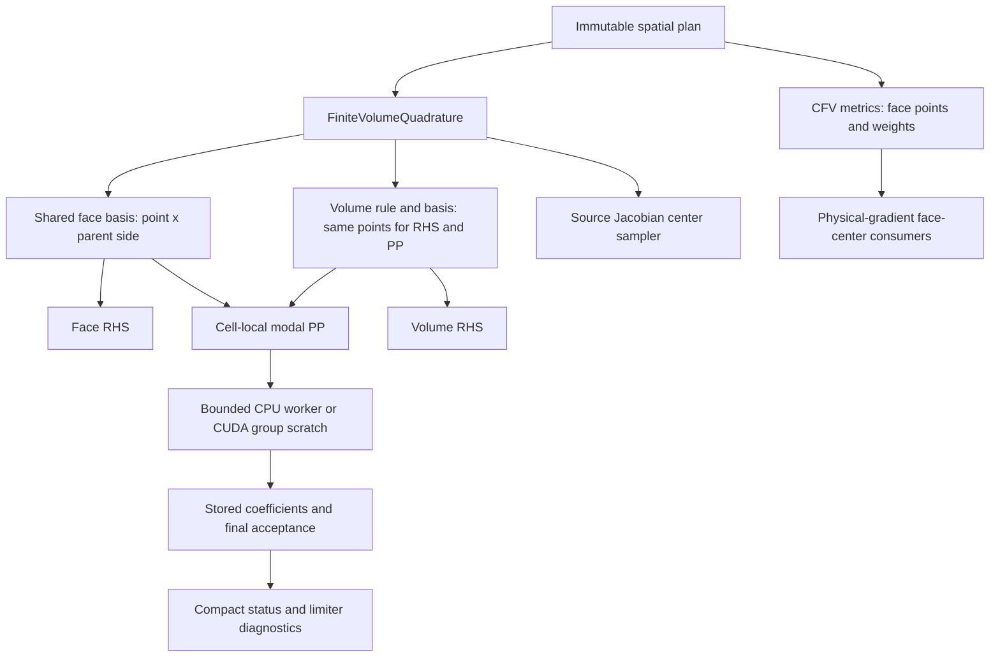

# Shared FV quadrature and polynomial basis

Cauchy's immutable `FiniteVolume::Data` publishes a `FiniteVolumeQuadrature`
alongside its CFV metrics. Face RHS and PP use the **same face basis allocation**.
Volume-source RHS and PP use the **same volume basis allocation**. Interior PP
always follows the RHS/source integration rule, even with no active source;
there is no separate PP quadrature control or maximum-order interior grid.
Without an active source, modal PP retains only cell-major volume offsets and
a value-only cache, or direct coordinates when caching is disabled.
Source Jacobian center samples remain a separate point set.

## Identity, ordering and lifetime

Modal PP enumerates each owned cell's face incidences, then the RHS volume
rule. Face cache rows are `2 * faceQuadraturePoint + parentSide`; the incidence
slot/Pbi disambiguates self-periodic faces. Coordinates and optional cached
basis values use that parent's frame. No PP-only repeated cell IDs, expanded
coordinates, basis-row map or output-scatter registry is stored.

`ModalPositivityQuadrature` keeps volume offsets plus either direct points or
cached basis. With sources it aliases `SourceQuadrature::offsets` and the
source sampler's `BasisStorage()`/`PointStorage()`. Equality is established by
the same prepared cell-major rule, never approximate coordinates. One placement
memo preserves those allocations across both consumers on the device.

Generic `PolynomialSamplingPlan::FromSharedBasis` and `WithOutputRows` remain
available for explicit arbitrary-point/interface sampling. Such user-requested
sampling may legitimately own query cells/maps and produce an output array;
Cauchy's fused PP no longer requires that decomposition. The queued PP wrapper
retains immutable stencil, metric, basis and volume owners, and declares its
actual mean/coefficient/decision operands before execution.

Copies of sampler and spatial-plan handles share Runtime storage. Workspaces
and explicit output observers allocate their own mutable samples and gradients.
Modal PP owns only bounded per-worker scratch and compact cell decisions; it
never owns a mesh-wide field of reconstructed PP states. `SamplingPlacementMemo` is scoped to placement of one publication and
seeded with the already-placed face basis. It preserves aliases on the device,
then releases its host-source handles. It is not a global registry. Its seed
contract requires an unchanged, equivalent destination copy; source generations
and layouts are checked when reused. Geometry/topology changes invalidate the
plans rather than silently repopulating caches.
An exposed shared basis handle is read-only by contract. Sampling records its
value, shape and mutation-intent generations and rejects an aliased write before
submission. Runtime read access then pins the accepted inputs through execution.

## Independent VR setup and cache policy

VR matrix preparation evaluates its full derivative tensors in temporary CPU
scratch. A separate face-cache pass runs after those writers and scratch are
released; it computes only the requested derivative order. No VR matrix assembly
depends on the hot-path cache. Both paths share Taylor definitions, moments,
normalization and periodic-frame conventions.

`cacheDiffBase=false` retains no numerical basis payload. Direct evaluation
retains point positions, cell normalization and moments. With caching enabled,
the default `cacheDiffBaseOrder=1` stores value and first derivatives; volume
sampling without a gradient consumer stores values only. Derivatives outside
partial cache coverage are evaluated directly. `WithDerivativeOrder` narrows a consumer's query contract and releases
direct metadata when the cache completely covers it. Cauchy source/RANS center
sampling requests only its needed derivatives, while standalone arbitrary-point
sampling retains the more general contract. Cache-off PP/source/RHS point
evaluation shares the placed moments and normalization geometry.

`TaylorPointEvaluation` computes normalized coordinates, coordinate
powers and inverse-scale powers once per point; modes and derivatives reuse
that context, and equation components reuse the resulting basis. This may
change floating-point roundoff relative to repeated division, not the polynomial
or quadrature definitions.

The common evaluator is the default because five or more equation components
reuse each point's polynomial basis. A fused multidimensional Horner contraction
is a possible future RHS specialization, not a replacement for this common
facility; compare its register/arithmetic cost before adopting it.

Allocation names distinguish `CFV/quadrature/face/basis`,
`Cauchy/quadrature/volume/*`, and `source-jacobian-center/*`. There is no
production `positivity/sampledValues`, `baseValues` or `pp-face` query payload.
A name is an alias, not another allocation; memory reports
must deduplicate identities. Arbitrary interface queries keep independent
samplers when their moving points differ from these prepared sets.

Quadrature degree is a supported-rule choice independent of reconstruction
degree; the former `intOrder >= maxOrder + 1` guard is removed. This does not
claim that every quadrature exactly integrates every variational functional
term. Setup keeps its SVD pseudoinverse and diagnostics. The common hot-path
rule does not force VR to retain its full-derivative matrix-assembly scratch.

The retired `positivityVolumePoints` option is no longer a configuration member
or schema field. Old checkpoint metadata that explicitly selects that active
policy remains a compatibility difference; it is not silently reinterpreted as
the new point rule. Non-PP restarts can discard inactive historical PP controls.

## Fused modal PP execution and acceptance

`CPU::LimitPositiveModalCoefficients` handles one complete cell procedure per
invocation: sampling, independent RANS scaling, reference-degree selection,
locked flow/species beta, coefficient publication, local recovery and final
stored-output verification. Scratch capacity follows the largest cell point
count and number of equation components, not the number of mesh cells. Thermal
energy references are immutable; worker cell loops share no mutable Cantera
state. Logical component views preserve separate or combined CPU field layouts.

`CUDA::LimitPositiveModalCoefficients` provides warp-per-cell and block-per-cell
mappings for combined AoS perfect-gas flow5, SA and 2EQ. Means and coefficients
are staged cooperatively; the common acceptance path checks register-local
point states before a group vote. Only the limiting fallback materializes
point states in group shared memory; neither path creates a global sample field.
The point evaluator reuses normalized powers/scales across modes and components.
Each point lane uses at most seven statically unrolled component accumulators,
without a dynamically indexed per-point basis array. Compiler resource/spill
measurements still determine the practical performance of a candidate.

PP POLICY: raw polynomial species remain available to transport. Reference
selection supports both the raw-affine beta construction and the temporary
clipped-composition EOS/T predicate; no independent simplex beta is imposed.
Flow and species modes compress together, while RANS modes follow their own
scalar rule. Rejected lower-degree trials become the next higher candidate,
preserving the existing staged algorithm, rather than always blending the
original highest polynomial toward the mean. Recovery samples actual stored
coefficients and checks the clipped-reference EOS/T endpoint, with the selected
fallback/backtracking rule and the existing 1000-trial bound. Failed outputs
are not publishable; no exception fallback occurs inside a numerical kernel.

Producing CUDA kernels emit status/count/minimum per CTA. A tiny finalizer
merges only those summaries; no mesh-sized status/flag/beta scan or host-visible
per-trial recovery decision remains. The enclosing schedule drains before
`LocalStatistics()` reports failures and reads compact diagnostics. Physical
gradient PP uses the same compact epilogue/finalizer but checks face centers
only. Its mean is validated separately.

The modal candidate controls are read once at workspace construction:

- `DNDS_CAUCHY_CUDA_MODAL_PP_MAPPING`: `warpPerCell` (default) or `blockPerCell`.
- `DNDS_CAUCHY_CUDA_MODAL_PP_THREADS`: 128 (default), 256 or 512.
- `DNDS_CAUCHY_CUDA_MODAL_PP_BLOCKS`: zero (default grid cap 1024) or a positive
  grid cap. Actual CTAs are limited by the number of cell-owning groups.

Workspace preparation checks shared-memory capability and configures opt-in
memory once. Unsupported candidates fail explicitly; hot prepared submissions
perform no capability query, upload, device allocation or host synchronization.

## Validation scope

The Plan 61-4 source migration and new focused fixtures require the grouped
validation recorded separately in its execution log; historical passes below
do not prove the new fused kernels or point-set changes.

Plan 61-1's corrected rule passed the grouped CPU/CUDA gates: full Cauchy FV,
physics and configuration suites at np1/np2; Runtime Array; Taylor evaluation;
CFV completion; CUDA reconstruction, domain, RHS, source and positivity. The
periodic shared-bank tests cover P3 with order-3 quadrature, independently
evaluated derivatives, scattered outputs, temporary-handle destruction and
aliased-mutation rejection. Source-enabled tests verify exactly one volume
bank; source-free tests verify the same rule's point count at orders 3 and 5.
The full numerical/memory record is maintained in the separate plan repository
under `docs/61-1-shared-quadrature-status.md`, with source/binary/input hashes.
