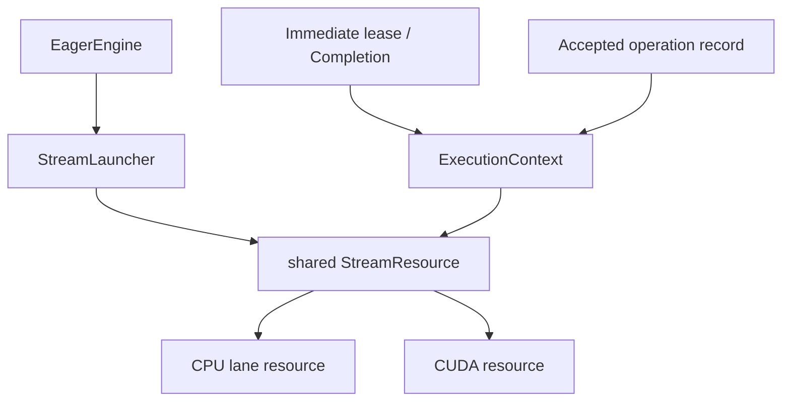

# Execution stream resources and shutdown

`ExecutionContext` contains placement and a shared `StreamResource`, with no
native stream pointer. CPU inline/worker lanes and CUDA streams implement this
same abstract resource. It supports identity, placement, synchronization and
terminal retirement. The engine owns scheduling/shutdown; retaining a context
does not keep an engine alive or grant submission rights. `ExecutionStream`
remains a checked weak submission handle.

The last context/lease/operation retains the backend resource. Numerical
array/mesh views remain non-owning PODs: an operator or operation record retains
their arrays and permission through execution. The shared stream reference
does not replace data ownership or cross-stream ordering.

`Close()` drains registered transport and all stream tails, retires captures,
shuts down CPU workers and publishes terminal resource state before releasing
the engine's launchers. A retained lease's later fence is a no-op after healthy
closure; it rethrows the recorded terminal failure after failed closure. It
does not call a destroyed stream. Backend `Drain()` implementations must retire
accepted work even when reporting a terminal error; unretirable backend failure
requires abort. New engine submissions and native CUDA launches on retired
resources reject. Context identity remains valid for completion matching.

`ExecutionContext::Synchronize()` dispatches to the abstract resource. CPU work
executing on its own lane is already synchronous relative to its predecessors;
its local lease release must not wait for that same unfinished command. Outside
that command, an immediate CPU completion observes the lane before claiming
readiness. Nonblocking CPU prefixes use `ExecutionStream::Record()`.

The CUDA-specific `CUDAStream(context)` accessor is confined to backend kernel
wrappers, communication providers and interoperability code. It validates the
resource before extracting a native handle; it does not run inside numerical
element loops. `CreateCUDAStream` owns a native stream, `AdoptCUDAStream` takes
ownership, and `ImportCUDAStream` retains a supplied real external owner.
Factories validate device placement where the toolkit supports that query.
Native default-stream sentinels cannot be adopted/destroyed.

A null resource denotes immediate host execution or the process's CUDA default
stream; it stores no borrowed pointer. General Python array access accepts a
managed stream, context or resource (`None`/zero selects the default), preserving
the declared device even for a default context. Nonzero native integer handles
are not accepted by that general interface.

DLPack's consumer ABI and the legacy CFV bridge still supply native handles
without an owner. Their explicitly named backend loan adapter encapsulates
that handle, but cannot manufacture native ownership. Those existing foreign
contracts require the external caller to retain the actual stream through use.
They are not used by native solver/orchestration paths.
